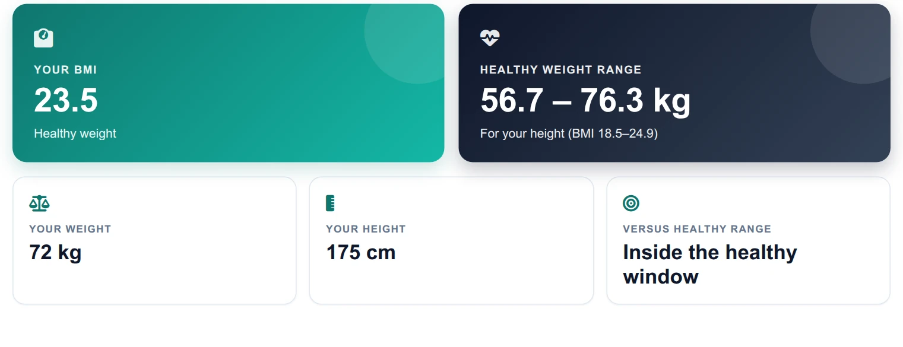
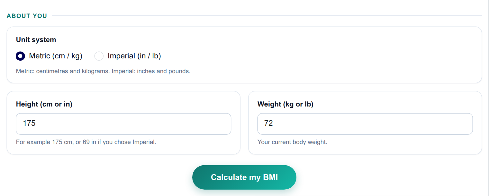
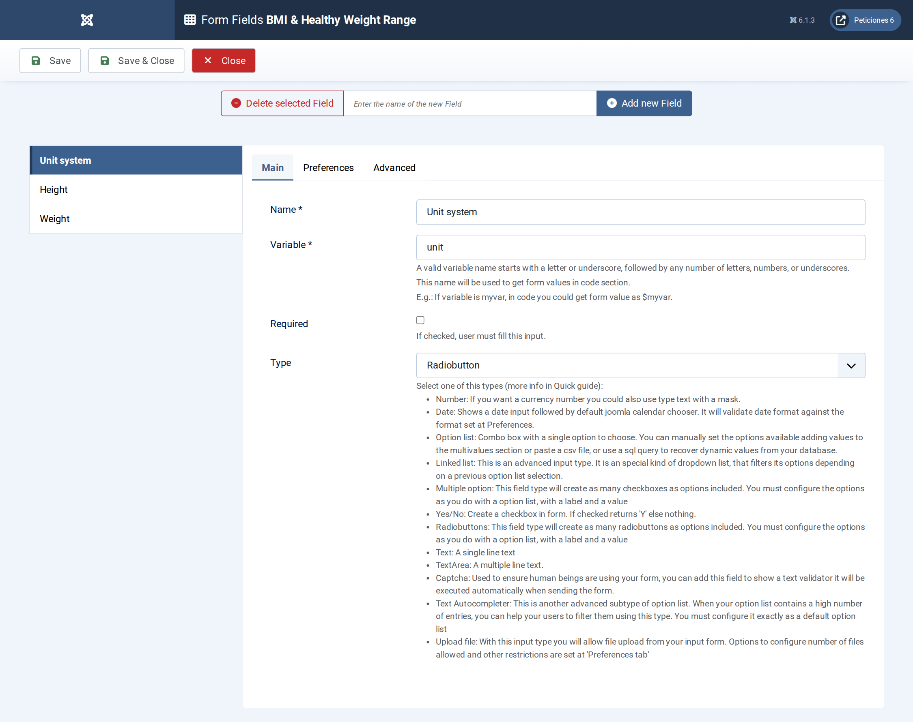
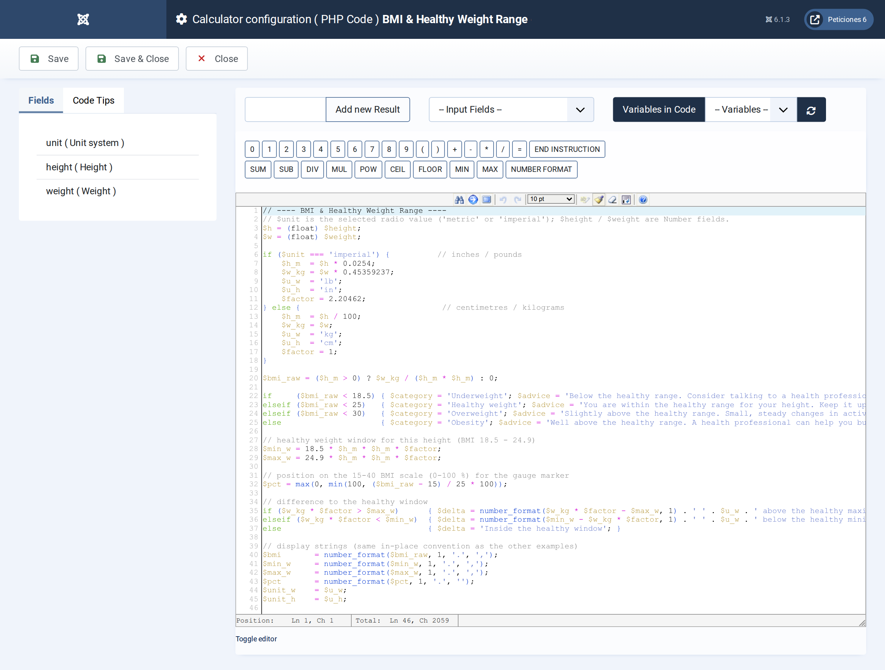
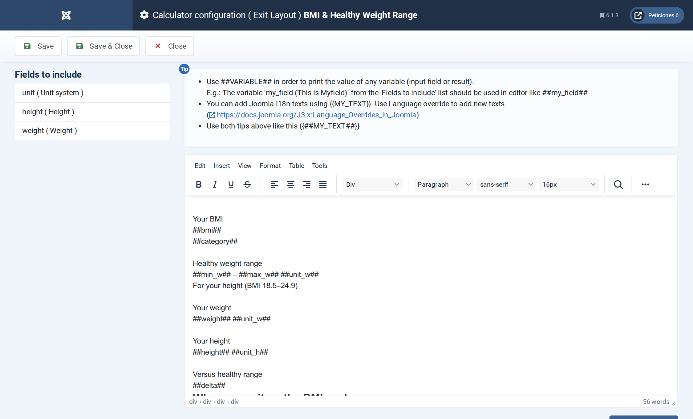

# BMI & Healthy Weight Range

**Calc Builder example** · [Live demo](https://demo.moonsoft.es/bmi-healthy-weight-range) · [Import instructions](https://demo.moonsoft.es/bmi-healthy-weight-range)

A clean BMI calculator with metric/imperial units, a colour-coded scale gauge and your personal healthy weight window.

The **BMI & Healthy Weight Range** calculator turns height and weight into a Body Mass Index, shows where it falls on a colour-coded scale and works out the weight window that is healthy for that height.

## What it calculates

A visitor picks metric or imperial units and enters a height and a weight. The calculator returns:
- **BMI and category** — weight divided by height squared, classed as underweight, healthy, overweight or obesity.
- **Healthy weight range** — the weights that give a BMI between 18.5 and 24.9 for that height, in the visitor’s own units.
- **Distance to the window** — how far above or below the healthy range the current weight is.
- **Scale gauge** — a segmented bar with a pointer placed at the visitor’s BMI.

## How it’s built

A **Radio** field switches unit systems and two **Number** fields take the measurements. The PHP Code converts inches and pounds when needed, computes the BMI and builds display strings.

The gauge is plain HTML and CSS: PHP returns the pointer position as a percentage and the Exit Layout uses it as `##pct##` inside an inline style, so no chart library is needed.

## Files in this folder

- `bmi-healthy-weight-range_export.xml`
- `screenshots/` – images of the frontend and of the Calc Builder settings

## How to import

1. Open **Components › CalcBuilder › Import** in your Joomla administrator.
2. Upload the `*_export.xml` file of this folder.
3. If the folder contains an `.xlsx` model, upload it in the calculator's Excel settings.
4. Create a menu item of type *CalcBuilder* pointing to the imported calculator.

Full step-by-step instructions with the live result: **https://demo.moonsoft.es/bmi-healthy-weight-range**

## Screenshots

*Live result on the frontend*

*The input form as your visitors see it, styled with the Form Layout.*

*Three fields: one Radio for the unit system and two Number fields.*

*Unit conversion, BMI, category, healthy window and the gauge position, all in a few lines of PHP.*

*The Exit Layout: two hero cards, three metric cards, the gauge panel and a footnote.*

---
Part of [Moonsoft demos](../../README.md) · [moonsoft.es](https://www.moonsoft.es) · [demo.moonsoft.es](https://demo.moonsoft.es)
