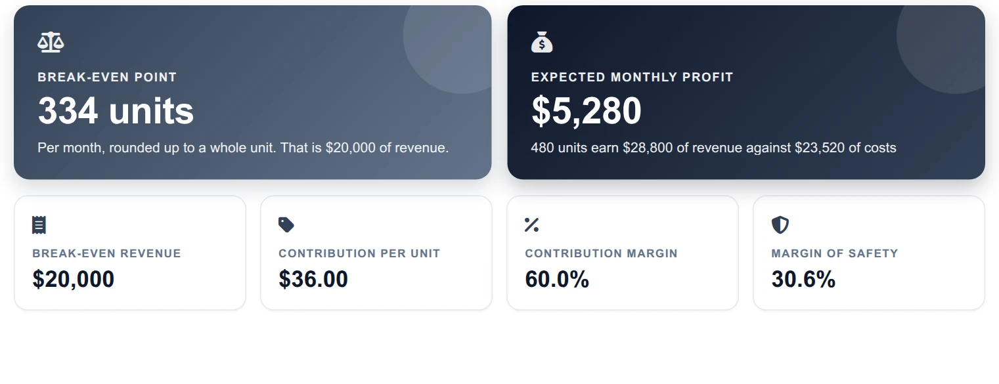
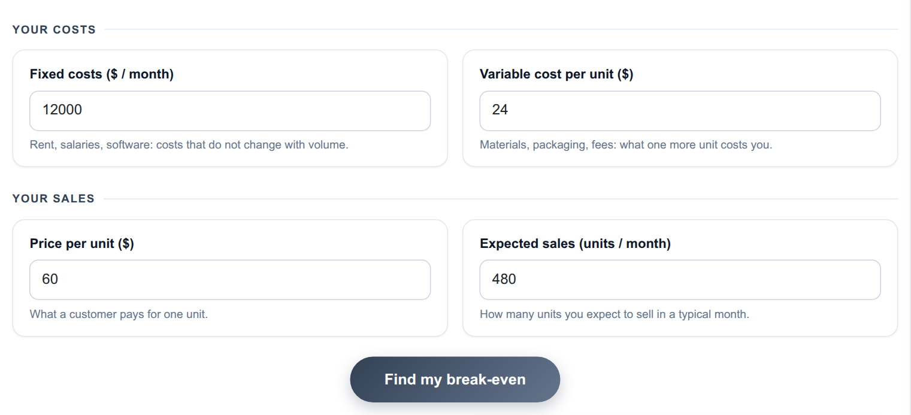
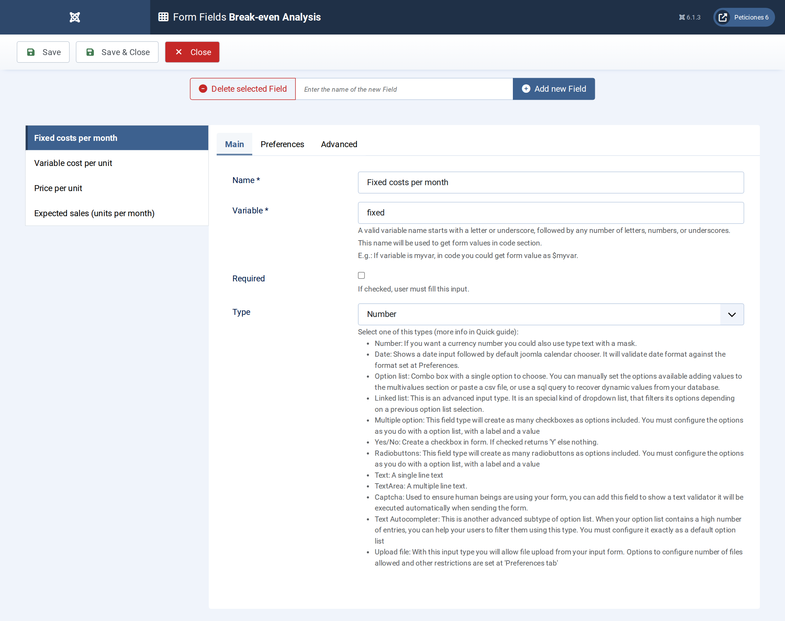
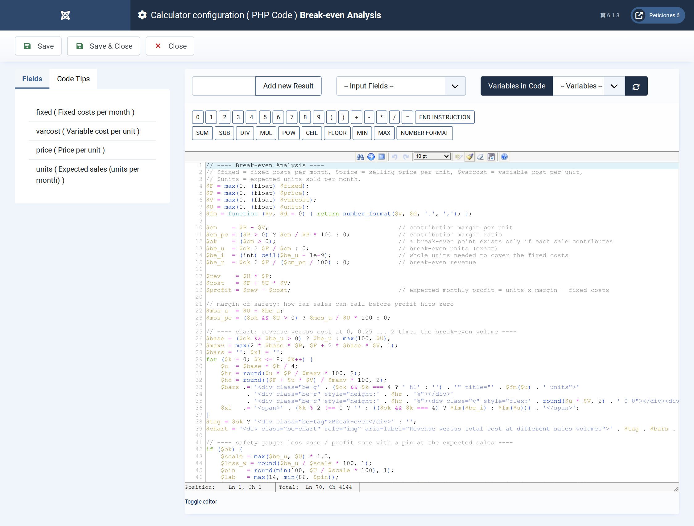
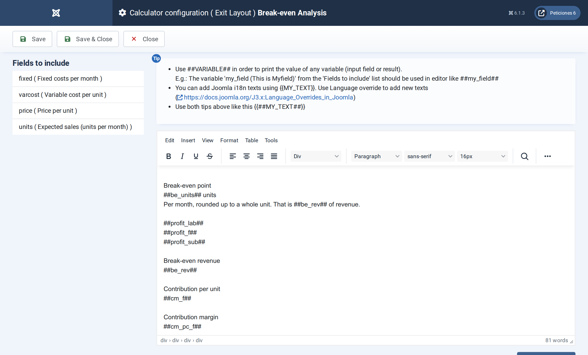

# Break-even Analysis

**Calc Builder example** · [Live demo](https://demo.moonsoft.es/break-even-analysis) · [Import instructions](https://demo.moonsoft.es/break-even-analysis)

Find how many units you must sell to cover your costs, what your margin of safety is and what profit your expected sales leave, with a revenue-versus-cost chart.

The **Break-even Analysis** calculator shows the sales volume at which a product stops losing money, how much room the business has above that point and how revenue and cost compare on either side of it.

## What it calculates

A visitor enters monthly fixed costs, the variable cost and price of one unit and the units they expect to sell. The calculator returns:
- **Break-even units and revenue** — fixed costs divided by the contribution margin, shown as a whole number of units (rounded up) and as the matching revenue.
- **Contribution margin** — price minus variable cost, in dollars per unit and as a percentage of the price.
- **Margin of safety** — how far expected sales can drop, in units, revenue and percent, before profit reaches zero.
- **Expected monthly profit** — expected units times the unit margin, minus fixed costs; shown as a loss when negative.
- **Revenue versus cost chart** — paired bars at 0 to 2 times the break-even volume, with costs split into fixed and variable, and a safety gauge with a pin on the expected sales.

## How it’s built

Four **Number** fields feed the PHP Code, which validates the margin (no break-even exists if the price does not exceed the variable cost) and builds every visual as plain HTML: nine bar pairs sized in percent, and a red/green gauge whose split point and pin are computed in PHP.

The PHP returns finished HTML strings (`##chart##` and `##safety##`) that the Exit Layout drops in, next to display strings for the hero and metric cards. The default values give a break-even of 334 units and a $5,280 monthly profit.

## Files in this folder

- `break-even-analysis_export.xml`
- `screenshots/` – images of the frontend and of the Calc Builder settings

## How to import

1. Open **Components › CalcBuilder › Import** in your Joomla administrator.
2. Upload the `*_export.xml` file of this folder.
3. If the folder contains an `.xlsx` model, upload it in the calculator's Excel settings.
4. Create a menu item of type *CalcBuilder* pointing to the imported calculator.

Full step-by-step instructions with the live result: **https://demo.moonsoft.es/break-even-analysis**

## Screenshots

*Live result on the frontend*

*The input form as your visitors see it, styled with the Form Layout.*

*Four Number fields: fixed costs, variable cost, price and expected units.*

*Contribution margin, break-even, margin of safety and the chart and gauge markup.*

*The Exit Layout: two hero cards, four metric cards, the chart panel and the safety gauge.*

---
Part of [Moonsoft demos](../../README.md) · [moonsoft.es](https://www.moonsoft.es) · [demo.moonsoft.es](https://demo.moonsoft.es)
