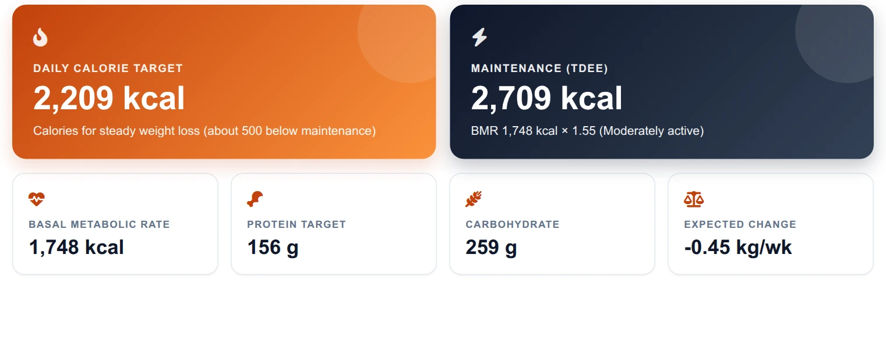
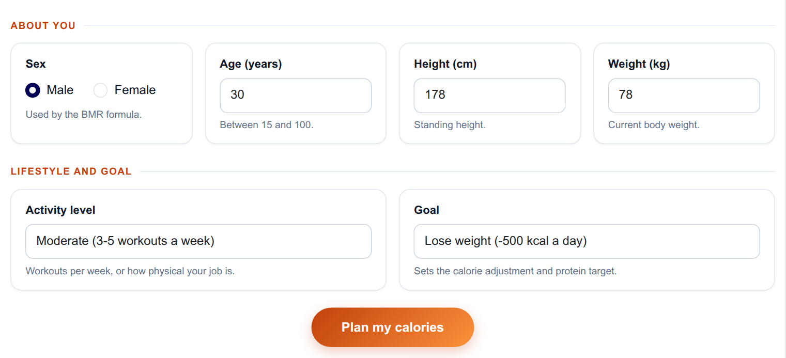
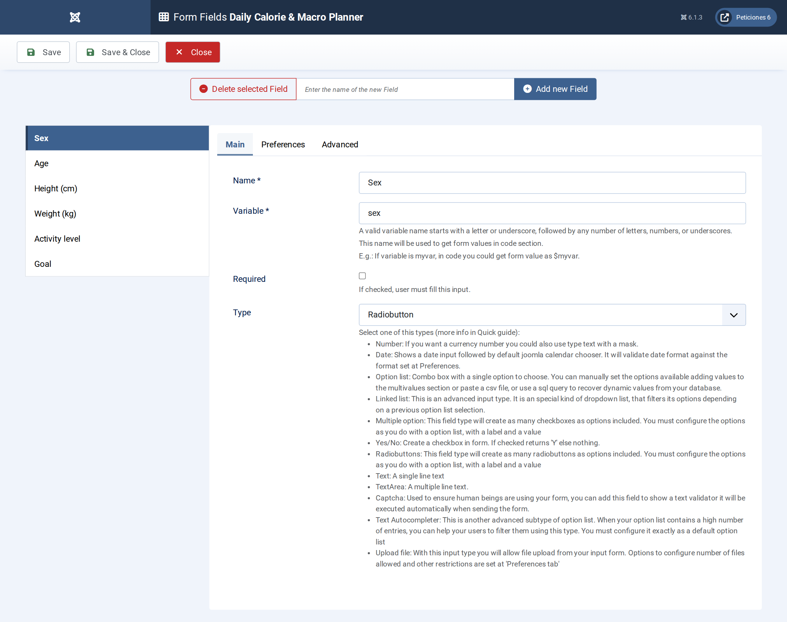
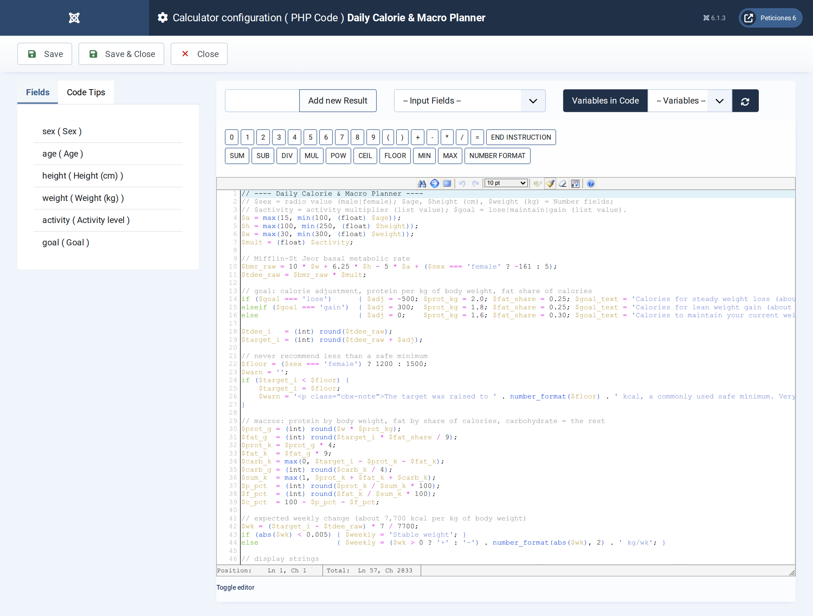
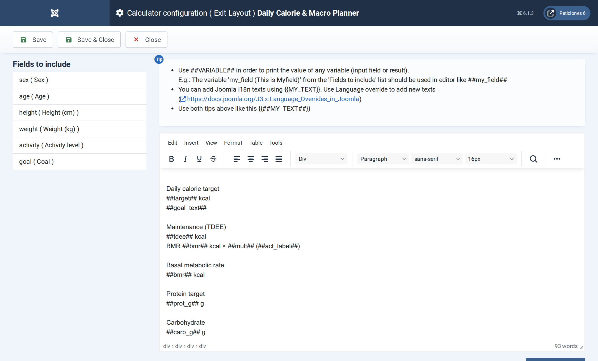

# Daily Calorie & Macro Planner

**Calc Builder example** · [Live demo](https://demo.moonsoft.es/daily-calorie-macro-planner) · [Import instructions](https://demo.moonsoft.es/daily-calorie-macro-planner)

Estimate your daily calories with the Mifflin-St Jeor equation, adjust them for weight loss, maintenance or gain and see a protein, carbohydrate and fat split in grams.

The **Daily Calorie & Macro Planner** works out a visitor’s basal metabolic rate, scales it by an activity level, applies a goal and turns the resulting calorie target into gram targets for protein, carbohydrate and fat.

## What it calculates

A visitor chooses a sex, enters age, height and weight, and picks an activity level and a goal. The calculator returns:
- **BMR and maintenance calories** — the Mifflin-St Jeor equation gives the basal rate, which is multiplied by an activity factor between 1.2 and 1.9.
- **Daily calorie target** — maintenance minus 500 kcal to lose weight, plus 300 kcal to gain, unchanged to maintain, never below a safe floor of 1,200 (female) or 1,500 (male) kcal.
- **Macro targets in grams** — protein from body weight (2.0, 1.8 or 1.6 g per kg depending on the goal), fat as 25–30% of calories and carbohydrate as the remainder.
- **Expected weekly change** — the calorie gap converted to kilograms per week at roughly 7,700 kcal per kg.
- **Macro split bar** — a coloured bar and three cards showing each macro in grams, kcal and percentage of the day.

## How it’s built

A **Radio** field holds the sex, three **Number** fields take age, height and weight and two **Option List** fields hold the activity multiplier and the goal. The option value of the activity list is the multiplier itself, so the PHP Code can use it directly in the formula.

The PHP Code clamps the inputs to sensible ranges, computes BMR, maintenance and target calories, then the macros. The split bar is plain HTML and CSS: PHP returns the three percentages and the Exit Layout uses them as `##p_pct##`, `##c_pct##` and `##f_pct##` inside inline widths.

## Files in this folder

- `daily-calorie-macro-planner_export.xml`
- `screenshots/` – images of the frontend and of the Calc Builder settings

## How to import

1. Open **Components › CalcBuilder › Import** in your Joomla administrator.
2. Upload the `*_export.xml` file of this folder.
3. If the folder contains an `.xlsx` model, upload it in the calculator's Excel settings.
4. Create a menu item of type *CalcBuilder* pointing to the imported calculator.

Full step-by-step instructions with the live result: **https://demo.moonsoft.es/daily-calorie-macro-planner**

## Screenshots

*Live result on the frontend*

*The input form as your visitors see it, styled with the Form Layout.*

*Six fields: a Radio, three Number fields and two Option Lists.*

*Mifflin-St Jeor, activity multiplier, goal adjustment, safe minimum and the macro maths.*

*The Exit Layout: two hero cards, four metric cards and the macro split panel.*

---
Part of [Moonsoft demos](../../README.md) · [moonsoft.es](https://www.moonsoft.es) · [demo.moonsoft.es](https://demo.moonsoft.es)
