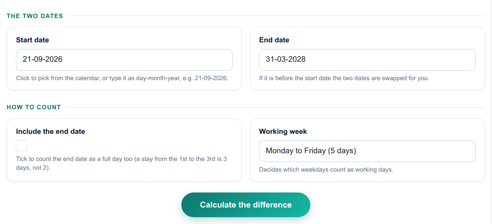
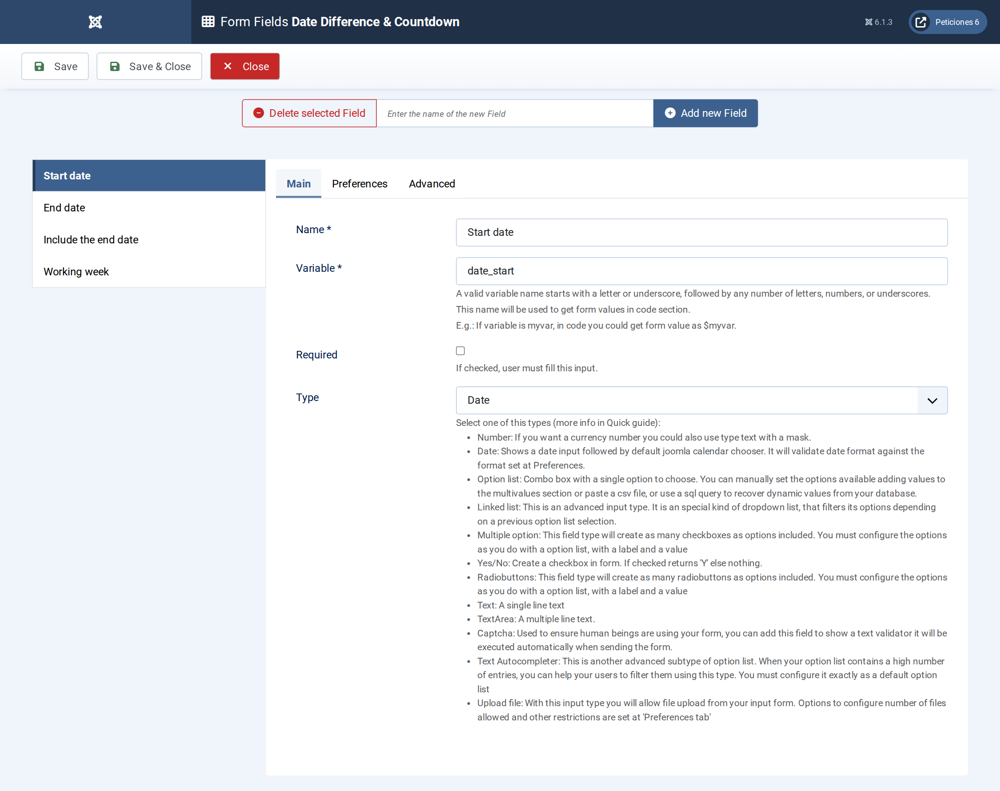
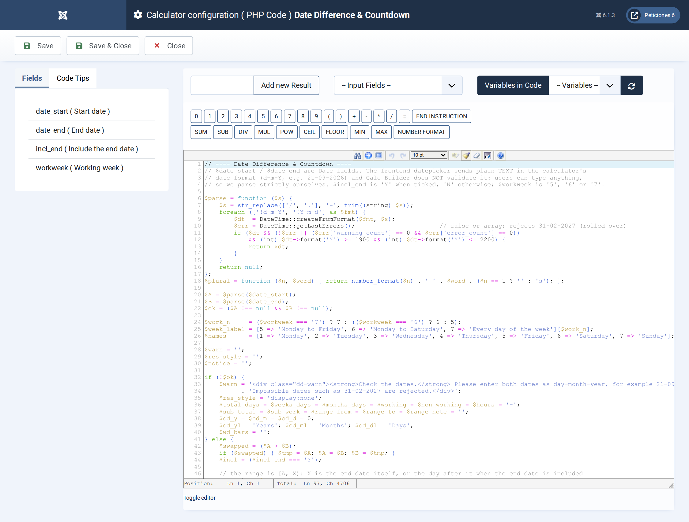
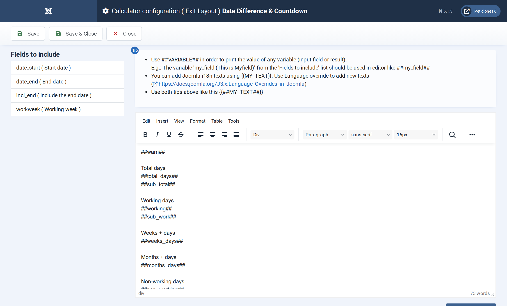

# Date Difference & Countdown

**Calc Builder example** · [Live demo](https://demo.moonsoft.es/date-difference-countdown) · [Import instructions](https://demo.moonsoft.es/date-difference-countdown)

Pick two dates and get the exact number of days, weeks and days, calendar months and days and the working days in between, with a countdown-style breakdown.

The **Date Difference & Countdown** calculator measures the time between two dates in every unit people ask for: total days, weeks, calendar months and working days, shown as a countdown clock and a weekday chart.

## What it calculates

A visitor picks a start and an end date, chooses whether the end date counts and which weekdays are working days. The calculator returns:
- **Total days** — the exact number of days in the range, plus the same figure as weeks and days and as hours.
- **Calendar time** — years, months and days worked out with real calendar months, not 30-day approximations.
- **Working days** — the days that fall on the chosen working week (Monday to Friday, Monday to Saturday or every day) and the remaining non-working days.
- **Weekday breakdown** — how many Mondays, Tuesdays and so on the range contains, drawn as bars with the working days highlighted.

## How it’s built

Two **Date** fields feed the calculation, a **Yes/No** field decides whether the end date is included and an **Option List** selects the working week. The calendar shows dates as `dd-mm-yyyy` (for example `21-09-2026`).

Calc Builder hands a Date field to the PHP Code as plain text and does not check it, so people can type anything. The PHP Code parses the text strictly with `DateTime::createFromFormat`, rejects impossible dates such as 31-02-2027 (they would otherwise roll over silently), swaps the dates when they are back to front and shows a friendly message instead of a result when a date cannot be read. Working days are computed from whole weeks plus a short remainder, so even a range of centuries returns instantly.

A Yes/No field that is not ticked arrives as `N` (ticked: `Y`), and it always starts unticked, which is why the option is worded as “Include the end date”.

## Files in this folder

- `date-difference-countdown_export.xml`
- `screenshots/` – images of the frontend and of the Calc Builder settings

## How to import

1. Open **Components › CalcBuilder › Import** in your Joomla administrator.
2. Upload the `*_export.xml` file of this folder.
3. If the folder contains an `.xlsx` model, upload it in the calculator's Excel settings.
4. Create a menu item of type *CalcBuilder* pointing to the imported calculator.

Full step-by-step instructions with the live result: **https://demo.moonsoft.es/date-difference-countdown**

## Screenshots

*Live result on the frontend*

*The input form as your visitors see it, styled with the Form Layout.*

*Four fields: two Date fields, a Yes/No field and an Option List.*

*Strict date parsing, calendar-aware difference with DateTime::diff, working days from whole weeks plus a remainder, and the weekday bars.*

*The Exit Layout: two hero cards, four metric cards, the period, the countdown clock and the weekday chart.*

---
Part of [Moonsoft demos](../../README.md) · [moonsoft.es](https://www.moonsoft.es) · [demo.moonsoft.es](https://demo.moonsoft.es)
