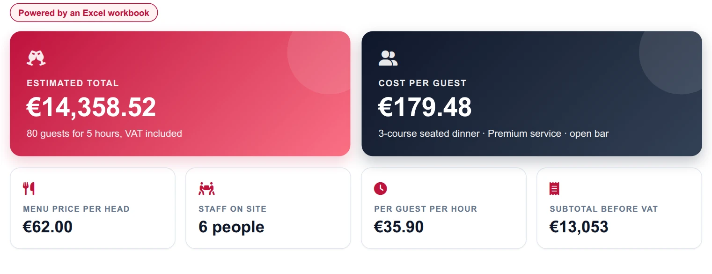
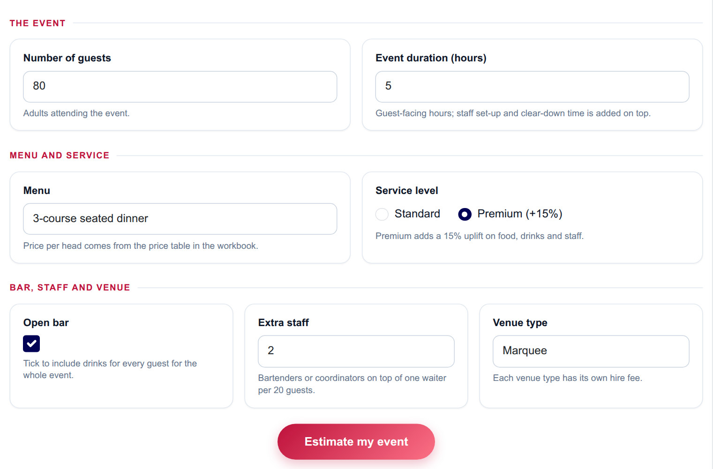
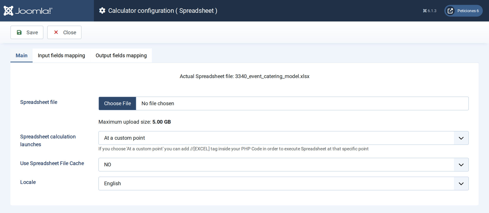
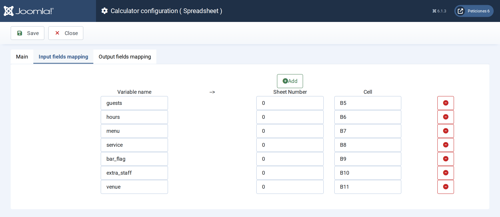
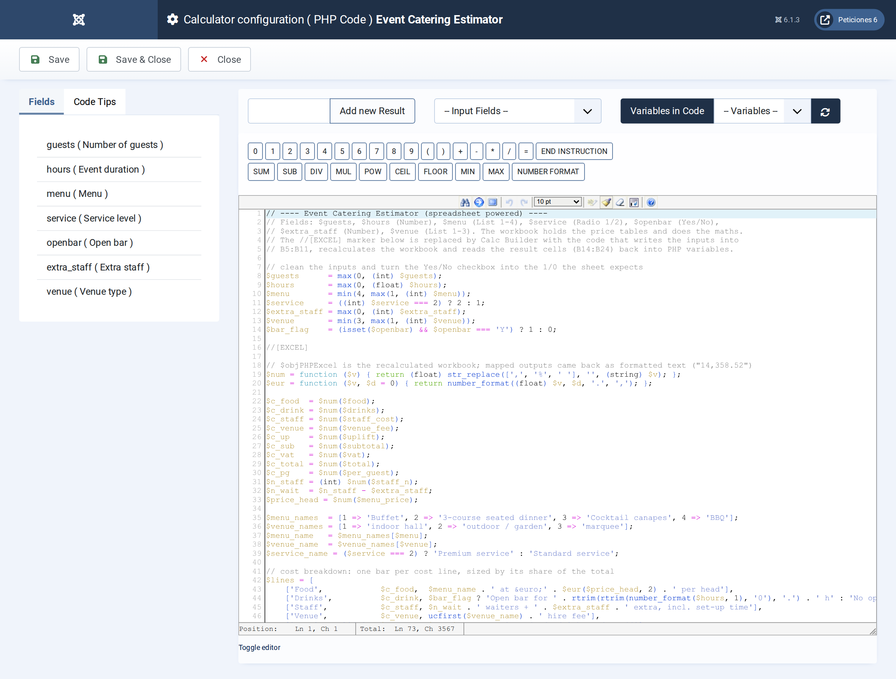

# Event Catering Estimator

**Calc Builder example** · [Live demo](https://demo.moonsoft.es/event-catering-estimator) · [Import instructions](https://demo.moonsoft.es/event-catering-estimator)

Excel-powered catering budget: menu price per head, open bar, staffing, venue fee, service uplift and VAT, with a cost breakdown and cost per guest.

The **Event Catering Estimator** budgets a party, wedding or corporate dinner with a real Excel workbook. Calc Builder writes the visitor’s choices into the sheet, lets it look prices up in its own tables and reads the costs back to draw a total, a cost per guest and a cost-breakdown chart.

## What it calculates

A visitor enters the number of guests and hours, picks a menu, a service level, a venue type, the number of extra staff and whether there is an open bar. The workbook returns:
- **Food** — guests times the price per head of the chosen menu (buffet, 3-course seated, cocktail canapes or BBQ), found with INDEX/MATCH.
- **Drinks and staff** — an open-bar rate per head per hour, and waiters (one per 20 guests, rounded up) plus extra staff, paid for the event and set-up hours.
- **Venue, service uplift and VAT** — the venue hire fee, a 15% uplift on food, drinks and staff for premium service, and VAT on the subtotal.
- **Total and cost per guest** — the final budget, the cost per guest, and each cost line’s share of the total.

## How it’s built

The **Spreadsheet** screen holds the workbook with seven *input mappings* (guests, hours, menu, service level, an open-bar 1/0 flag, extra staff and venue type into `B5:B11`) and eleven *output mappings* (the result cells `B14:B24` back into PHP variables). The menu, venue and service price tables, the drinks rate, waiter ratio, staff rate and VAT live in the workbook and are editable, so a caterer can swap in real prices. The execution mode is *custom*: the `//[EXCEL]` marker in the PHP Code shows where the sheet runs.

The **List** and **Radio** fields use numeric option values (1–4, 1–3, 1/2) that the sheet matches against the code column of each price table; the **Yes/No** checkbox is converted to 1/0 before the marker. After the marker the PHP Code strips the thousands separators from the formatted results and builds the breakdown bars. Download the workbook below: import the calculator, then upload the Excel file on its Spreadsheet screen.

## Files in this folder

- `event-catering-estimator_export.xml`
- `event_catering_model.xlsx`
- `screenshots/` – images of the frontend and of the Calc Builder settings

## How to import

1. Open **Components › CalcBuilder › Import** in your Joomla administrator.
2. Upload the `*_export.xml` file of this folder.
3. If the folder contains an `.xlsx` model, upload it in the calculator's Excel settings.
4. Create a menu item of type *CalcBuilder* pointing to the imported calculator.

Full step-by-step instructions with the live result: **https://demo.moonsoft.es/event-catering-estimator**

## Screenshots

*Live result on the frontend*

*The input form as your visitors see it, styled with the Form Layout.*

*The Spreadsheet screen: the workbook is uploaded here and the execution mode is set.*

*Input mapping: each Calc Builder variable is written into a cell of the workbook before it recalculates.*

*The PHP Code: inputs are cleaned, the //[EXCEL] marker runs the sheet, then the results are turned into the hero, metrics and breakdown bars.*

---
Part of [Moonsoft demos](../../README.md) · [moonsoft.es](https://www.moonsoft.es) · [demo.moonsoft.es](https://demo.moonsoft.es)
