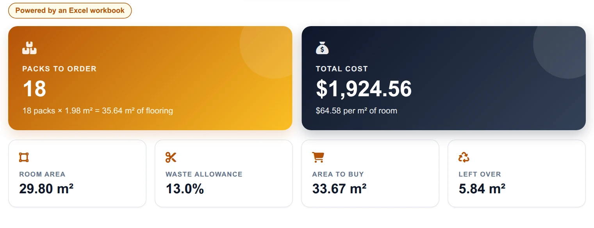
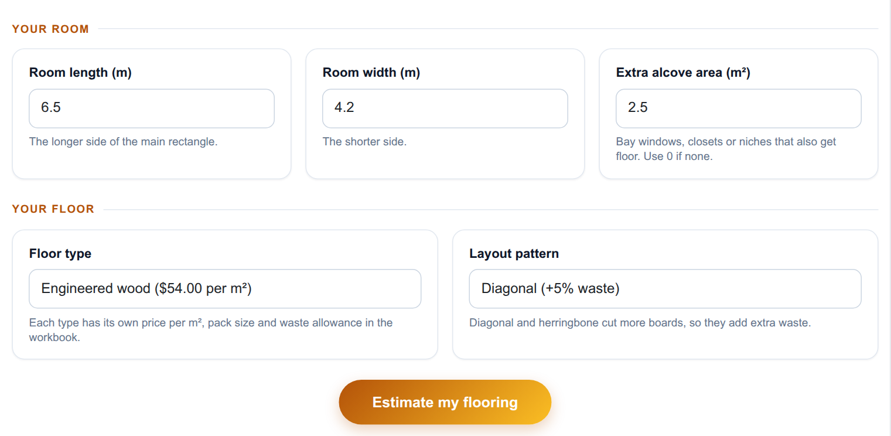
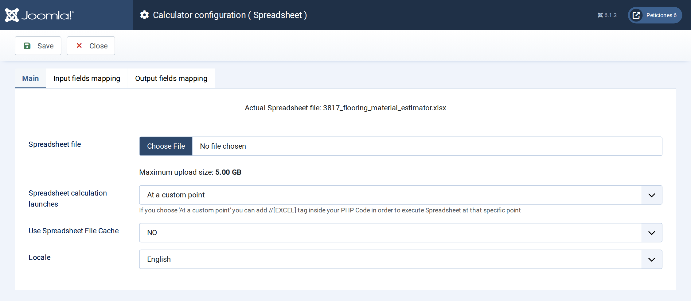
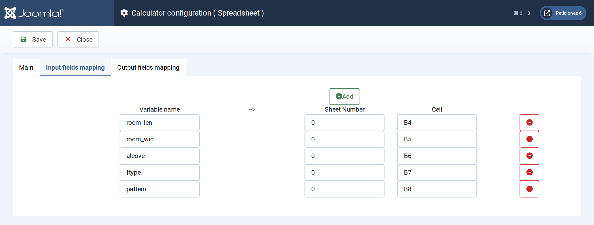
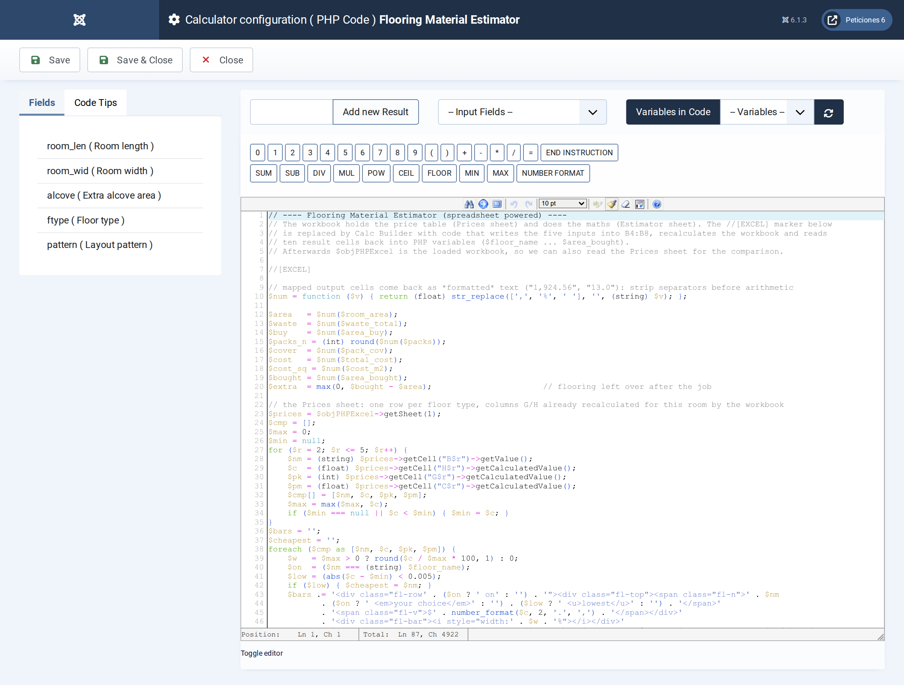

# Flooring Material Estimator

**Calc Builder example** · [Live demo](https://demo.moonsoft.es/flooring-material-estimator) · [Import instructions](https://demo.moonsoft.es/flooring-material-estimator)

Excel-powered flooring estimator: enter the room size, floor type and layout to get packs to order, total cost and a price comparison of every floor type.

The **Flooring Material Estimator** is powered by a real Excel workbook that holds the price table, pack sizes and waste allowances. Calc Builder writes the room and choices into the sheet, lets it recalculate and turns the results into a quote-ready dashboard.

## What it calculates

A visitor enters a room length and width, an optional alcove area, a floor type and a layout pattern. The workbook returns:
- **Room area and waste** — the floor area plus the recommended waste for the floor type and the extra waste that diagonal or herringbone layouts need.
- **Packs to order** — the area to buy divided by the coverage of one pack and rounded up with `ROUNDUP`, plus the flooring left over.
- **Cost** — the total price and the cost per m² of room, using the price per m² of the chosen floor type.
- **Comparison** — the total cost of the same room on all four floor types, read back from the Prices sheet and drawn as bars, with the cheapest one flagged.

## How it’s built

The **Spreadsheet** screen holds the workbook with two sheets: *Estimator* (inputs and results) and *Prices* (a price table for four floor types and a waste table for three layouts). Five *input mappings* write the Number fields and the two Option Lists into cells `B4:B8`; the lists send a type number that the sheet turns into names, prices and waste with `INDEX/MATCH`. Ten *output mappings* bring the result cells back into PHP variables. The execution mode is *custom*, so the `//[EXCEL]` marker in the PHP Code shows exactly where the sheet runs.

Mapped output cells arrive as formatted text (such as `1,924.56`), so the PHP Code strips the separators before doing arithmetic. After the marker `$objPHPExcel` is the loaded workbook, so the code also reads the price table and the per-type totals from the Prices sheet to build the comparison, and draws a room sketch whose pattern follows the layout. The workbook is available for download below: import the calculator, then upload the Excel file on its Spreadsheet screen.

## Files in this folder

- `flooring-material-estimator_export.xml`
- `flooring_material_estimator.xlsx`
- `screenshots/` – images of the frontend and of the Calc Builder settings

## How to import

1. Open **Components › CalcBuilder › Import** in your Joomla administrator.
2. Upload the `*_export.xml` file of this folder.
3. If the folder contains an `.xlsx` model, upload it in the calculator's Excel settings.
4. Create a menu item of type *CalcBuilder* pointing to the imported calculator.

Full step-by-step instructions with the live result: **https://demo.moonsoft.es/flooring-material-estimator**

## Screenshots

*Live result on the frontend*

*The input form as your visitors see it, styled with the Form Layout.*

*The Spreadsheet screen: the workbook is uploaded here and the execution mode is set.*

*Input mapping: each Calc Builder variable is written into a cell of the workbook before it recalculates.*

*The PHP Code: the //[EXCEL] marker runs the sheet, then the Prices sheet is read back to draw the comparison and the room sketch.*

---
Part of [Moonsoft demos](../../README.md) · [moonsoft.es](https://www.moonsoft.es) · [demo.moonsoft.es](https://demo.moonsoft.es)
