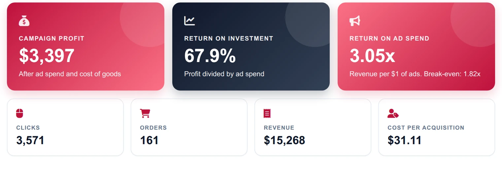
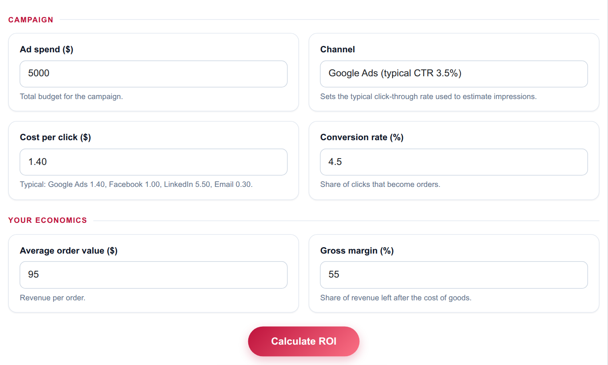
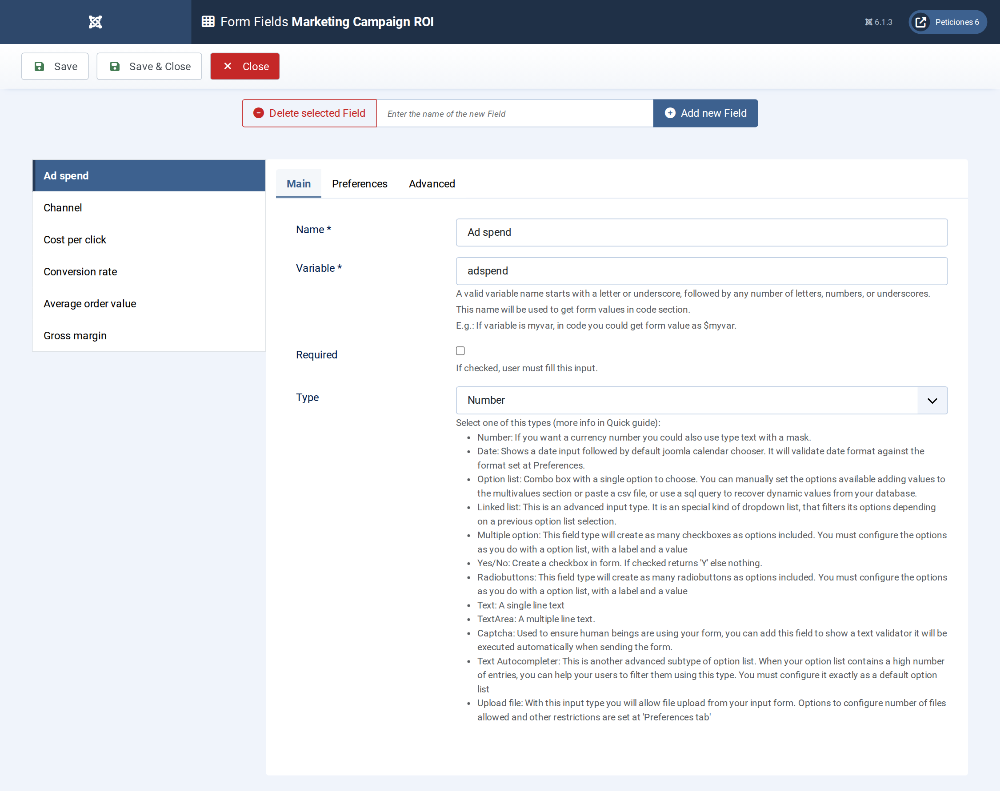
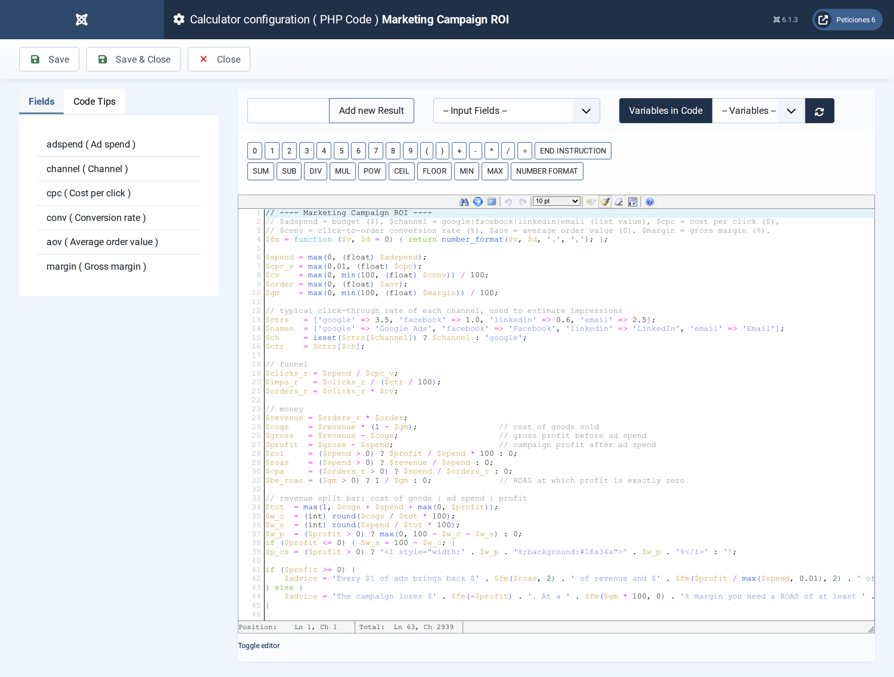
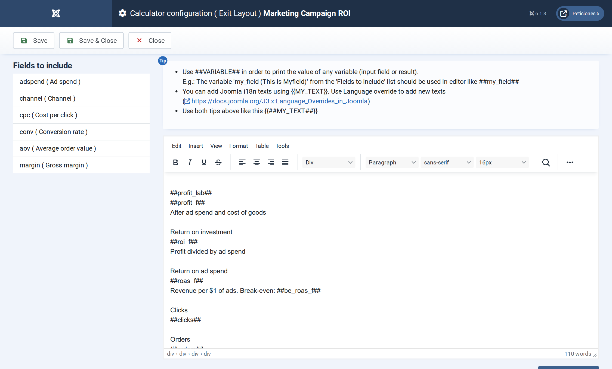

# Marketing Campaign ROI

**Calc Builder example** · [Live demo](https://demo.moonsoft.es/marketing-campaign-roi) · [Import instructions](https://demo.moonsoft.es/marketing-campaign-roi)

Turn an ad budget, a cost per click and a conversion rate into clicks, orders, revenue, profit, ROI, ROAS and cost per acquisition, with a funnel and a revenue-split bar.

The **Marketing Campaign ROI** calculator follows an ad budget through the funnel, from impressions to clicks to orders, and then works out whether the campaign made money once the cost of goods and the ad spend are covered.

## What it calculates

A visitor enters an ad spend, picks a channel and gives a cost per click, a conversion rate, an average order value and a gross margin. The calculator returns:
- **Funnel volumes** — clicks (spend divided by cost per click), orders (clicks times conversion rate) and estimated impressions from the channel’s typical click-through rate.
- **Revenue and profit** — orders times order value, then gross profit at the given margin, minus the ad spend.
- **ROI and ROAS** — ROI is campaign profit divided by ad spend; ROAS is revenue divided by ad spend, shown next to the break-even ROAS (one over the margin).
- **Cost per acquisition** — the ad spend divided by the number of orders.
- **Two visuals** — a funnel of impressions, clicks and orders with the rates between the steps, and a bar splitting revenue into cost of goods, ad spend and profit.

## How it’s built

Five **Number** fields and one **Option List** feed the PHP Code. The list holds the channel key; PHP maps it to a typical click-through rate and channel name, so the help text and the funnel stay in sync with one lookup table.

The funnel and the revenue split are plain HTML and CSS: PHP computes the percentage widths and the Exit Layout uses them inside inline styles. When the campaign loses money the profit segment disappears and the advice line explains the shortfall against the break-even ROAS.

## Files in this folder

- `marketing-campaign-roi_export.xml`
- `screenshots/` – images of the frontend and of the Calc Builder settings

## How to import

1. Open **Components › CalcBuilder › Import** in your Joomla administrator.
2. Upload the `*_export.xml` file of this folder.
3. If the folder contains an `.xlsx` model, upload it in the calculator's Excel settings.
4. Create a menu item of type *CalcBuilder* pointing to the imported calculator.

Full step-by-step instructions with the live result: **https://demo.moonsoft.es/marketing-campaign-roi**

## Screenshots

*Live result on the frontend*

*The input form as your visitors see it, styled with the Form Layout.*

*Six fields: five Number fields and one Option List for the channel.*

*Funnel maths, revenue, profit, ROI, ROAS, break-even ROAS and the split-bar widths.*

*The Exit Layout: three hero cards, four metric cards, the funnel and the revenue-split bar.*

---
Part of [Moonsoft demos](../../README.md) · [moonsoft.es](https://www.moonsoft.es) · [demo.moonsoft.es](https://demo.moonsoft.es)
