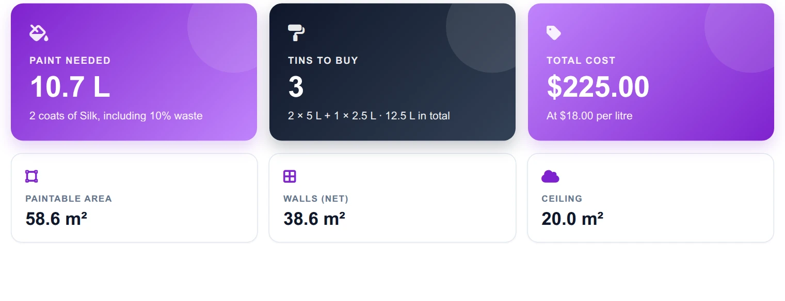
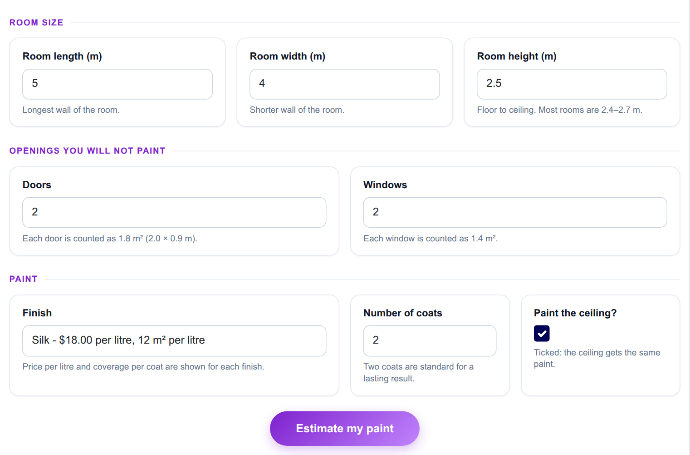
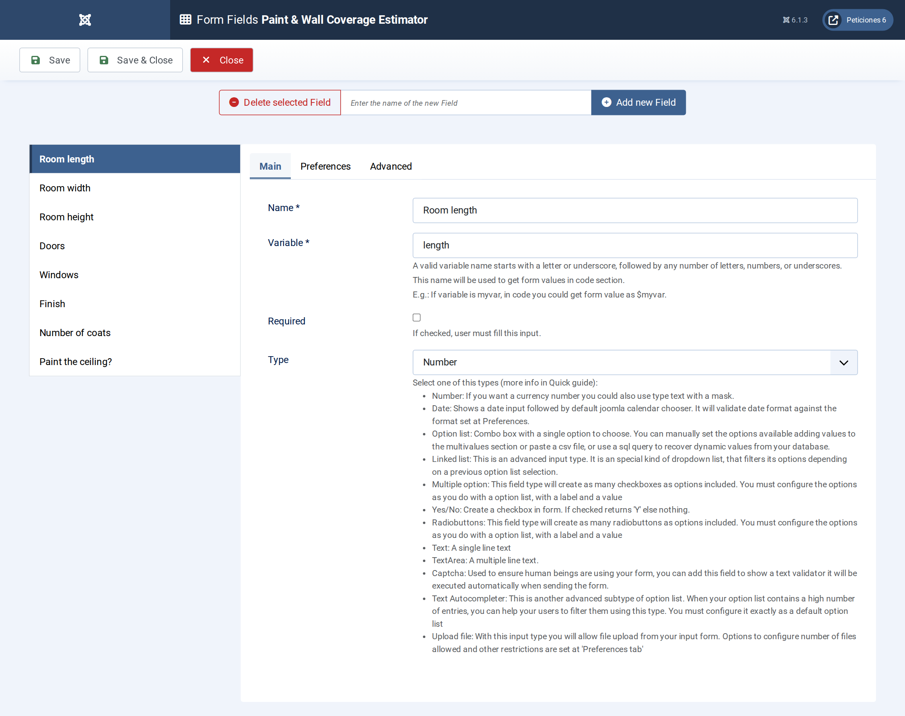
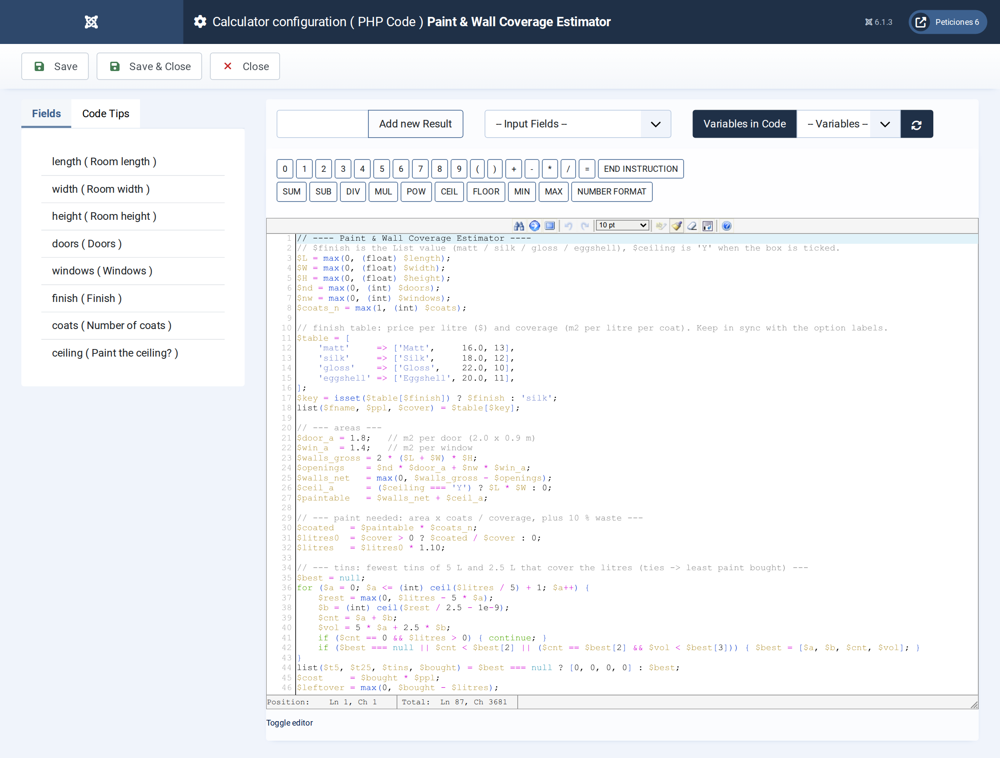
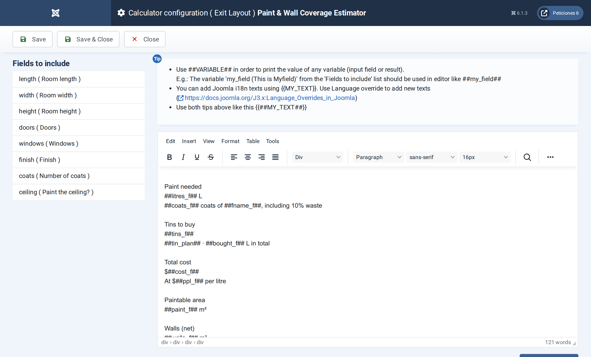

# Paint & Wall Coverage Estimator

**Calc Builder example** · [Live demo](https://demo.moonsoft.es/paint-wall-coverage-estimator) · [Import instructions](https://demo.moonsoft.es/paint-wall-coverage-estimator)

Work out the paintable area of a room, the litres of paint including waste, the cheapest tin combination and the total cost for four finishes.

The **Paint & Wall Coverage Estimator** turns a room’s dimensions into a shopping list: how much paint, which tins and what it costs. It subtracts doors and windows, optionally adds the ceiling and uses the coverage and price of the finish you pick.

## What it calculates

A visitor enters length, width and height, the number of doors and windows, the number of coats, a finish and whether the ceiling is painted. The calculator returns:
- **Paintable area** — wall area (perimeter times height) minus doors and windows, plus the ceiling when it is included.
- **Litres needed** — paintable area times the coats, divided by the finish’s coverage in m² per litre, plus 10% for waste.
- **Tin combination** — the fewest 5 L and 2.5 L tins that cover the litres, choosing the smaller total volume when two combinations use the same number of tins.
- **Total cost** — litres actually bought (whole tins) times the finish’s price per litre, with a per-tin shopping list and the paint left over.
- **Wall versus ceiling** — a two-part bar that shows how the paintable area splits between walls and ceiling.

## How it’s built

Five **Number** fields take the room and the coats, a **List** field offers four finishes whose labels show the price per litre and the coverage, and a **Yes/No** field switches the ceiling on or off. The PHP Code looks up the selected finish by its option value.

The tin optimiser is a small loop over the number of 5 L tins that picks the fewest tins and, on a tie, the least paint. The table rows and the area bar are built as HTML in PHP and printed by the Exit Layout with `##tin_rows##` and `##area_bar##`.

## Files in this folder

- `paint-wall-coverage-estimator_export.xml`
- `screenshots/` – images of the frontend and of the Calc Builder settings

## How to import

1. Open **Components › CalcBuilder › Import** in your Joomla administrator.
2. Upload the `*_export.xml` file of this folder.
3. If the folder contains an `.xlsx` model, upload it in the calculator's Excel settings.
4. Create a menu item of type *CalcBuilder* pointing to the imported calculator.

Full step-by-step instructions with the live result: **https://demo.moonsoft.es/paint-wall-coverage-estimator**

## Screenshots

*Live result on the frontend*

*The input form as your visitors see it, styled with the Form Layout.*

*Eight fields: five Number, one List with the finish data in every label, one Number for coats and one Yes/No for the ceiling.*

*The PHP Code: areas, litres with 10% waste, the tin optimiser and the markup for the table and bar.*

*The Exit Layout: three hero cards, six metric cards, the wall/ceiling bar and the shopping-list table.*

---
Part of [Moonsoft demos](../../README.md) · [moonsoft.es](https://www.moonsoft.es) · [demo.moonsoft.es](https://demo.moonsoft.es)
