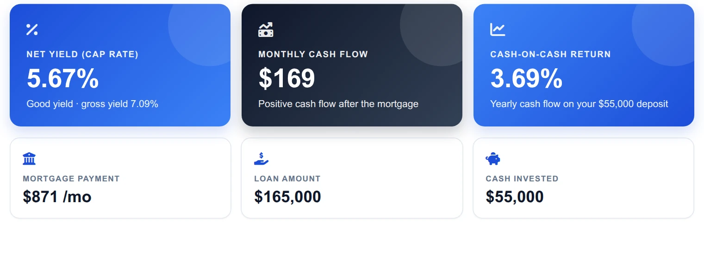
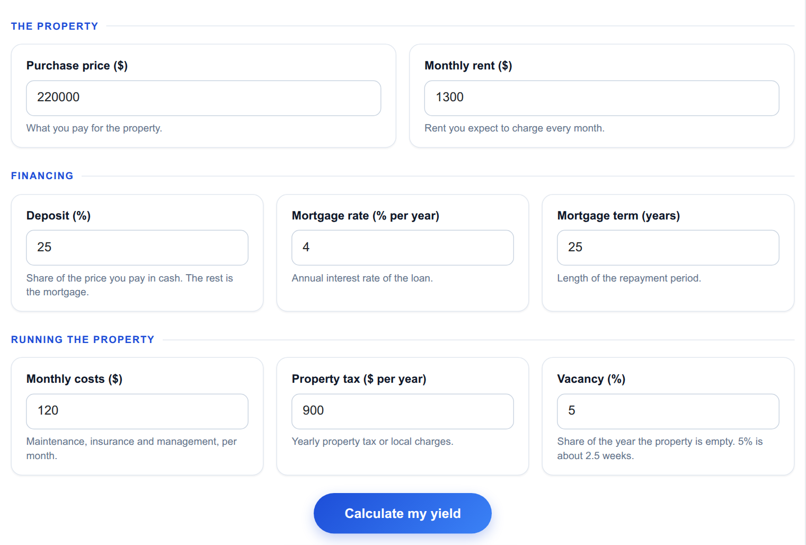
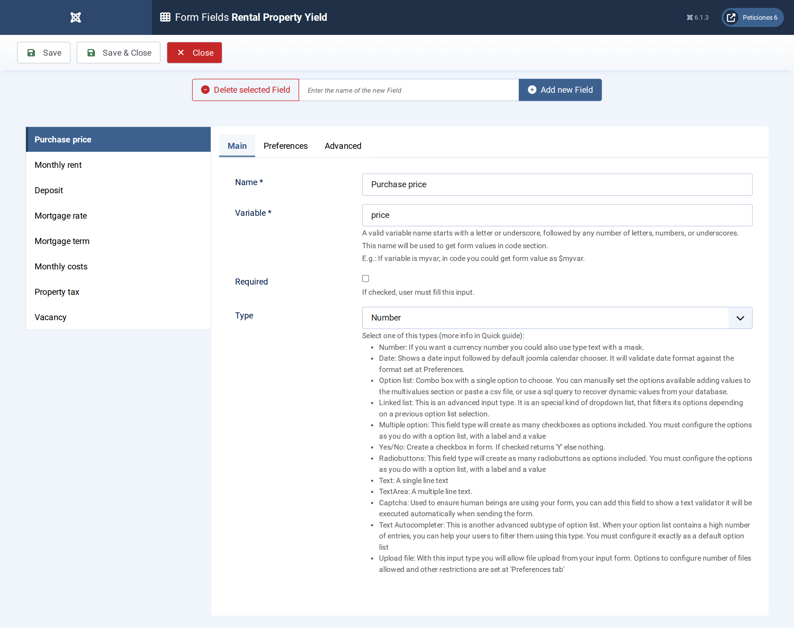
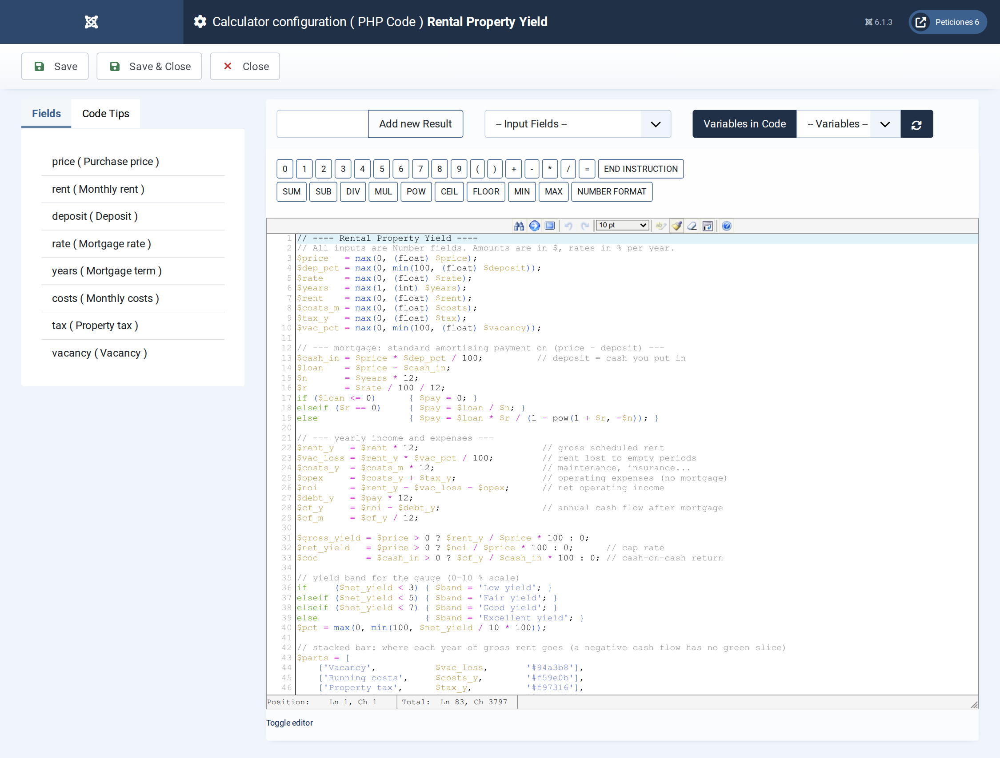
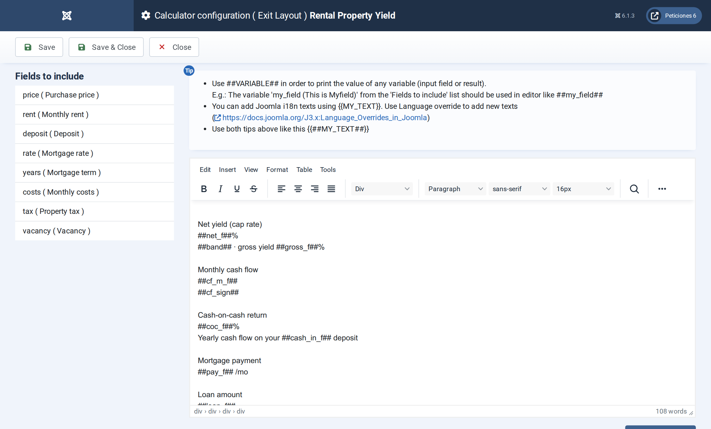

# Rental Property Yield

**Calc Builder example** · [Live demo](https://demo.moonsoft.es/rental-property-yield) · [Import instructions](https://demo.moonsoft.es/rental-property-yield)

Gross yield, net yield (cap rate), mortgage payment, monthly cash flow and cash-on-cash return for a buy-to-let, with a breakdown of where the rent goes.

The **Rental Property Yield** calculator answers the first question of any buy-to-let: does the rent pay for the property? It combines price, mortgage, running costs, tax and vacancy into the yields investors compare and the cash you actually keep each month.

## What it calculates

A visitor enters the purchase price, deposit, mortgage rate and term, monthly rent, monthly costs, yearly property tax and a vacancy allowance. The calculator returns:
- **Mortgage payment** — the monthly repayment of a standard amortising loan on the price minus the deposit.
- **Gross and net yield** — yearly rent over price, and net operating income (rent minus vacancy, costs and tax) over price, also known as the cap rate.
- **Monthly cash flow** — net operating income minus the mortgage, per month, flagged as positive or negative.
- **Cash-on-cash return** — the yearly cash flow as a percentage of the deposit paid in cash.
- **Where the rent goes** — a stacked bar splitting the yearly rent into vacancy, costs, tax, mortgage and what is left for the owner, plus a gauge that places the net yield in a low, fair, good or excellent band.

## How it’s built

Eight **Number** fields feed the PHP Code, which computes the amortisation payment (`L*r / (1 - (1+r)^-n)`, with a zero-rate fallback), the yearly income statement and the three returns.

The stacked bar is plain HTML and CSS built in a PHP loop: each slice gets a width in percent and the finished markup is returned in a variable that the Exit Layout prints with `##stack##`. If the cash flow is negative the green slice is dropped and the note explains the monthly top-up.

## Files in this folder

- `rental-property-yield_export.xml`
- `screenshots/` – images of the frontend and of the Calc Builder settings

## How to import

1. Open **Components › CalcBuilder › Import** in your Joomla administrator.
2. Upload the `*_export.xml` file of this folder.
3. If the folder contains an `.xlsx` model, upload it in the calculator's Excel settings.
4. Create a menu item of type *CalcBuilder* pointing to the imported calculator.

Full step-by-step instructions with the live result: **https://demo.moonsoft.es/rental-property-yield**

## Screenshots

*Live result on the frontend*

*The input form as your visitors see it, styled with the Form Layout.*

*Eight Number fields with sensible defaults, so the calculator shows a realistic result on first load.*

*The PHP Code: mortgage payment, operating income, the three yields and the markup for the stacked bar and gauge.*

*The Exit Layout: three hero cards, five metric cards, the rent breakdown bar and the yield-band gauge.*

---
Part of [Moonsoft demos](../../README.md) · [moonsoft.es](https://www.moonsoft.es) · [demo.moonsoft.es](https://demo.moonsoft.es)
