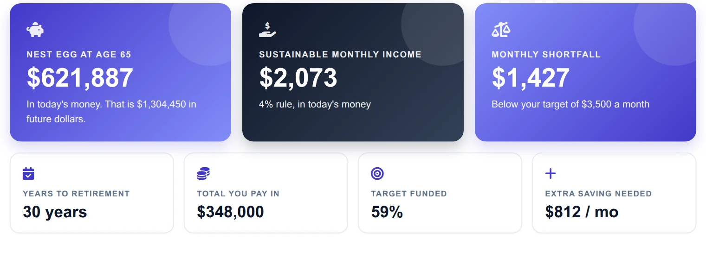
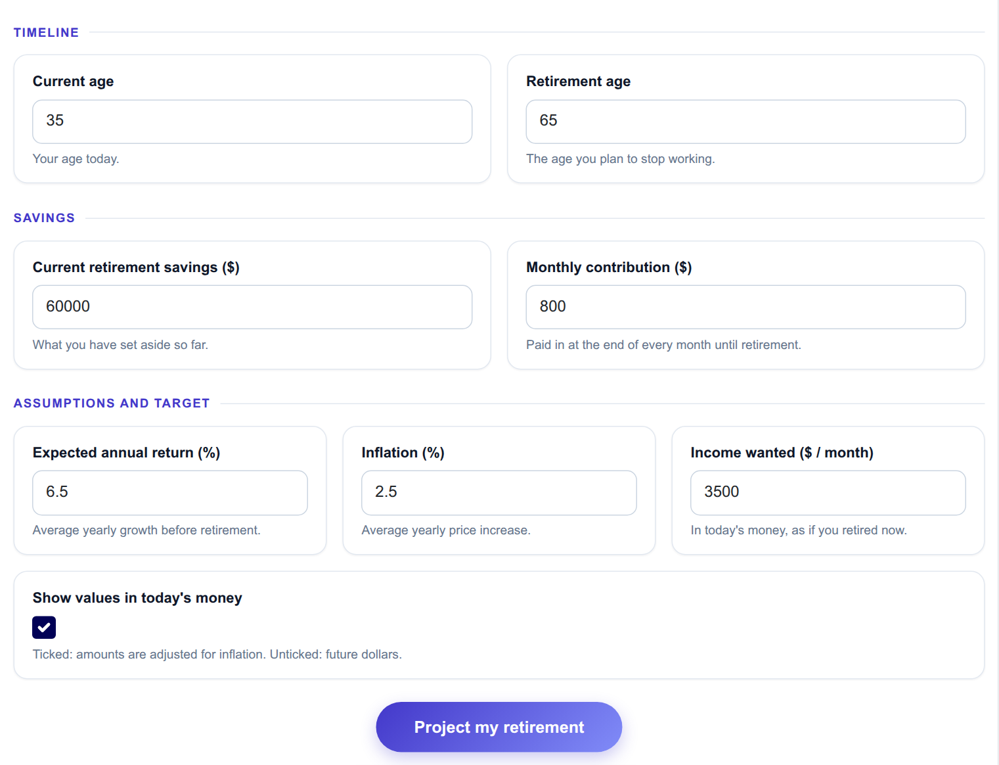
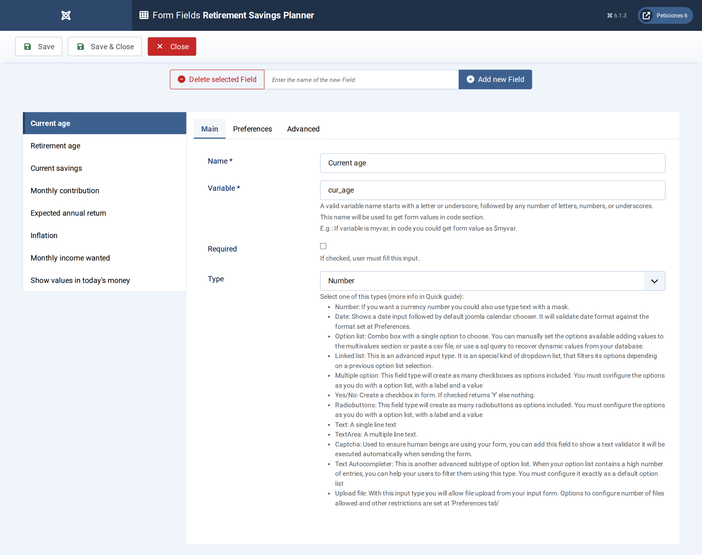
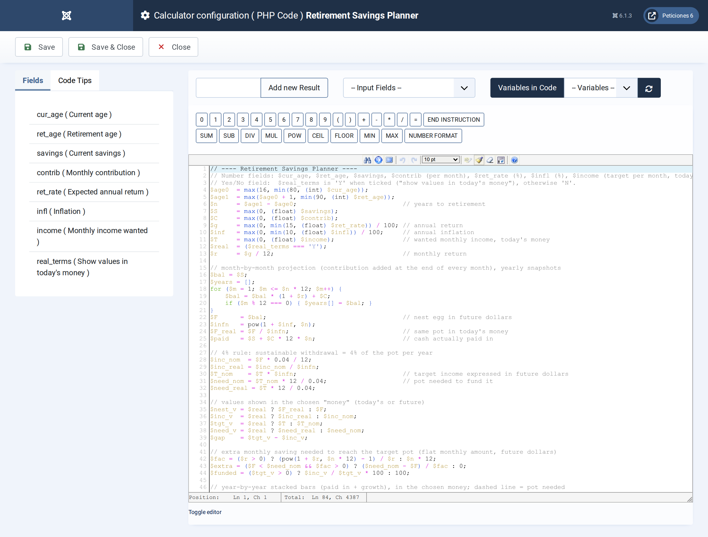
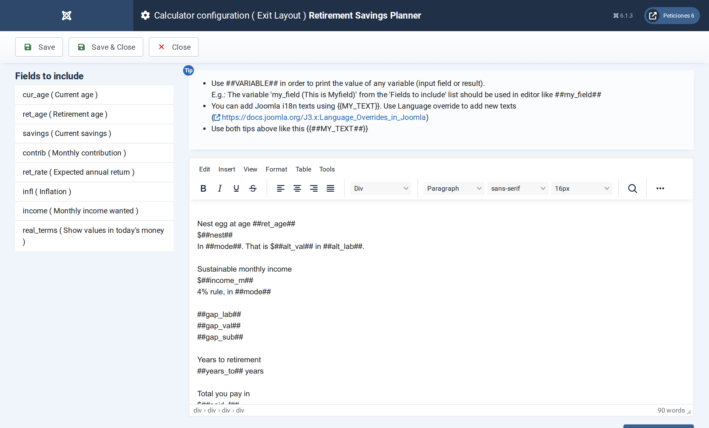

# Retirement Savings Planner

**Calc Builder example** · [Live demo](https://demo.moonsoft.es/retirement-savings-planner) · [Import instructions](https://demo.moonsoft.es/retirement-savings-planner)

Project a retirement nest egg from current savings and monthly contributions, adjust it for inflation and see whether the 4% rule can fund your target income.

The **Retirement Savings Planner** projects what a visitor’s savings could grow to by retirement, converts that pot into a sustainable monthly income and compares it with the income they want.

## What it calculates

A visitor enters current age, retirement age, savings, a monthly contribution, an expected return, inflation and the monthly income they would like in today’s money. The calculator returns:
- **Projected nest egg** — savings and contributions compounded month by month until retirement, shown either in future dollars or, with the Yes/No toggle ticked, in today’s money.
- **Sustainable income** — 4% of the pot per year, divided by twelve (the 4% rule), in the same money as the nest egg.
- **Gap versus target** — the monthly shortfall or surplus against the wanted income, plus the percentage of the target that is funded.
- **Extra saving needed** — the additional flat monthly contribution that would close the gap by retirement.
- **Year-by-year chart** — stacked bars of what was paid in and what growth added at every age, with a dashed line marking the pot the target requires.

## How it’s built

Seven **Number** fields collect the assumptions and one **Yes/No** field switches between future dollars and today’s money (a checked box arrives in PHP as `'Y'`, an unchecked one as `'N'`). A small script in the Form Layout ticks the box when the page loads.

The PHP Code loops through the months, keeps a snapshot at each year end, applies the 4% rule and builds the chart as plain HTML: each year is a stacked column sized in percent, and the target line is a positioned dashed rule. No chart library and no spreadsheet are needed.

## Files in this folder

- `retirement-savings-planner_export.xml`
- `screenshots/` – images of the frontend and of the Calc Builder settings

## How to import

1. Open **Components › CalcBuilder › Import** in your Joomla administrator.
2. Upload the `*_export.xml` file of this folder.
3. If the folder contains an `.xlsx` model, upload it in the calculator's Excel settings.
4. Create a menu item of type *CalcBuilder* pointing to the imported calculator.

Full step-by-step instructions with the live result: **https://demo.moonsoft.es/retirement-savings-planner**

## Screenshots

*Live result on the frontend*

*The input form as your visitors see it, styled with the Form Layout.*

*Eight fields: seven Number fields and a Yes/No toggle.*

*Month-by-month compounding, inflation adjustment, the 4% rule, the gap and the chart markup.*

*The Exit Layout: three hero cards, four metric cards and the chart panel with a legend.*

---
Part of [Moonsoft demos](../../README.md) · [moonsoft.es](https://www.moonsoft.es) · [demo.moonsoft.es](https://demo.moonsoft.es)
