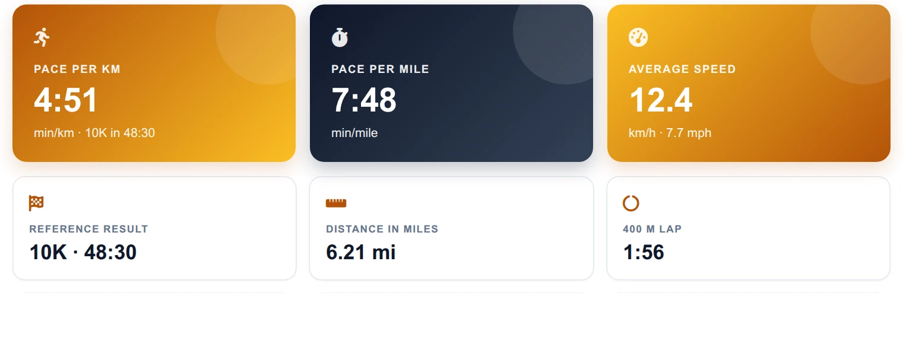
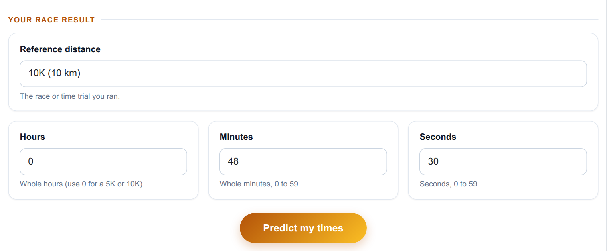
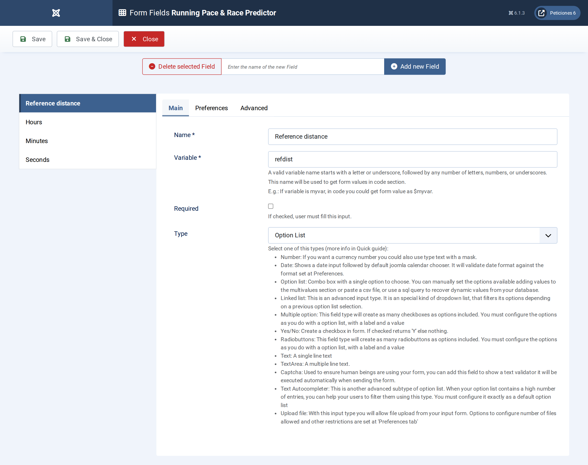
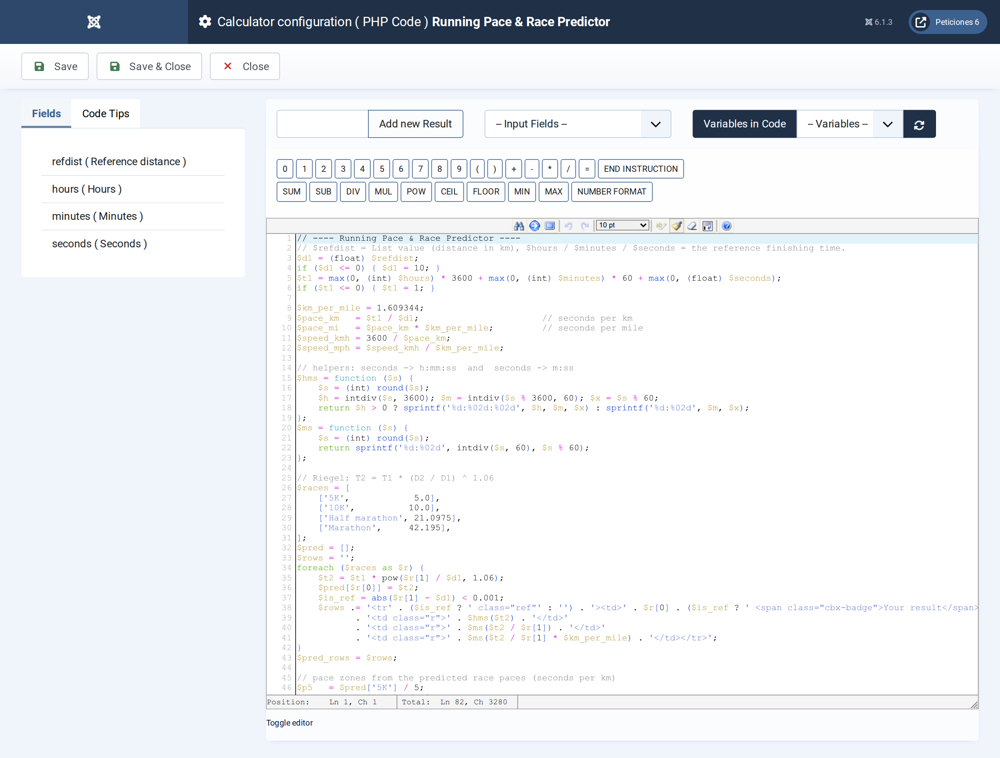
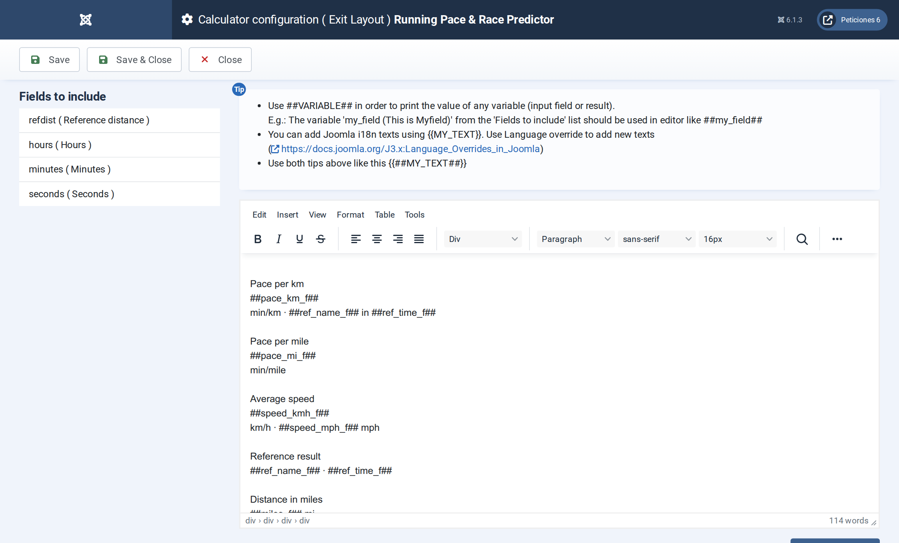

# Running Pace & Race Predictor

**Calc Builder example** · [Live demo](https://demo.moonsoft.es/running-pace-race-predictor) · [Import instructions](https://demo.moonsoft.es/running-pace-race-predictor)

Turn any 5K, 10K, half marathon or marathon result into pace per km and per mile, speed, Riegel race predictions and training pace zones.

The **Running Pace & Race Predictor** takes a recent race result and answers two questions runners ask constantly: what pace was that, and what could I run at the other distances? It uses the Riegel formula and lays the answers out in a tidy table.

## What it calculates

A visitor picks a reference distance and enters hours, minutes and seconds. The calculator returns:
- **Pace** — seconds per kilometre and per mile, formatted as minutes:seconds, plus the 400 m lap time.
- **Speed** — average speed in km/h and mph.
- **Race predictions** — predicted 5K, 10K, half marathon and marathon times with Riegel’s formula `T2 = T1 × (D2 / D1)^1.06`, each with its pace, and the row for the reference race highlighted.
- **Pace zones** — a six-part bar from easy running to speed repetitions, taking each zone’s pace from the predicted race paces.

## How it’s built

A **List** field carries the distance in kilometres as the option value, and three **Number** fields take the finishing time. The PHP Code converts everything to seconds, applies the Riegel exponent to each target distance and formats the results with two small closures (h:mm:ss and m:ss).

The predictions table and the zone bar are HTML built in PHP loops and printed by the Exit Layout with `##pred_rows##` and `##zone_html##`. The reference row gets a CSS class so it stands out, and the same calculator works whichever distance is chosen.

## Files in this folder

- `running-pace-race-predictor_export.xml`
- `screenshots/` – images of the frontend and of the Calc Builder settings

## How to import

1. Open **Components › CalcBuilder › Import** in your Joomla administrator.
2. Upload the `*_export.xml` file of this folder.
3. If the folder contains an `.xlsx` model, upload it in the calculator's Excel settings.
4. Create a menu item of type *CalcBuilder* pointing to the imported calculator.

Full step-by-step instructions with the live result: **https://demo.moonsoft.es/running-pace-race-predictor**

## Screenshots

*Live result on the frontend*

*The input form as your visitors see it, styled with the Form Layout.*

*Four fields: a List for the reference distance and three Number fields for hours, minutes and seconds.*

*The PHP Code: time to seconds, pace and speed, the Riegel loop, the zones and the HTML builders.*

*The Exit Layout: three hero cards, six metric cards, the predictions table and the pace-zone bar.*

---
Part of [Moonsoft demos](../../README.md) · [moonsoft.es](https://www.moonsoft.es) · [demo.moonsoft.es](https://demo.moonsoft.es)
