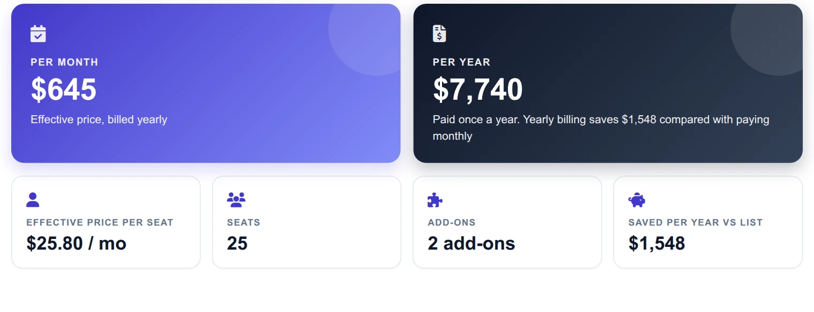
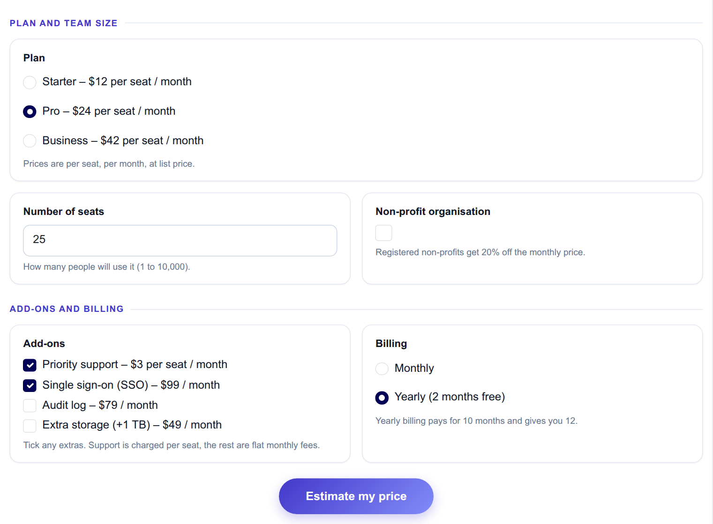
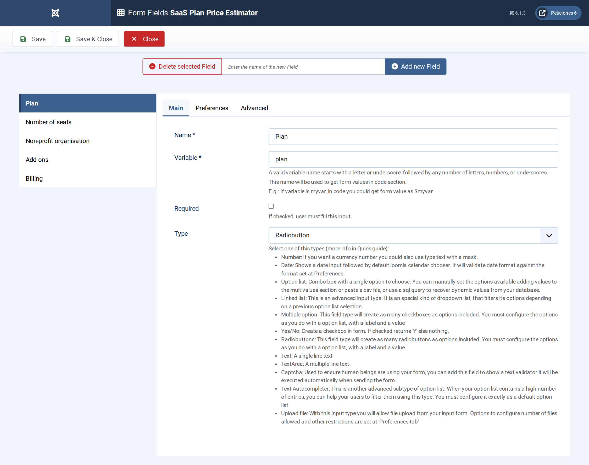
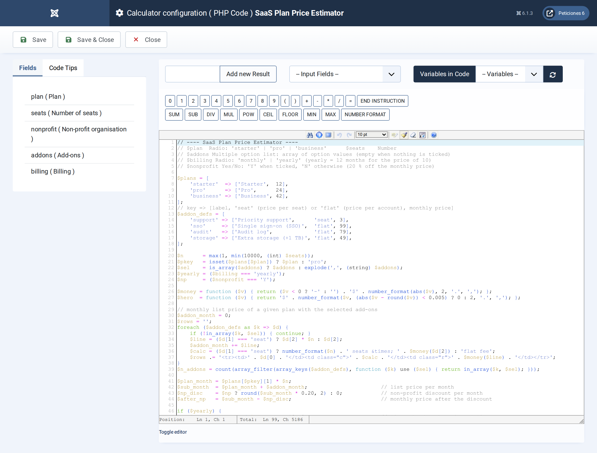
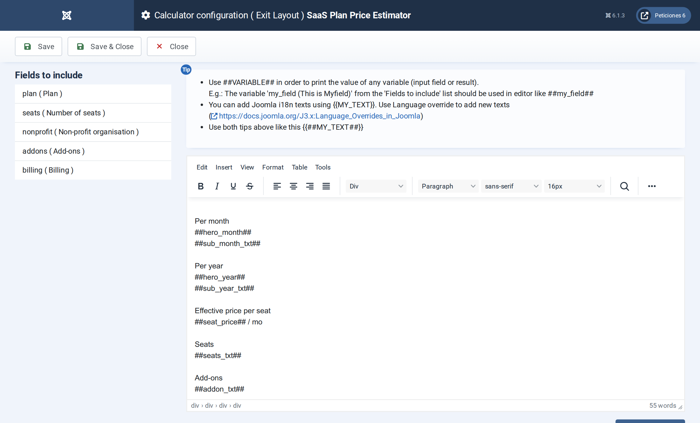

# SaaS Plan Price Estimator

**Calc Builder example** · [Live demo](https://demo.moonsoft.es/saas-plan-price-estimator) · [Import instructions](https://demo.moonsoft.es/saas-plan-price-estimator)

A software pricing estimator: pick a plan, seats, add-ons and billing period and get an invoice-style quote with monthly and yearly totals.

The **SaaS Plan Price Estimator** turns a pricing page into an interactive quote. Visitors choose a plan, a team size, optional add-ons and a billing period and see an itemised, invoice-style breakdown instantly.

## What it calculates

A visitor picks one of three plans, types a number of seats, ticks add-ons and chooses monthly or yearly billing, with an optional non-profit discount. The calculator returns:
- **Line-item quote** — the plan multiplied by the seats, every selected add-on (per seat or flat fee), the subtotal, each discount and the totals.
- **Monthly and yearly totals** — two hero cards; with yearly billing the customer pays for 10 months and gets 12, and the monthly figure is the effective price.
- **Effective price per seat** — the total per month divided by the seats, and how much is saved per year against the list price.
- **Plan comparison** — the same team, add-ons, billing and discount priced on each of the three plans, with the chosen plan highlighted.

## How it’s built

A **Radio** field carries the plan (the per-seat price is written in each label), a **Number** field the seats, a **Multiple Option List** the add-ons, a second **Radio** the billing period and a **Yes/No** field the non-profit discount.

The prices live in two small arrays at the top of the PHP Code, so changing a price or adding an add-on means editing one line. The multiple list arrives as an array of option values (or nothing when no box is ticked, which the code handles). The PHP Code builds the invoice table as an HTML string, including only the discount rows that apply, and the Exit Layout drops it in with `##table##`.

## Files in this folder

- `saas-plan-price-estimator_export.xml`
- `screenshots/` – images of the frontend and of the Calc Builder settings

## How to import

1. Open **Components › CalcBuilder › Import** in your Joomla administrator.
2. Upload the `*_export.xml` file of this folder.
3. If the folder contains an `.xlsx` model, upload it in the calculator's Excel settings.
4. Create a menu item of type *CalcBuilder* pointing to the imported calculator.

Full step-by-step instructions with the live result: **https://demo.moonsoft.es/saas-plan-price-estimator**

## Screenshots

*Live result on the frontend*

*The input form as your visitors see it, styled with the Form Layout.*

*Five fields: two Radio fields, a Number field, a Multiple Option List and a Yes/No field.*

*Price arrays, add-on and discount arithmetic, the invoice table and the per-plan comparison bars.*

*The Exit Layout: two hero cards, four metric cards, the invoice table and the plan comparison.*

---
Part of [Moonsoft demos](../../README.md) · [moonsoft.es](https://www.moonsoft.es) · [demo.moonsoft.es](https://demo.moonsoft.es)
