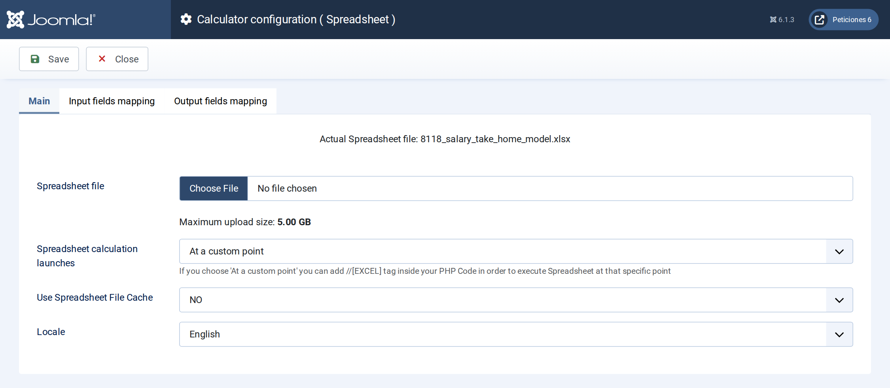
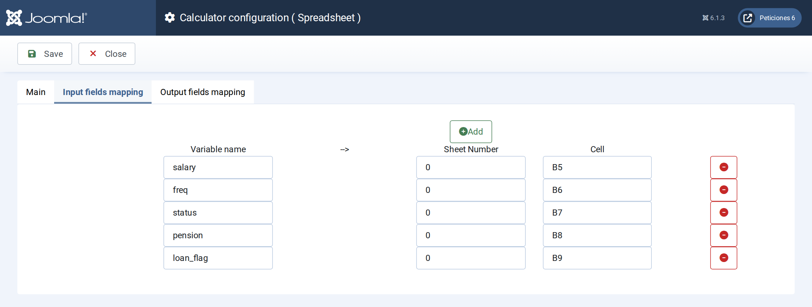
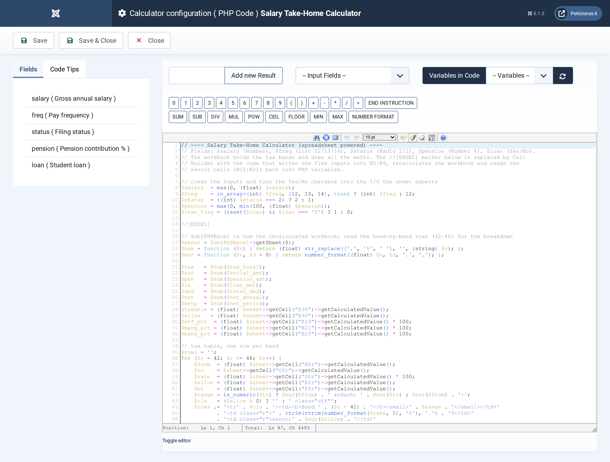

# Salary Take-Home Calculator

**Calc Builder example** · [Live demo](https://demo.moonsoft.es/salary-take-home-calculator) · [Import instructions](https://demo.moonsoft.es/salary-take-home-calculator)

Excel-powered net pay calculator: progressive income tax by band, social contributions with a cap, pension relief and an optional student loan.

The **Salary Take-Home Calculator** turns a gross salary into net pay using a real Excel workbook. Calc Builder writes the visitor’s numbers into the sheet, lets it recalculate a five-band progressive tax model and reads the band-by-band rows back to draw a breakdown table and a ‘where your gross goes’ bar.

## What it calculates

A visitor enters a gross annual salary, how many payments per year they receive, their filing status, a pension percentage and whether they repay a student loan. The workbook returns:
- **Net pay** — annual take-home and the amount per payment (12, 13 or 14 payments a year).
- **Total deductions** — income tax, social contributions (with a salary cap), the pension contribution and the loan repayment above a threshold.
- **Effective and marginal rate** — the average share of gross paid in tax and social contributions, and the rate on the next euro earned.
- **Tax by band** — how much taxable income falls in each of the five bands and the tax it produces, after the personal allowance and pension relief.

## How it’s built

The **Spreadsheet** screen holds the workbook with five *input mappings* (salary, pay frequency, filing status, pension % and a 1/0 student-loan flag into `B5:B9`) and ten *output mappings* (the result cells `B12:B21` back into PHP variables). The band table, allowances, social cap and loan threshold are labelled *illustrative* and editable in the workbook, so anyone can replace them with real rules. The execution mode is *custom*: the `//[EXCEL]` marker in the PHP Code shows where the sheet runs.

The **Yes/No** checkbox is converted to 1/0 before the marker, and the Radio and List values are plain numbers (1/2 and 12/13/14) so they can be written straight into cells. After the marker `$objPHPExcel` is the loaded workbook: the PHP Code reads the band rows (`42–46`) to render the tax table and builds the stacked bar from the amounts. Mapped outputs arrive as formatted text, so the code strips the separators before doing arithmetic. Download the workbook below: import the calculator, then upload the Excel file on its Spreadsheet screen.

## Files in this folder

- `salary-take-home-calculator_export.xml`
- `salary_take_home_model.xlsx`
- `screenshots/` – images of the frontend and of the Calc Builder settings

## How to import

1. Open **Components › CalcBuilder › Import** in your Joomla administrator.
2. Upload the `*_export.xml` file of this folder.
3. If the folder contains an `.xlsx` model, upload it in the calculator's Excel settings.
4. Create a menu item of type *CalcBuilder* pointing to the imported calculator.

Full step-by-step instructions with the live result: **https://demo.moonsoft.es/salary-take-home-calculator**

## Screenshots

*Live result on the frontend*

*The input form as your visitors see it, styled with the Form Layout.*

*The Spreadsheet screen: the workbook is uploaded here and the execution mode is set.*

*Input mapping: each Calc Builder variable is written into a cell of the workbook before it recalculates.*

*The PHP Code: inputs are cleaned, the //[EXCEL] marker runs the sheet, then the band rows are read back for the table and the stacked bar.*

---
Part of [Moonsoft demos](../../README.md) · [moonsoft.es](https://www.moonsoft.es) · [demo.moonsoft.es](https://demo.moonsoft.es)
