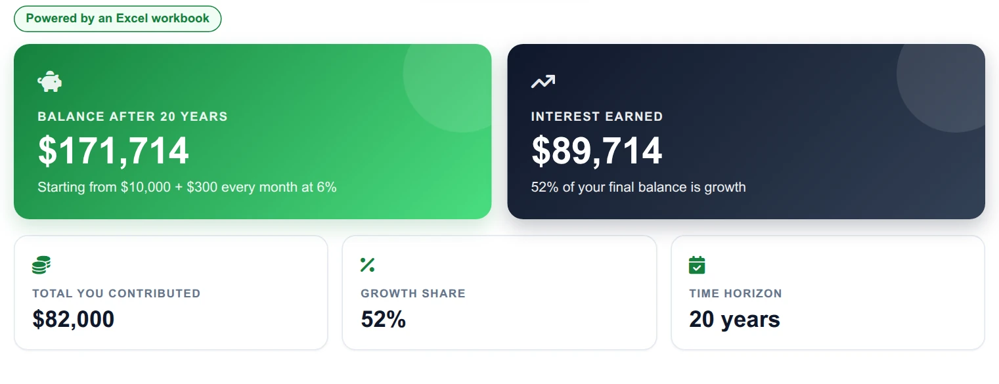
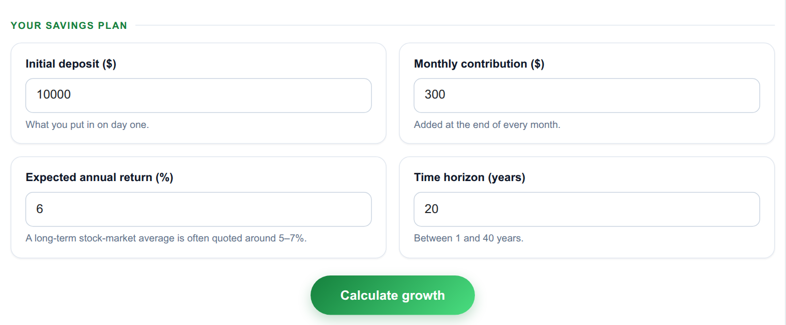
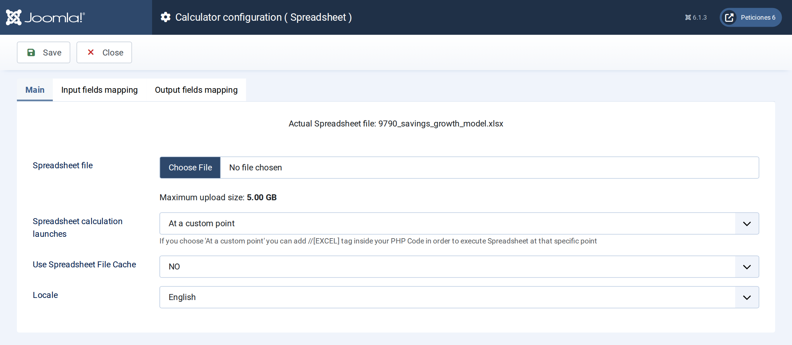
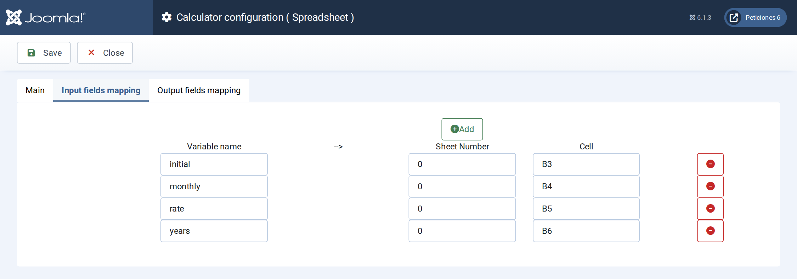
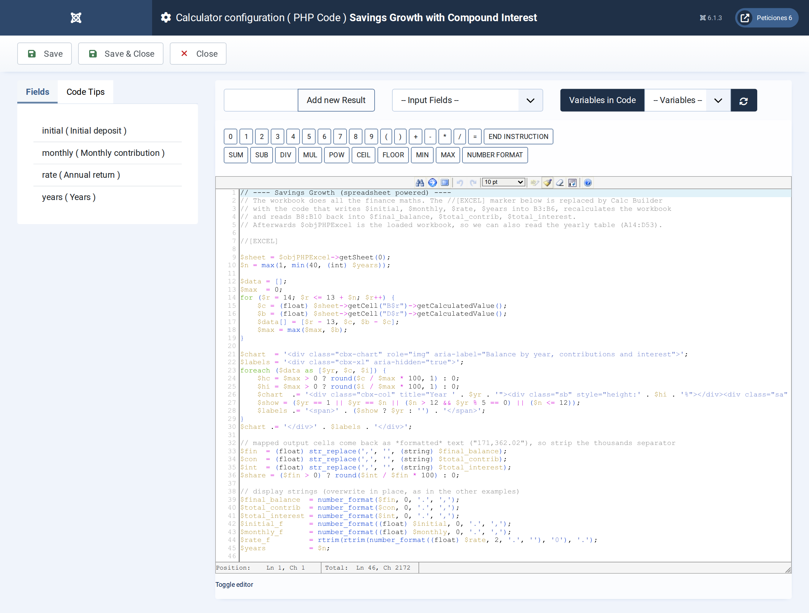

# Savings Growth with Compound Interest

**Calc Builder example** · [Live demo](https://demo.moonsoft.es/savings-growth-with-compound-interest) · [Import instructions](https://demo.moonsoft.es/savings-growth-with-compound-interest)

Excel-powered savings projector: enter a deposit, a monthly contribution and a return and see the balance grow year by year.

The **Savings Growth** calculator is powered by a real Excel workbook. Calc Builder writes the visitor’s numbers into the sheet, lets the workbook recalculate and reads the results back to draw a dashboard and a year-by-year chart.

## What it calculates

A visitor enters a starting deposit, a monthly contribution, an expected annual return and a number of years. The workbook returns:
- **Final balance** — the future value of the deposit plus every monthly contribution, compounded monthly.
- **Total contributed** — everything the visitor puts in over the period.
- **Interest earned** — the growth on top of the contributions, and its share of the final balance.
- **Yearly table** — contributions, interest and balance for every year, which the PHP code turns into a stacked bar chart.

## How it’s built

The **Spreadsheet** screen holds the workbook and four *input mappings* (each Number field to a cell such as `B3`) and three *output mappings* (result cells back into PHP variables). The execution mode is *custom*, so the `//[EXCEL]` marker in the PHP Code shows exactly where the sheet runs.

After the marker `$objPHPExcel` is the loaded workbook, so the PHP Code also reads the yearly table (rows 14–53) to build the chart. The workbook is available for download below: import the calculator, then upload the Excel file on its Spreadsheet screen.

## Files in this folder

- `savings-growth-compound-interest_export.xml`
- `savings_growth_model.xlsx`
- `screenshots/` – images of the frontend and of the Calc Builder settings

## How to import

1. Open **Components › CalcBuilder › Import** in your Joomla administrator.
2. Upload the `*_export.xml` file of this folder.
3. If the folder contains an `.xlsx` model, upload it in the calculator's Excel settings.
4. Create a menu item of type *CalcBuilder* pointing to the imported calculator.

Full step-by-step instructions with the live result: **https://demo.moonsoft.es/savings-growth-with-compound-interest**

## Screenshots

*Live result on the frontend*

*The input form as your visitors see it, styled with the Form Layout.*

*The Spreadsheet screen: the workbook is uploaded here and the execution mode is set.*

*Input mapping: each Calc Builder variable is written into a cell of the workbook before it recalculates.*

*The PHP Code: the //[EXCEL] marker runs the sheet, then the yearly table is read back to draw the chart.*

---
Part of [Moonsoft demos](../../README.md) · [moonsoft.es](https://www.moonsoft.es) · [demo.moonsoft.es](https://demo.moonsoft.es)
