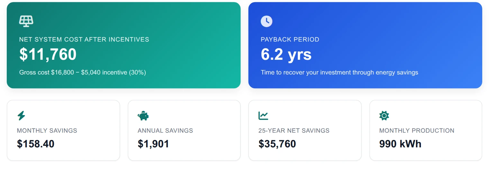
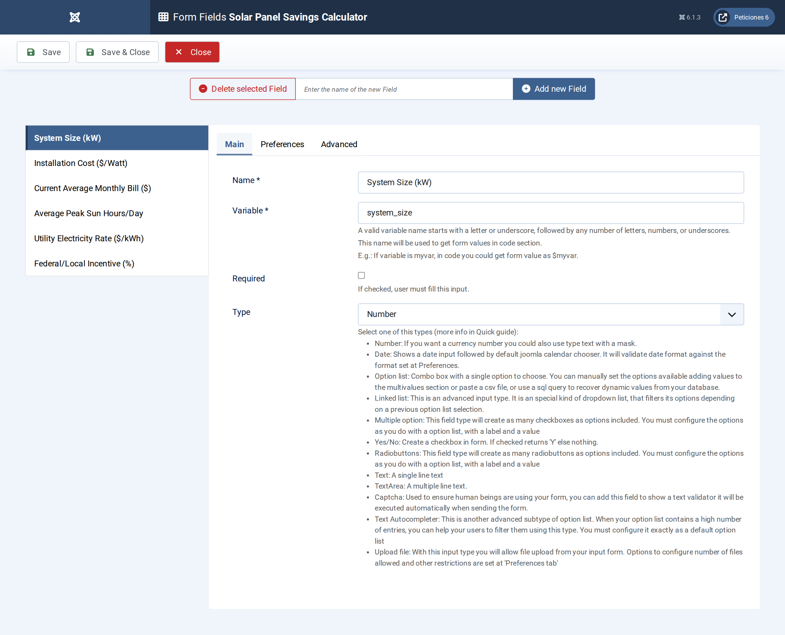
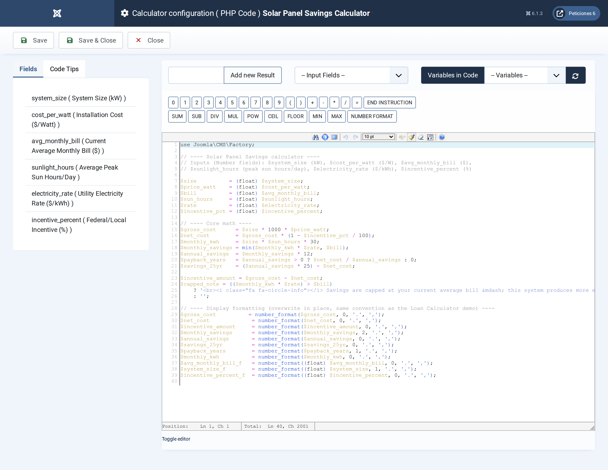
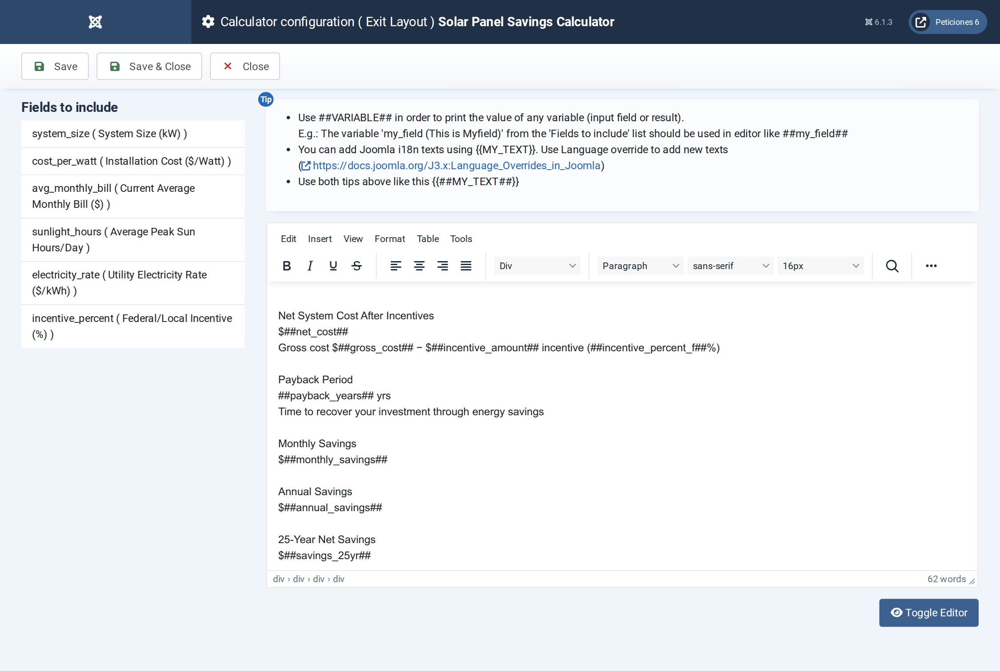

# Solar Panel Savings Calculator

**Calc Builder example** · [Live demo](https://demo.moonsoft.es/solar-panel-savings-calculator) · [Import instructions](https://demo.moonsoft.es/solar-panel-savings-calculator)

See how a real Calc Builder ROI tool comes together: enter your system size and utility rate, and get an instantly-calculated, dashboard-style breakdown of net cost, payback period, and 25-year savings.

The **Solar Panel Savings Calculator** is a worked Calc Builder example built end-to-end in the admin UI: six numeric inputs, a server-side PHP calculation, and a dashboard-style results panel with gradient hero cards, supporting metric cards and Font Awesome icons.

## What it calculates

A visitor enters their system size (kW), installation cost per watt, current average monthly electricity bill, average peak sun hours per day, utility electricity rate, and any federal/local incentive percentage. From those six numbers the calculator works out:
- **Gross and net system cost** — installation cost before and after the incentive is subtracted.
- **Monthly and annual savings** — estimated energy production (kW × sun hours × 30 days) valued at the local electricity rate, capped at the visitor's current bill so the numbers never look inflated.
- **Payback period** — net cost divided by annual savings, in years.
- **25-year net savings** — a simple lifetime projection.

## Why it's a good Calc Builder example

All six inputs use the same **Number** field type — a deliberately simple choice so the example stays focused on demonstrating the two parts most builders care about most: the **PHP Code** screen and the **Exit Layout** screen.

The PHP Code reads each field directly as a variable (e.g. `$system_size`, `$cost_per_watt`), does the math, then reuses each result variable name for its own formatted (`number_format`) display string — the same convention used by the site's Loan Calculator demo. Those result variables (`net_cost`, `payback_years`, `monthly_savings`, `annual_savings`, `savings_25yr`, and more) are then dropped straight into the Exit Layout as `##placeholders##`.

The Exit Layout is where this example earns its keep as a template: instead of a plain list of numbers, it's a scoped inline `<style>` block styling two gradient "hero" cards (net cost after incentives, payback period) plus a responsive grid of four supporting metric cards (monthly savings, annual savings, 25-year savings, monthly production), each with its own Font Awesome icon (`fa-solar-panel`, `fa-clock`, `fa-bolt`, `fa-piggy-bank`, `fa-chart-line`, `fa-sun`) already loaded by the Joomla Cassiopeia template.

## Files in this folder

- `solar_panel_savings_calculator_export.xml`
- `screenshots/` – images of the frontend and of the Calc Builder settings

## How to import

1. Open **Components › CalcBuilder › Import** in your Joomla administrator.
2. Upload the `*_export.xml` file of this folder.
3. If the folder contains an `.xlsx` model, upload it in the calculator's Excel settings.
4. Create a menu item of type *CalcBuilder* pointing to the imported calculator.

Full step-by-step instructions with the live result: **https://demo.moonsoft.es/solar-panel-savings-calculator**

## Screenshots

*Live result on the frontend*

*The six Number-type input fields, configured on the Form Fields screen.*

*The PHP Code screen: inputs are read as plain variables, the core
math runs, then every result variable is overwritten in place with its formatted display
string.*

*The Exit Layout screen, where the ##result_variable## placeholders
and the scoped card CSS are assembled into the polished results panel shown above.*

---
Part of [Moonsoft demos](../../README.md) · [moonsoft.es](https://www.moonsoft.es) · [demo.moonsoft.es](https://demo.moonsoft.es)
