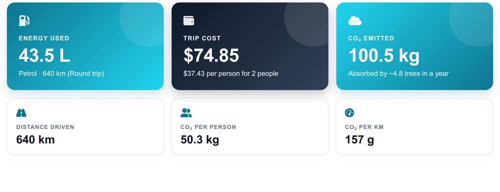
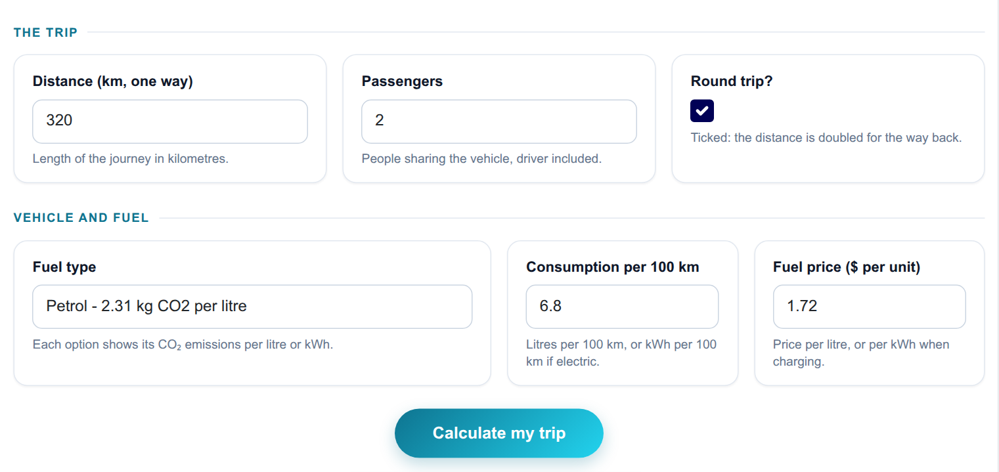
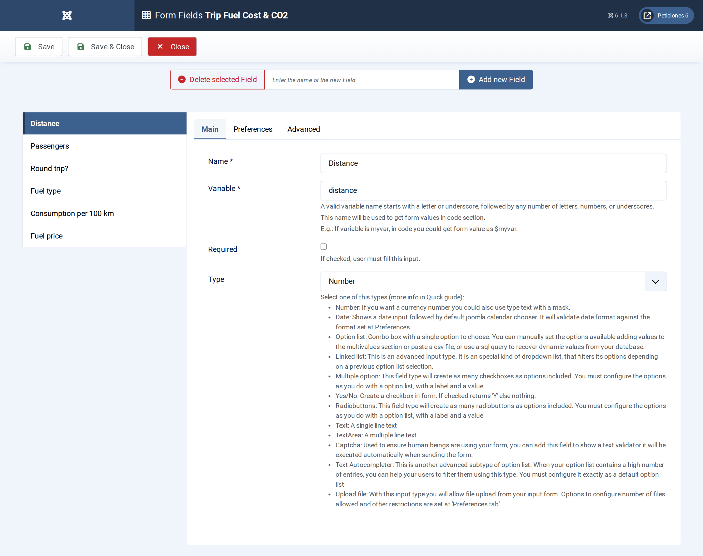
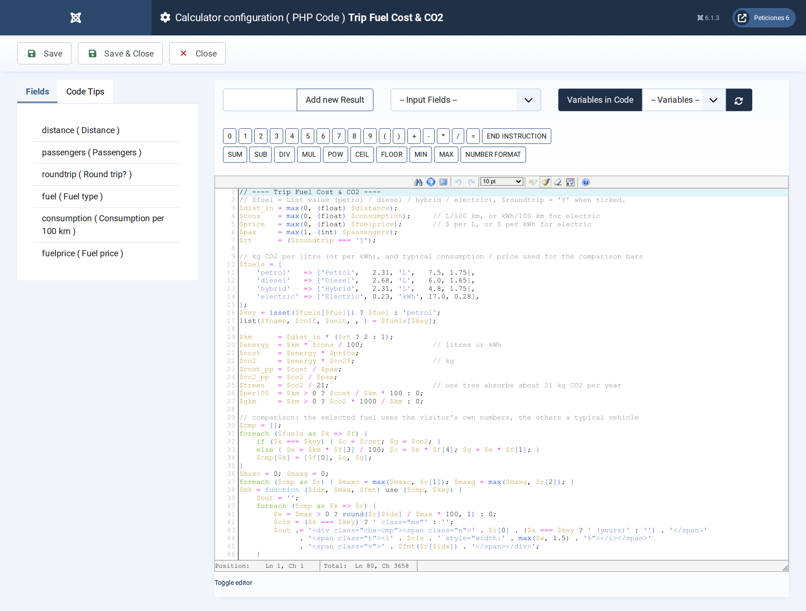
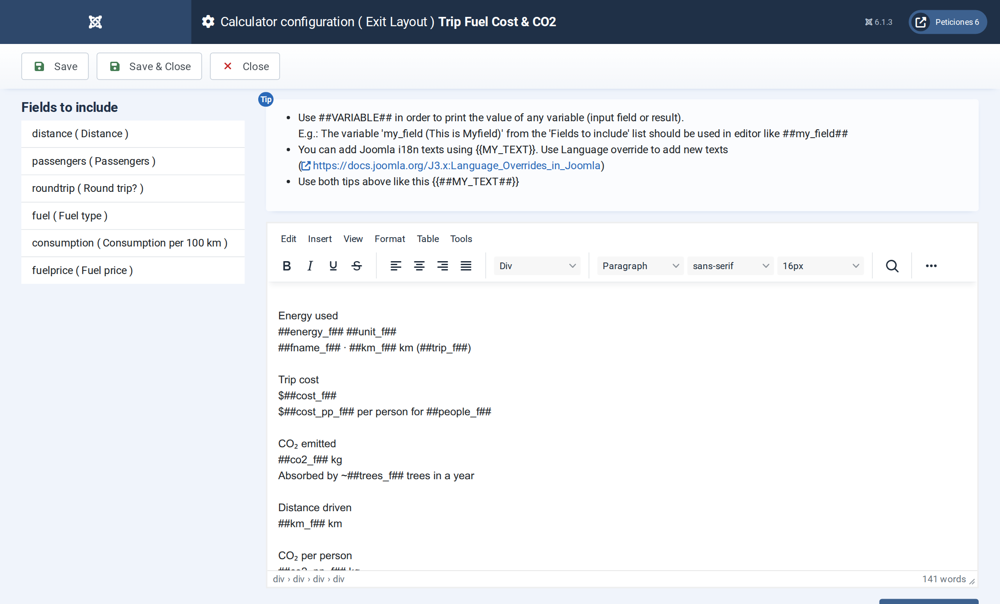

# Trip Fuel Cost & CO2

**Calc Builder example** · [Live demo](https://demo.moonsoft.es/trip-fuel-cost-co2) · [Import instructions](https://demo.moonsoft.es/trip-fuel-cost-co2)

Fuel or energy used, trip cost, cost per person, CO2 emitted and a tree equivalent for petrol, diesel, hybrid or electric, compared with the other fuel types.

The **Trip Fuel Cost & CO2** calculator prices a journey and shows its carbon footprint. Pick a fuel, enter distance, consumption and price, and see what the trip costs per person and how it compares with the other fuel types.

## What it calculates

A visitor picks a fuel type, enters a distance, consumption per 100 km, a fuel price and the number of passengers, and optionally ticks Round trip. The calculator returns:
- **Energy and cost** — litres or kWh used for the distance (doubled on a round trip) and the resulting cost, plus the cost per person and per 100 km.
- **CO2 emitted** — energy times the emission factor of the fuel: 2.31 kg per litre of petrol or hybrid fuel, 2.68 for diesel and 0.23 kg per kWh of electricity.
- **Trees equivalent** — the number of trees needed for a year to absorb that CO2, at about 21 kg per tree.
- **Fuel comparison** — paired bars for cost and CO2 across the four fuel types. The selected fuel uses the visitor’s own figures, the others a typical vehicle and price, with a sentence about the lowest-emission option.

## How it’s built

A **List** field carries the fuel with its emission factor in every label, two **Number** fields take the consumption and price, and a **Yes/No** field doubles the distance. The PHP Code keeps a single table of factors, typical consumptions and typical prices and reads the selected row by its option value.

The comparison bars are built in a PHP loop with a small closure that scales each value against the largest one and returns HTML, which the Exit Layout prints with `##cmp_cost##` and `##cmp_co2##`. Yes/No fields have no “ticked by default” option, so a two-line script in the Form Layout ticks Round trip on load.

## Files in this folder

- `trip-fuel-cost-co2_export.xml`
- `screenshots/` – images of the frontend and of the Calc Builder settings

## How to import

1. Open **Components › CalcBuilder › Import** in your Joomla administrator.
2. Upload the `*_export.xml` file of this folder.
3. If the folder contains an `.xlsx` model, upload it in the calculator's Excel settings.
4. Create a menu item of type *CalcBuilder* pointing to the imported calculator.

Full step-by-step instructions with the live result: **https://demo.moonsoft.es/trip-fuel-cost-co2**

## Screenshots

*Live result on the frontend*

*The input form as your visitors see it, styled with the Form Layout.*

*Six fields: a List for the fuel, Number fields for distance, passengers, consumption and price, and a Yes/No for the round trip.*

*The PHP Code: fuel table, trip energy, cost, CO2, the comparison bar builder and the lowest-emission sentence.*

*The Exit Layout: three hero cards, six metric cards and the side-by-side cost and CO2 comparison bars.*

---
Part of [Moonsoft demos](../../README.md) · [moonsoft.es](https://www.moonsoft.es) · [demo.moonsoft.es](https://demo.moonsoft.es)
