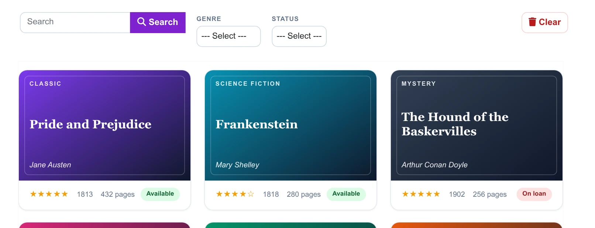
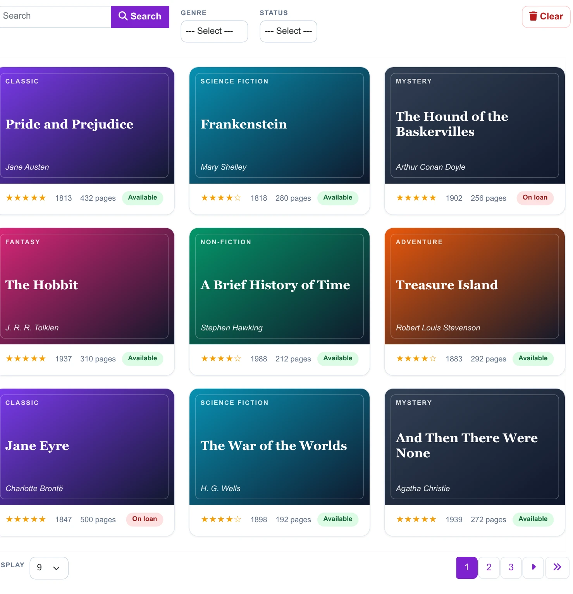
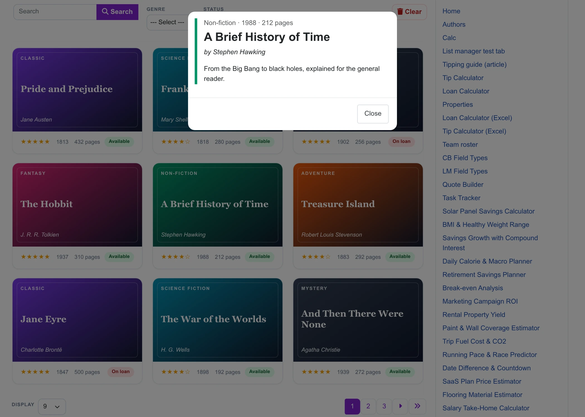
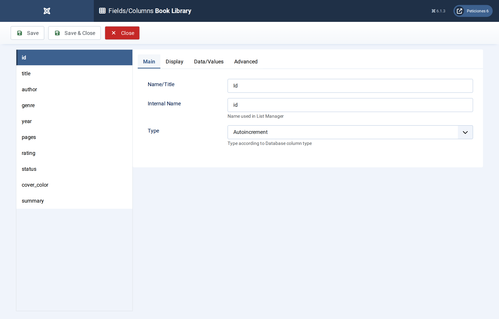
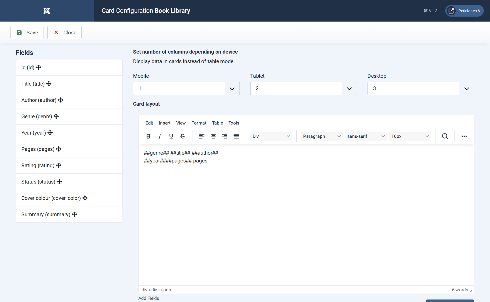
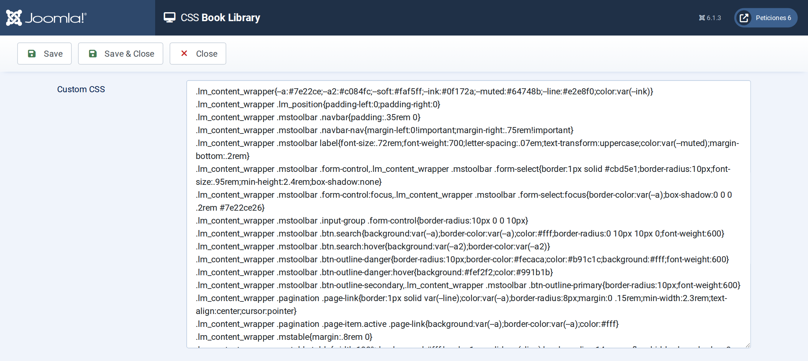

# Book Library

**List Manager example** · [Live demo](https://demo.moonsoft.es/book-library-import) · [Import instructions](https://demo.moonsoft.es/book-library-import)

A library catalogue shown as book-cover cards: search, genre and status filters, star ratings, an availability badge and a detail pop-up.

The **Book Library** list turns a plain MySQL table into a browsable catalogue. Every row becomes a book-cover card whose colour comes from the genre, and a click opens the book’s details in a pop-up.

## What it shows

The visitor can find and browse books quickly:
- **Card layout** — three columns on desktop, two on tablets and one on phones, each card built from the row’s fields.
- **Search and filters** — a search box over title, author and genre plus two drop-down filters (genre and status).
- **Ratings and status** — the numeric rating is drawn as stars and the status as a green or red badge, using only CSS.
- **Detail pop-up** — clicking a card opens a modal with the summary of the book.

## How it’s built

The list uses the **Card** layout: the card HTML is written once with `##field##` placeholders (title, author, genre, cover colour...) and List Manager repeats it for every row.

All the styling is in the list’s **CSS** screen. The cover colour is stored in a column of the table, so a designer can change a book’s look just by editing that value. Option-list columns (genre, status) give their label to the card, which is how the status badge picks its colour.

The database is the table `lm_books` with 24 sample rows (see the SQL download); the list configuration is a single XML file created with the **Export Configuration** button.

## Files in this folder

- `book-library_config.xml`
- `book-library.sql`
- `screenshots/` – images of the frontend and of the List Manager settings

## How to import

1. Run the `*.sql` file on your Joomla database (phpMyAdmin or the mysql client). It creates the sample table with its data.
2. Open **Components › List Manager › Import** and upload the `*_config.xml` file.
3. Create a menu item of type *List Manager* and select the imported list.

Full step-by-step instructions with the live result: **https://demo.moonsoft.es/book-library-import**

## Screenshots

*Live result on the frontend*

*The whole list on the frontend: toolbar with search and filters, card grid and pagination.*

*The detail pop-up that opens when a card is clicked.*

*Fields/Columns: ten columns with their types (text, option lists, numbers, textarea).*

*Display › Card: number of columns per device and the card HTML with its placeholders.*

*The CSS screen holds the whole design of the toolbar, pagination and cards.*

---
Part of [Moonsoft demos](../../README.md) · [moonsoft.es](https://www.moonsoft.es) · [demo.moonsoft.es](https://demo.moonsoft.es)
