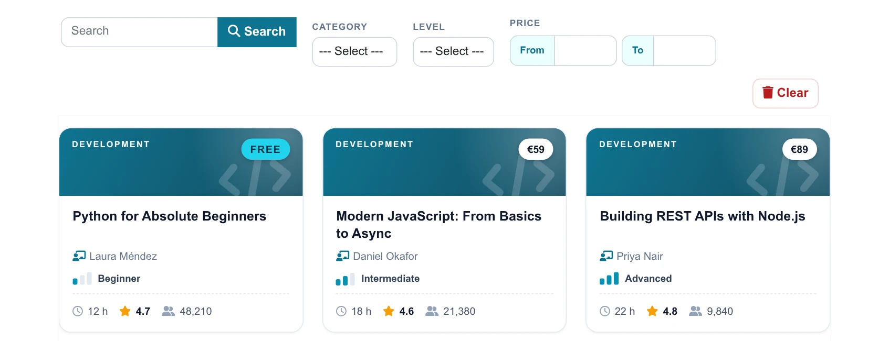
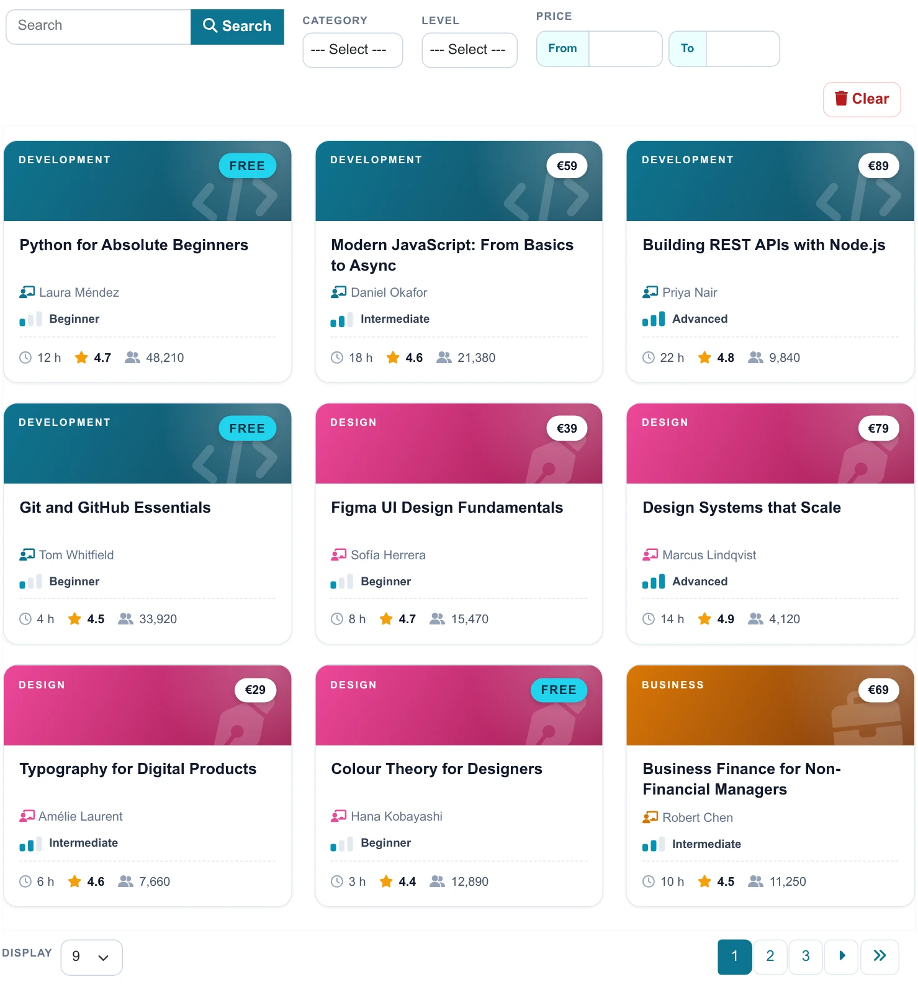
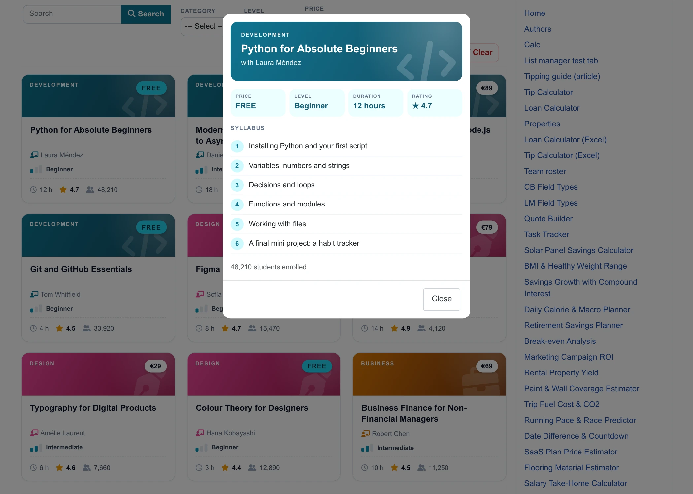
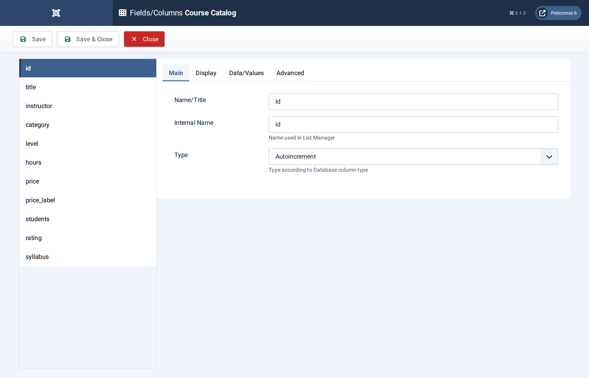
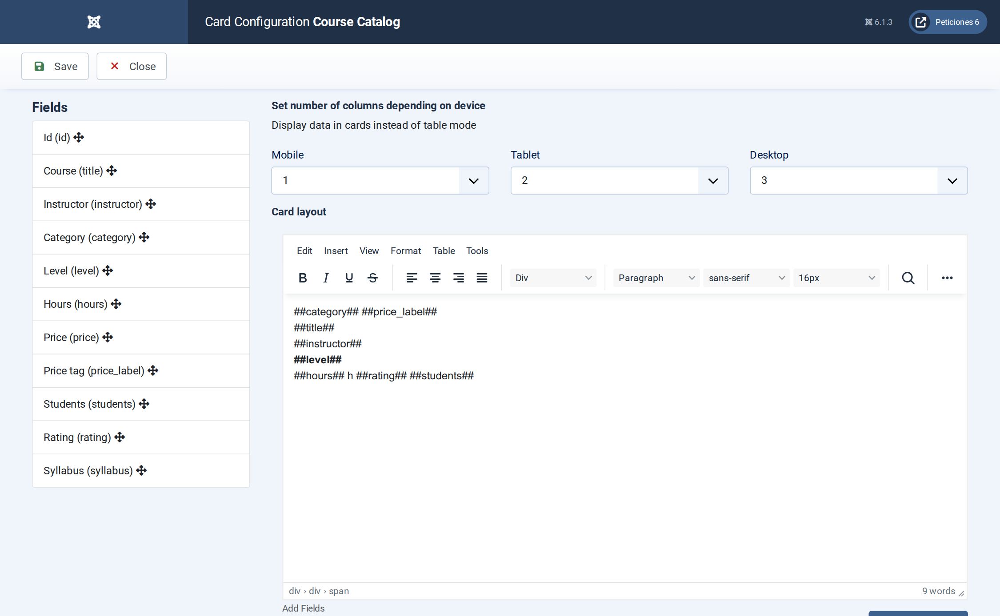
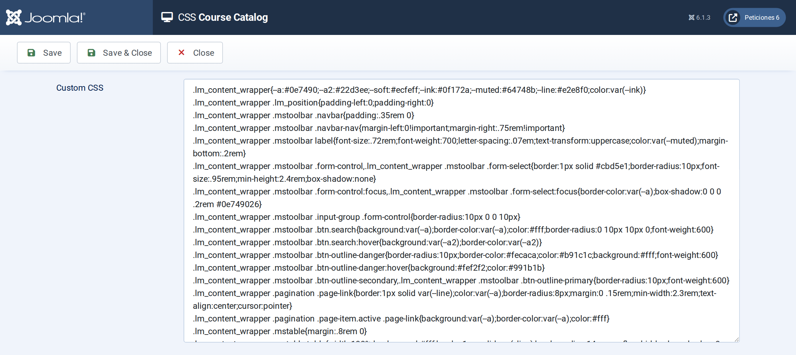

# Course Catalog

**List Manager example** · [Live demo](https://demo.moonsoft.es/course-catalog-import) · [Import instructions](https://demo.moonsoft.es/course-catalog-import)

An online course catalog as category-coloured cards: level meter, duration, rating, student count, FREE or price tag, price-range filter and a numbered syllabus pop-up.

The **Course Catalog** list shows 24 online courses as cards. The header colour and icon come from the category, a three-bar meter shows the level, and a tag shows either *FREE* or the price. A click opens the course with its numbered syllabus.

## What it shows

A learner can find the right course quickly:
- **Card layout** — three columns on desktop, two on tablets and one on phones, with a category-coloured header and icon.
- **Filters** — category and level drop-downs, a price range filter and a search box over title, instructor, category and syllabus.
- **Level meter and tags** — the level (Beginner, Intermediate, Advanced) fills one, two or three bars using only CSS; free courses get a FREE tag.
- **Detail pop-up** — clicking a card shows price, level, duration, rating and the syllabus as a numbered list.

## How it’s built

The list uses the **Card** layout with `##field##` placeholders. The category and level labels are single words, so the card can use them as CSS classes (`c-Data`, `lv-Advanced`) that pick the header colour and the number of filled bars. The price is stored as a number for the range filter and as a text column (`price_label`, FREE or €49) for the tag.

The syllabus is stored as one text column with the modules separated by semicolons; a few lines in the list’s **Javascript** screen turn it into a numbered list inside the pop-up. The student count uses the list’s thousands separator.

The database is the table `lm_courses` with 24 sample rows (see the SQL download); the list configuration is a single XML file created with the **Export Configuration** button.

## Files in this folder

- `course-catalog_config.xml`
- `course-catalog.sql`
- `screenshots/` – images of the frontend and of the List Manager settings

## How to import

1. Run the `*.sql` file on your Joomla database (phpMyAdmin or the mysql client). It creates the sample table with its data.
2. Open **Components › List Manager › Import** and upload the `*_config.xml` file.
3. Create a menu item of type *List Manager* and select the imported list.

Full step-by-step instructions with the live result: **https://demo.moonsoft.es/course-catalog-import**

## Screenshots

*Live result on the frontend*

*The whole list on the frontend: toolbar with search and filters, course cards and pagination.*

*The detail pop-up that opens when a card is clicked.*

*Fields/Columns: the columns with their types (text, option lists, numbers, textarea).*

*Display › Card: number of columns per device and the card HTML with its placeholders.*

*The CSS screen holds the whole design of the toolbar, pagination, cards and detail pop-up.*

---
Part of [Moonsoft demos](../../README.md) · [moonsoft.es](https://www.moonsoft.es) · [demo.moonsoft.es](https://demo.moonsoft.es)
