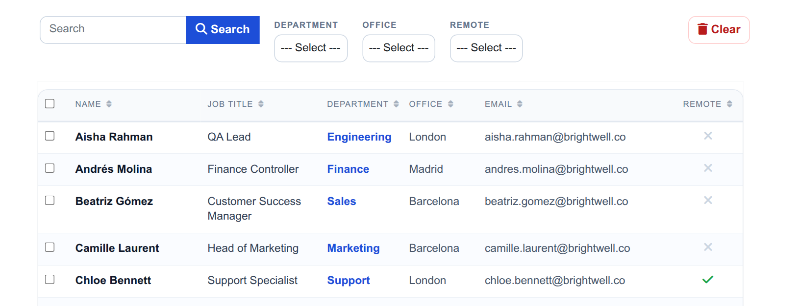
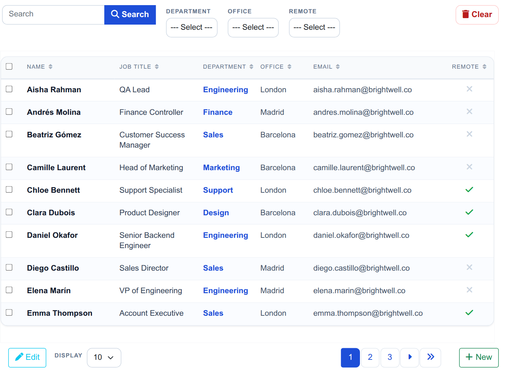
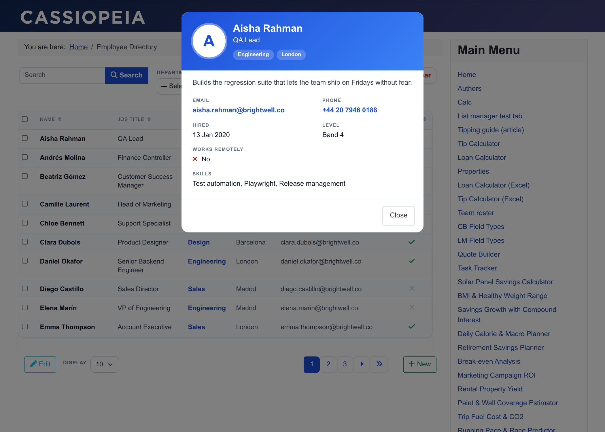
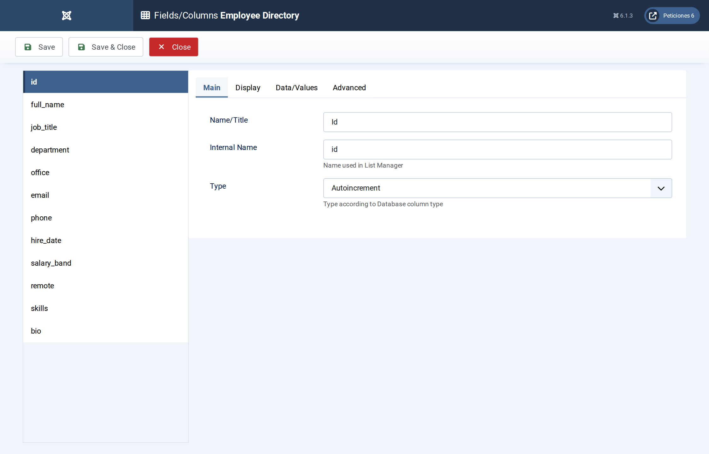
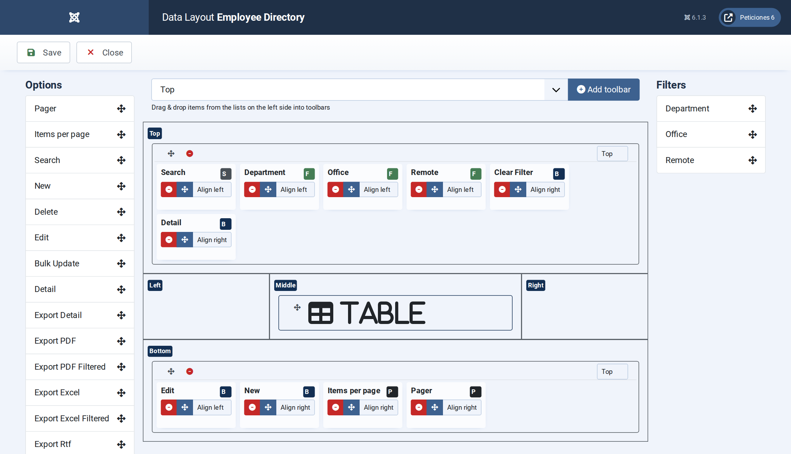
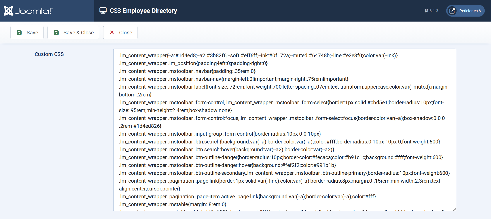

# Employee Directory

**List Manager example** · [Live demo](https://demo.moonsoft.es/employee-directory-import) · [Import instructions](https://demo.moonsoft.es/employee-directory-import)

A staff directory as a clean data table: department, office and remote filters, search over name, title and skills, a contact-card pop-up and a styled add/edit form.

The **Employee Directory** list turns a plain MySQL table into a searchable staff directory. It uses the **Table** layout, a hand-styled toolbar, a contact-card detail pop-up and an add/edit form laid out in sections.

## What it shows

What a visitor can do:
- **Table layout** — name, job title, department, office, email and a Yes/No remote icon, sorted by name and paginated; hire date, phone, level and skills live in the pop-up and on the phone cards.
- **Search and filters** — one search box over name, job title and skills, plus three drop-down filters: department, office and remote.
- **Contact card** — clicking a row opens a pop-up with an avatar initial, department and office badges, bio, clickable email and phone, level and skills.
- **Add and edit form** — the New and Edit buttons open a sectioned form (Who, Work, Contact, About) with a toggle switch for remote work.
- **Phone layout** — on narrow screens List Manager stacks every row; the CSS turns each stacked row into a small card.

## How it’s built

The columns are ordinary table columns. Department, office and band are **Option list** fields, remote is **Yes/No** (shown as a tick or a cross), hire date is a **Date** field and bio is a **Textarea**. The hire date, phone, band, skills and bio columns are kept for the pop-up, the form, search and export, and are hidden from the table with CSS so the table stays airy.

Column widths are set in the **CSS** screen with `td.<column>` and `th[data-id=<column>]` rules. The add/edit form is the **Form Layout**: plain HTML with `##field##` placeholders inside sections and a grid, styled in the same CSS.

The database is the table `lm_employees` with 30 sample rows (see the SQL download); the list configuration is a single XML file created with the **Export Configuration** button.

## Files in this folder

- `employee-directory_config.xml`
- `employee-directory.sql`
- `screenshots/` – images of the frontend and of the List Manager settings

## How to import

1. Run the `*.sql` file on your Joomla database (phpMyAdmin or the mysql client). It creates the sample table with its data.
2. Open **Components › List Manager › Import** and upload the `*_config.xml` file.
3. Create a menu item of type *List Manager* and select the imported list.

Full step-by-step instructions with the live result: **https://demo.moonsoft.es/employee-directory-import**

## Screenshots

*Live result on the frontend*

*The whole list on the frontend: search, three filters, the table and pagination with Edit and New buttons.*

*The contact-card pop-up that opens when a row is clicked.*

*Fields/Columns: the twelve columns with their types (text, option lists, date, Yes/No, textarea).*

*Display › Data Layout: the toolbar rows, filters and table position.*

*The CSS screen: column widths, the phone card layout, the contact card and the form styling.*

---
Part of [Moonsoft demos](../../README.md) · [moonsoft.es](https://www.moonsoft.es) · [demo.moonsoft.es](https://demo.moonsoft.es)
