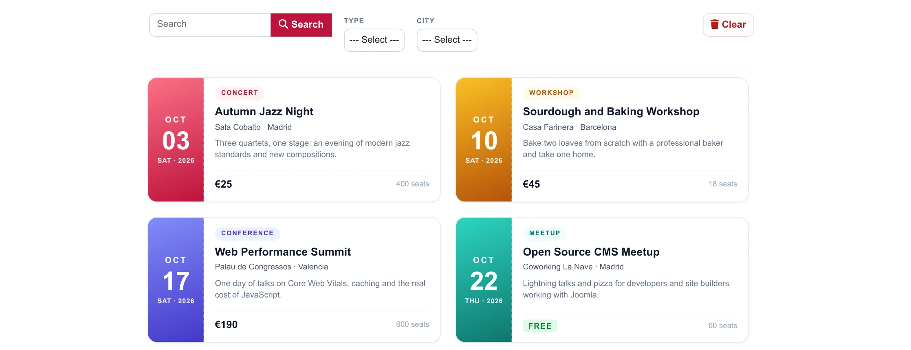
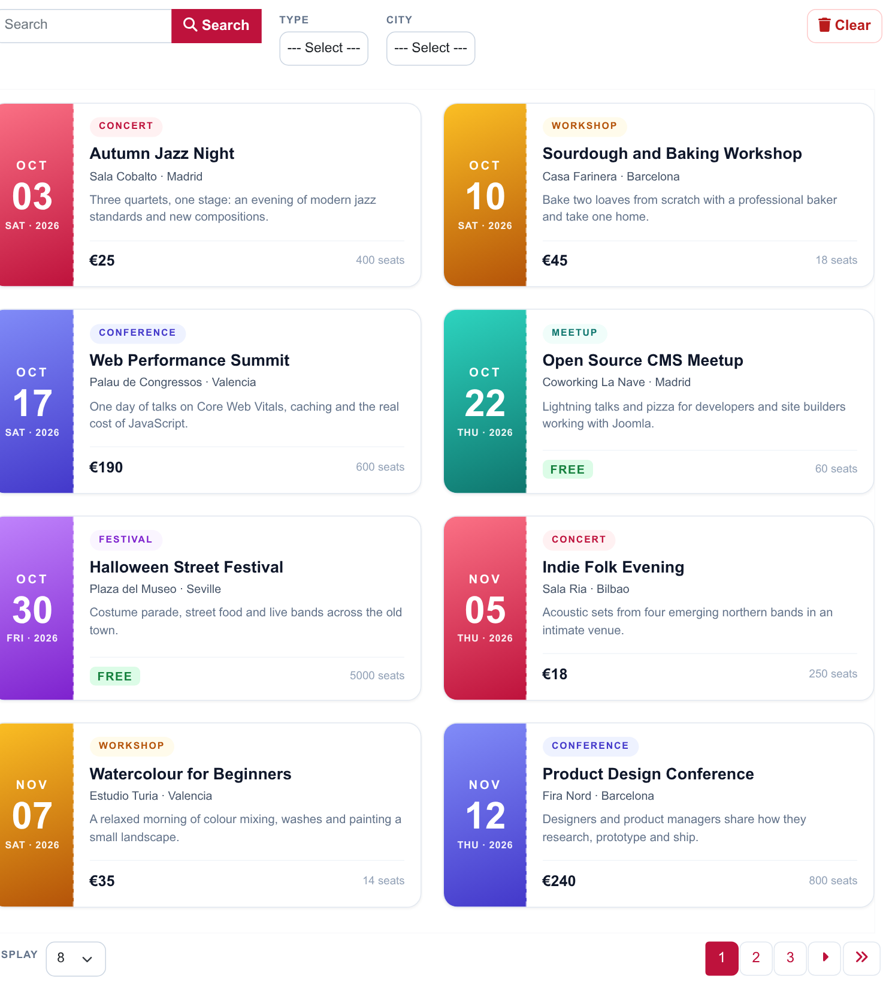
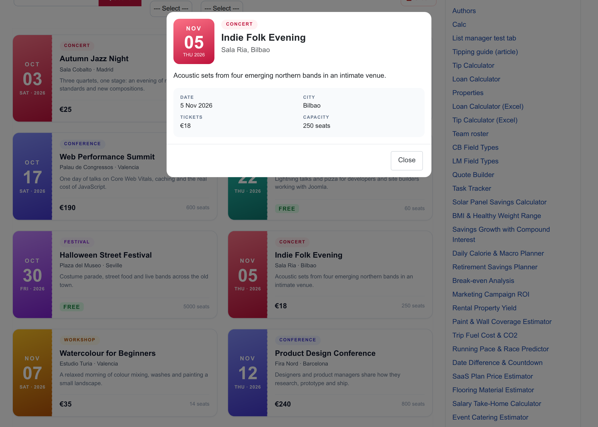
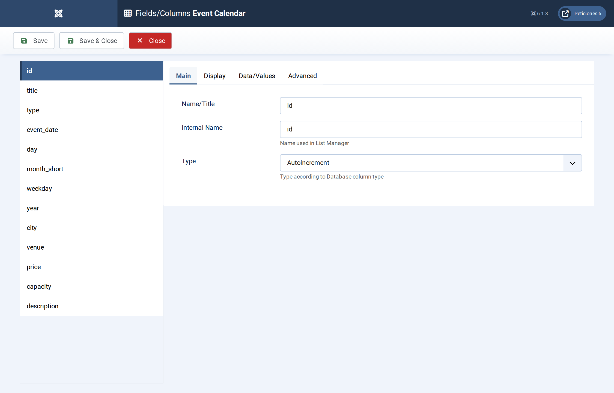
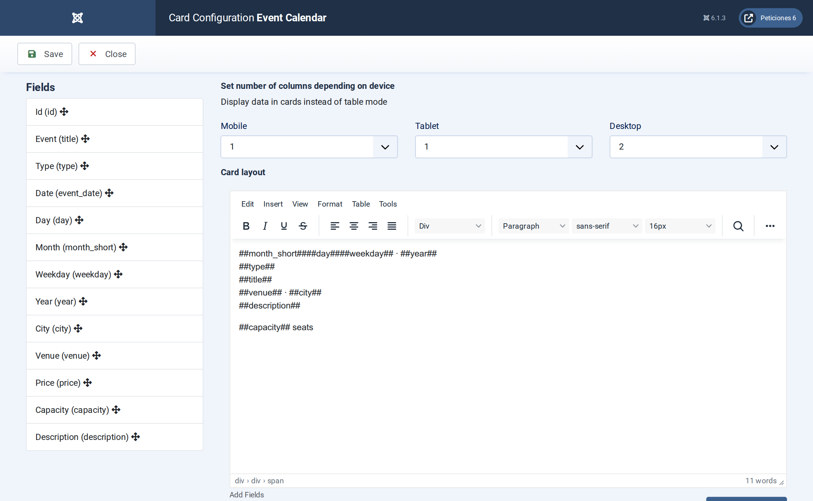
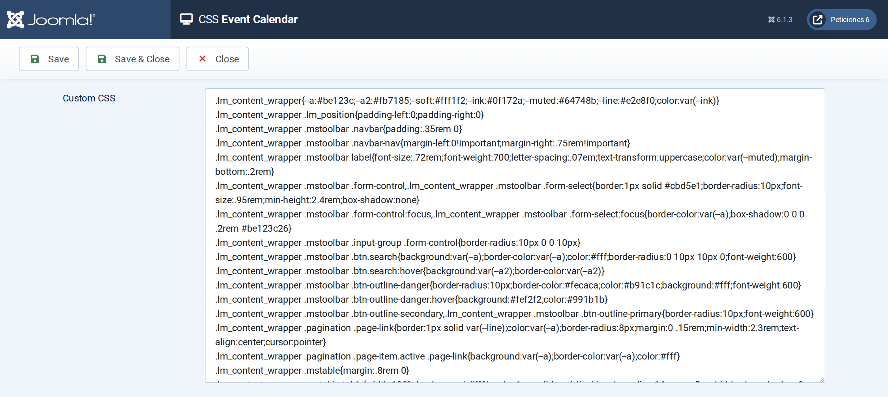

# Event Calendar

**List Manager example** · [Live demo](https://demo.moonsoft.es/event-calendar-import) · [Import instructions](https://demo.moonsoft.es/event-calendar-import)

An event programme for October 2026 to March 2027 as ticket-style cards: calendar date tile, type chip, venue, price or FREE, type and city filters, always ordered by date.

The **Event Calendar** list turns a table of events into a season programme. Every row becomes a ticket-style card with a calendar date tile, and a click opens the full details in a pop-up.

## What it shows

Visitors see what is on next, in date order:
- **Default order by date** — the table is stored in no particular order; the list is configured to sort by the `event_date` column, oldest first.
- **Card layout** — two ticket cards per row on desktop, one on tablets and phones.
- **Search and filters** — a search box over title, venue and description plus type and city drop-downs.
- **Date tile, chip and price** — month, day and weekday sit in a coloured tile whose colour depends on the event type; the price shows as “FREE” when it is 0, using only CSS.
- **Detail pop-up** — clicking a card opens the event with date, city, tickets and capacity.

## How it’s built

The list uses the **Card** layout. `event_date` is a real **Date** column used for ordering (Display › Default order), while `day`, `month_short` and `weekday` are plain text columns feeding the date tile, so no script is needed.

The price column is a plain number; a CSS attribute selector on `data-p="0"` turns it into a FREE label. All dates are fixed (October 2026 to March 2027), so nothing depends on today’s date.

The database is the table `lm_events` with 24 sample rows (see the SQL download); the list configuration is a single XML file created with the **Export Configuration** button.

## Files in this folder

- `event-calendar_config.xml`
- `event-calendar.sql`
- `screenshots/` – images of the frontend and of the List Manager settings

## How to import

1. Run the `*.sql` file on your Joomla database (phpMyAdmin or the mysql client). It creates the sample table with its data.
2. Open **Components › List Manager › Import** and upload the `*_config.xml` file.
3. Create a menu item of type *List Manager* and select the imported list.

Full step-by-step instructions with the live result: **https://demo.moonsoft.es/event-calendar-import**

## Screenshots

*Live result on the frontend*

*The whole list on the frontend: toolbar with search and filters, event cards ordered by date and pagination.*

*The detail pop-up with date, place, tickets and capacity.*

*Fields/Columns: thirteen columns with their types (text, option lists, date, numbers, textarea).*

*Display › Card: number of columns per device and the card HTML with its placeholders.*

*The CSS screen holds the toolbar, pagination and ticket-card design.*

---
Part of [Moonsoft demos](../../README.md) · [moonsoft.es](https://www.moonsoft.es) · [demo.moonsoft.es](https://demo.moonsoft.es)
