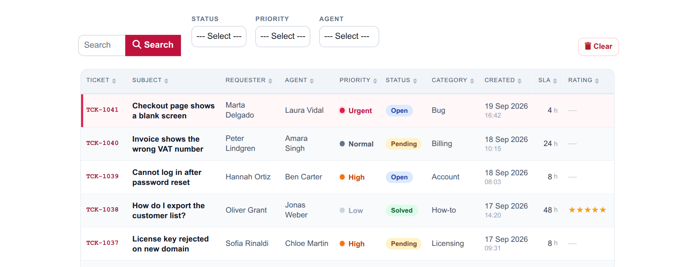
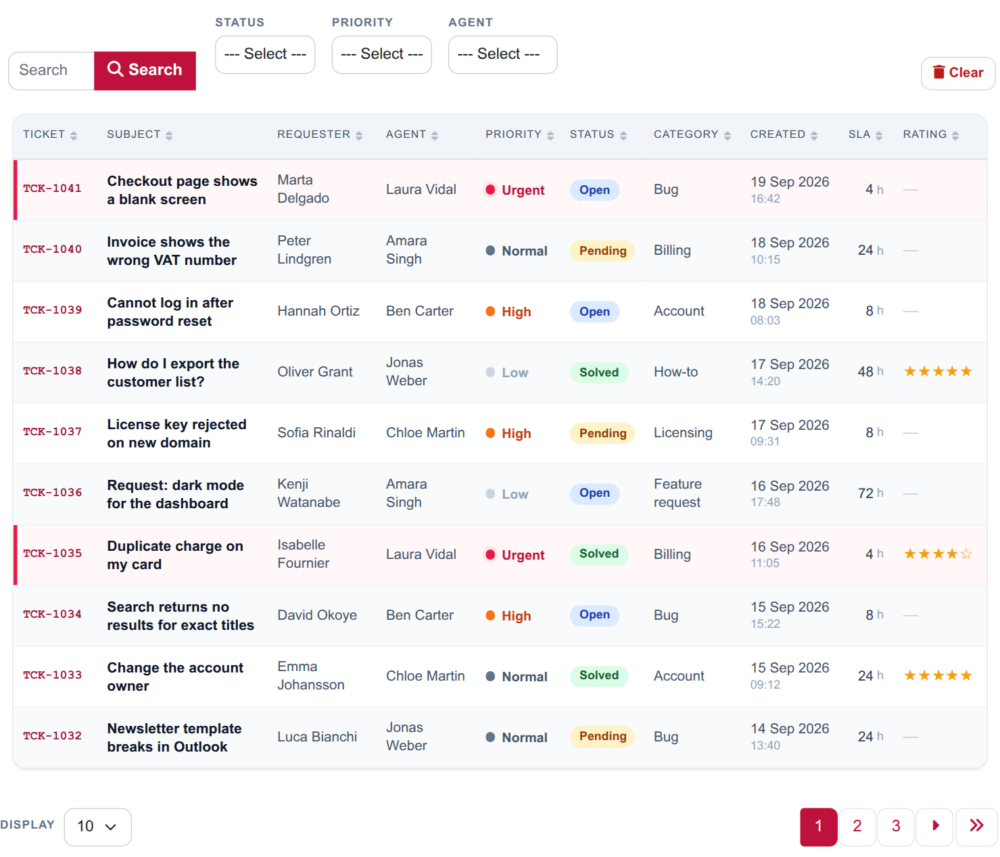
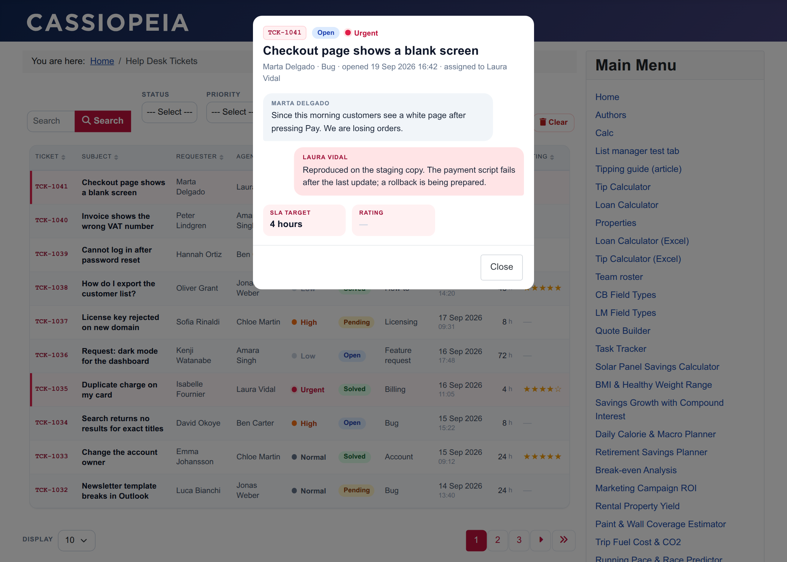
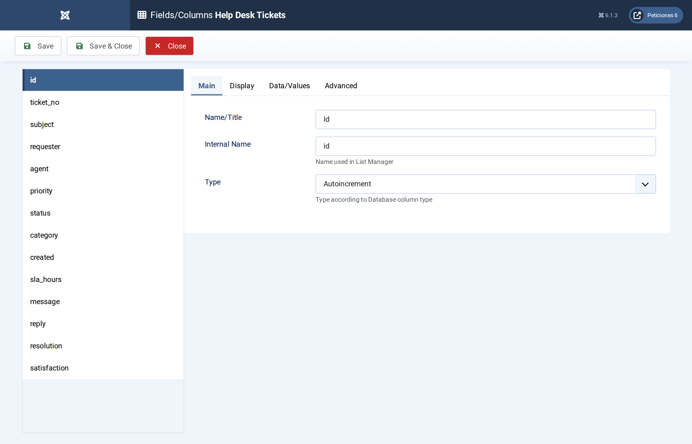
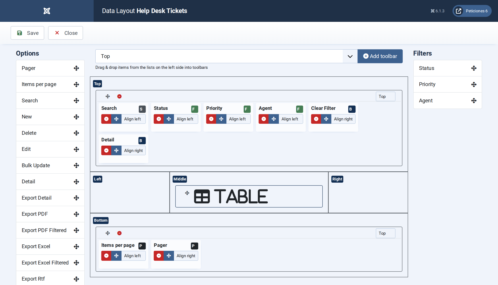
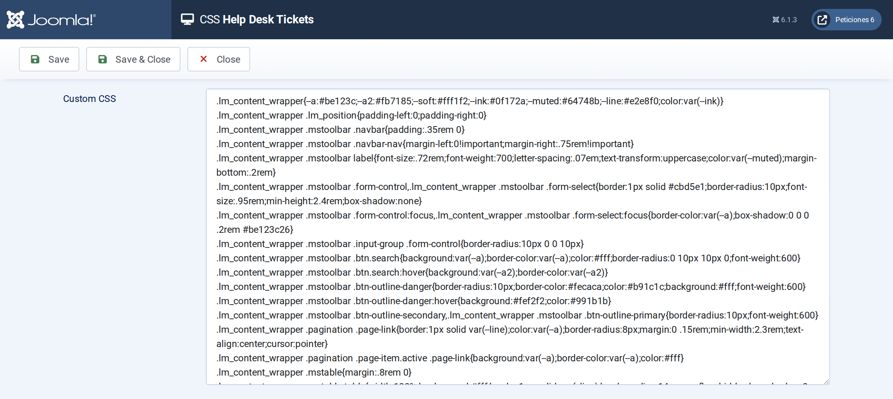

# Help Desk Tickets

**List Manager example** · [Live demo](https://demo.moonsoft.es/help-desk-tickets-import) · [Import instructions](https://demo.moonsoft.es/help-desk-tickets-import)

A support help-desk queue with status pills, priority dots, star ratings, urgent rows highlighted, three filters and a chat-style detail pop-up.

The **Help Desk Tickets** list shows a support team’s queue of thirty tickets, newest first. Agents can scan priorities and statuses at a glance, and a click on a ticket opens the conversation summary.

## What it shows

What a support lead sees on the screen:
- **Readable statuses and priorities** — List Manager prints plain text in table cells, so a few lines of Javascript wrap the status, priority and rating values in a  with a data attribute and the CSS colours them: status pills, priority dots and star ratings.
- **Urgent rows** — a CSS `:has()` rule gives every row that contains an urgent priority a rose edge and a tinted background.
- **Sorting that follows the workflow** — priority and status are stored as codes 1–4 in the table and mapped to labels by the option list, so sorting the Priority column orders by urgency instead of alphabetically.
- **Date and time** — the *Created* field is a Datetime field; the list script shows the date and the time on two lines.
- **Search and filters** — a search box over ticket number, subject, requester and the customer message, plus filters for status, priority and agent.
- **Conversation pop-up** — the detail view shows the customer message and the agent’s reply as chat bubbles, the resolution note and the SLA target.

## How it’s built

The list uses the **Table** layout. The message, reply and resolution columns are loaded but hidden in the table with CSS, so they are available to the detail pop-up (and the message to the search) without making the table too wide. Column widths use `td.<column>` and `th[data-id=<column>]` selectors.

Note that the field settings *CSS class*, *prefix* and *suffix* only apply to the edit form, not to table cells; per-value colours therefore come from the small script on the **Javascript** screen (it re-runs after every filter, sort or page change).

The database is the table `lm_tickets` with 30 sample rows (see the SQL download); the list configuration is a single XML file created with the **Export Configuration** button.

## Files in this folder

- `help-desk-tickets_config.xml`
- `help-desk-tickets.sql`
- `screenshots/` – images of the frontend and of the List Manager settings

## How to import

1. Run the `*.sql` file on your Joomla database (phpMyAdmin or the mysql client). It creates the sample table with its data.
2. Open **Components › List Manager › Import** and upload the `*_config.xml` file.
3. Create a menu item of type *List Manager* and select the imported list.

Full step-by-step instructions with the live result: **https://demo.moonsoft.es/help-desk-tickets-import**

## Screenshots

*Live result on the frontend*

*The whole list on the frontend: search, three filters and the ticket table with status pills, priority dots and ratings.*

*The detail pop-up: ticket header, the customer and agent messages as chat bubbles, the resolution note and the SLA target.*

*Fields/Columns: ticket data with option lists (value codes and labels), a Datetime field and textareas for the conversation.*

*Display › Data Layout: table layout, formats and the default order (created, newest first).*

*The CSS screen holds the column widths, the pill / dot / star styling, the urgent-row rule and the chat-style pop-up.*

---
Part of [Moonsoft demos](../../README.md) · [moonsoft.es](https://www.moonsoft.es) · [demo.moonsoft.es](https://demo.moonsoft.es)
