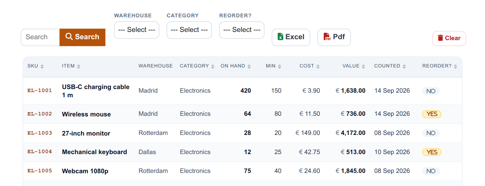
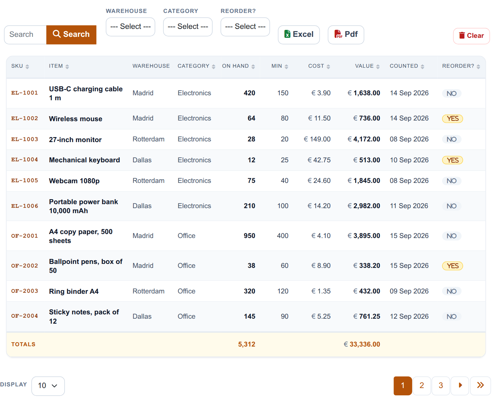
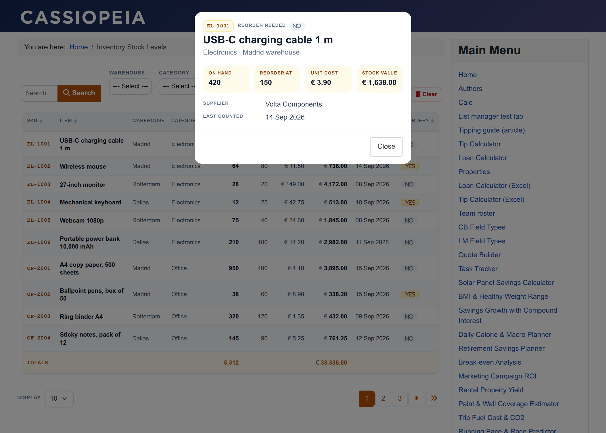
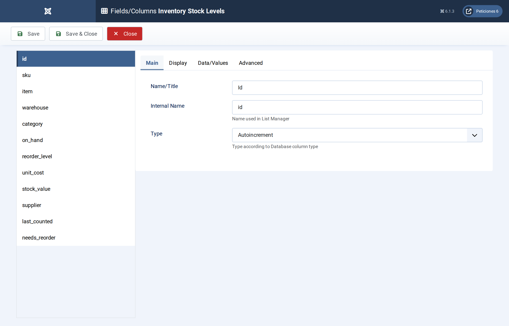
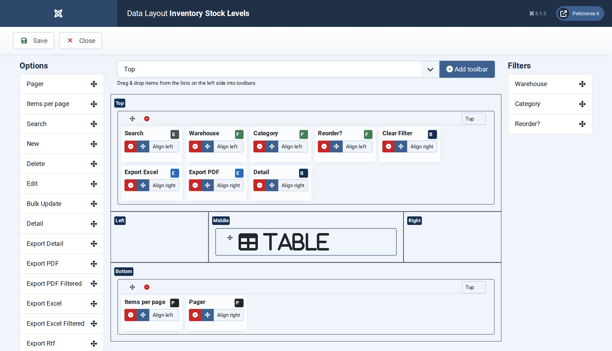
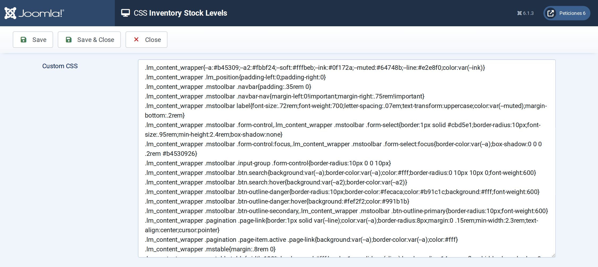

# Inventory Stock Levels

**List Manager example** · [Live demo](https://demo.moonsoft.es/inventory-stock-levels-import) · [Import instructions](https://demo.moonsoft.es/inventory-stock-levels-import)

A warehouse stock list with totals for units and stock value, reorder badges, three filters, search and one-click Excel and PDF export.

The **Inventory Stock Levels** list shows thirty SKUs spread over three warehouses. It is the kind of list a purchasing team keeps open: what is on the shelf, what it is worth, and which items are at or below their reorder level.

## What it shows

The visitor can check stock and take the data away:
- **Totals row** — the *On hand* and *Value* columns have the Total option, so the table ends with a totals row for the filtered list.
- **Reorder badges** — the *Reorder?* column is a Yes/No field; List Manager prints a tick or a cross and the CSS turns those icons into amber “Yes” / grey “No” badges.
- **Search and filters** — one search box over SKU, item and supplier (the supplier column is searchable although the table hides it) and drop-down filters for warehouse, category and reorder status.
- **Excel and PDF export** — two toolbar buttons download the list as an .xlsx or a PDF file, with the current search and filters applied.
- **Detail pop-up** — clicking a row opens the item card with stock, reorder level, unit cost, stock value, supplier and last count date.

## How it’s built

The list uses the **Table** layout with eleven columns. The stock value is stored in the table (on hand × unit cost), so the totals row and the sorting work on real numbers. Money columns get their currency sign from CSS, and column widths are set with `td.<column>` and `th[data-id=<column>]` selectors in the **CSS** screen.

The toolbar is the standard one plus the `export.excel` and `export.pdf` buttons. On phones each row is turned into a small card by the CSS.

The database is the table `lm_inventory` with 30 sample rows (see the SQL download); the list configuration is a single XML file created with the **Export Configuration** button.

## Files in this folder

- `inventory-stock_config.xml`
- `inventory-stock.sql`
- `screenshots/` – images of the frontend and of the List Manager settings

## How to import

1. Run the `*.sql` file on your Joomla database (phpMyAdmin or the mysql client). It creates the sample table with its data.
2. Open **Components › List Manager › Import** and upload the `*_config.xml` file.
3. Create a menu item of type *List Manager* and select the imported list.

Full step-by-step instructions with the live result: **https://demo.moonsoft.es/inventory-stock-levels-import**

## Screenshots

*Live result on the frontend*

*The whole list on the frontend: search, filters, Excel and PDF buttons, the stock table and its totals row.*

*The detail pop-up with the item card.*

*Fields/Columns: the SKU, text, option list, number (with totals), date and Yes/No columns.*

*Display › Data Layout: table layout, date and number formats and pagination defaults.*

*The CSS screen holds the column widths, the reorder badges, the totals row and the phone layout.*

---
Part of [Moonsoft demos](../../README.md) · [moonsoft.es](https://www.moonsoft.es) · [demo.moonsoft.es](https://demo.moonsoft.es)
