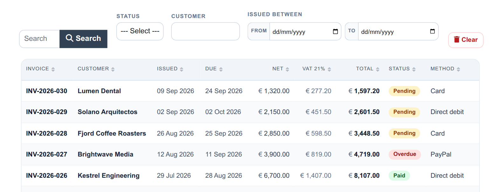
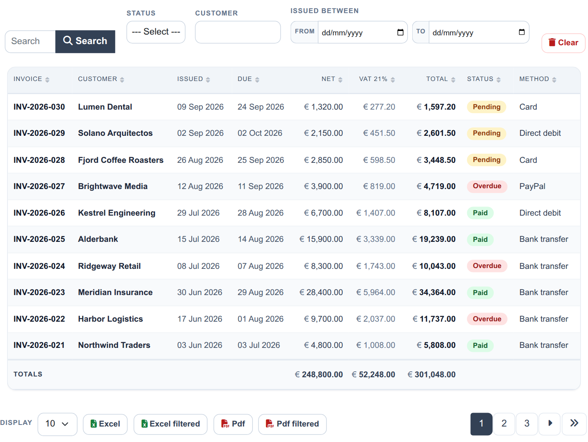
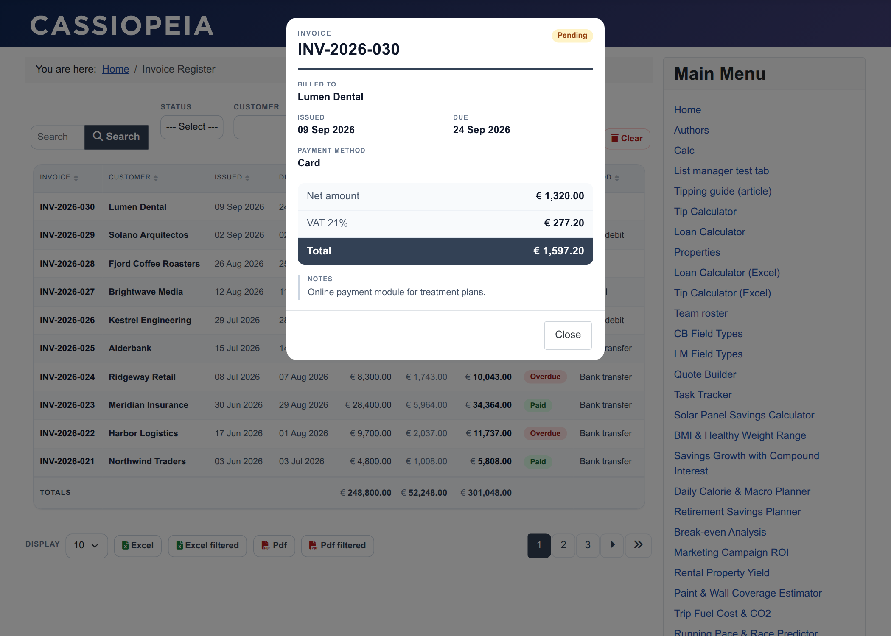
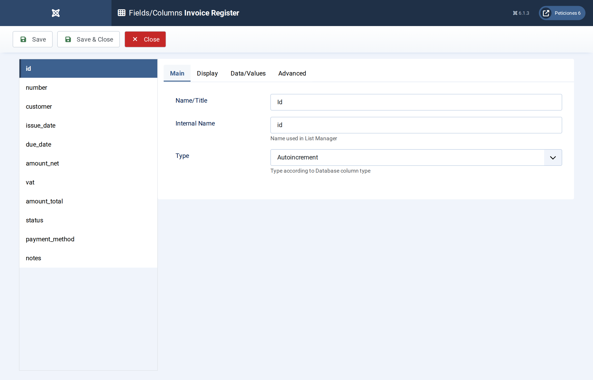
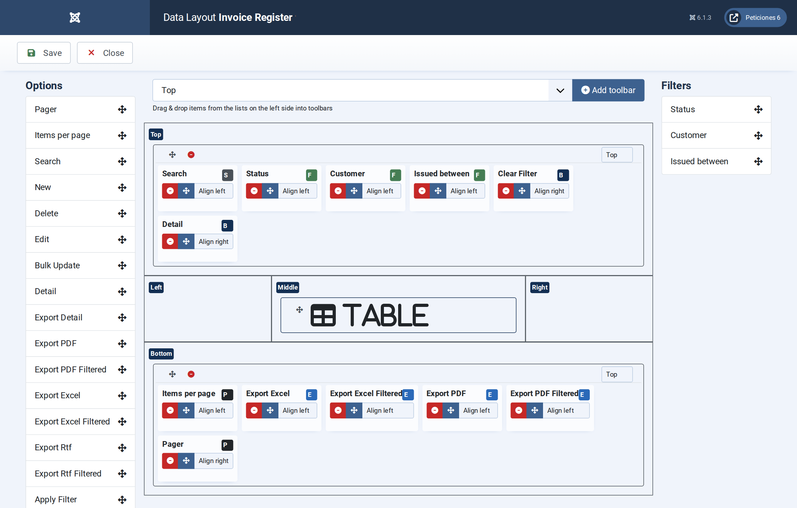
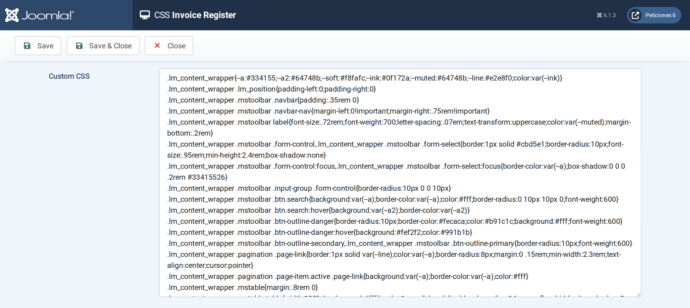

# Invoice Register

**List Manager example** · [Live demo](https://demo.moonsoft.es/invoice-register-import) · [Import instructions](https://demo.moonsoft.es/invoice-register-import)

A sales-invoice register with totals for net, VAT and gross, paid / pending / overdue badges, a date-range filter, four export buttons and an invoice-style detail pop-up.

The **Invoice Register** list keeps thirty 2026 invoices in one sortable table, newest first. It is a small accounts-receivable view: who was billed, how much, and what is still outstanding.

## What it shows

The visitor can look up invoices and export exactly what is on screen:
- **Default order** — the list opens with the newest invoice first; the default order (issue date, descending) is set on the Display › Data Layout screen.
- **Totals** — net, VAT and total have the Total option, so the table ends with a sums row (it follows the current filters).
- **Filters** — a status drop-down, a customer text filter that narrows the list while you type, and an *Issued between* date-range filter with From and To pickers.
- **Export buttons** — Excel and PDF, each in two flavours: the whole list and the *filtered* version that only contains the rows matching the current search and filters.
- **Status badges** — paid, pending and overdue are coloured with a few lines of Javascript that add a data attribute to the cell.
- **Invoice pop-up** — clicking a row opens the invoice as a small document: number, customer, dates, net / VAT / total lines and the notes.

## How it’s built

The list uses the **Table** layout. Amounts are stored as decimals, the currency sign is added by CSS, and the column widths are set with `td.<column>` and `th[data-id=<column>]` rules in the **CSS** screen. The Notes column is loaded but hidden in the table, so it is available for search and for the pop-up.

The four export buttons are toolbar elements (`export.excel`, `export.excel.filtered`, `export.pdf`, `export.pdf.filtered`) placed next to the pagination. The date-range filter is a filter of type *Range* on the issue-date column. On phones the table rows become compact cards.

The database is the table `lm_invoices` with 30 sample rows (see the SQL download); the list configuration is a single XML file created with the **Export Configuration** button.

## Files in this folder

- `invoice-register_config.xml`
- `invoice-register.sql`
- `screenshots/` – images of the frontend and of the List Manager settings

## How to import

1. Run the `*.sql` file on your Joomla database (phpMyAdmin or the mysql client). It creates the sample table with its data.
2. Open **Components › List Manager › Import** and upload the `*_config.xml` file.
3. Create a menu item of type *List Manager* and select the imported list.

Full step-by-step instructions with the live result: **https://demo.moonsoft.es/invoice-register-import**

## Screenshots

*Live result on the frontend*

*The whole list on the frontend: search, status, customer and date-range filters, the invoice table with its totals row, and the export buttons.*

*The detail pop-up laid out like an invoice summary.*

*Fields/Columns: invoice number, customer, dates, decimal amounts with totals, option lists and notes.*

*Display › Data Layout: table layout, formats and the default order (issue date, newest first).*

*The CSS screen holds the column widths, the totals row, the status badges, the phone layout and the invoice pop-up.*

---
Part of [Moonsoft demos](../../README.md) · [moonsoft.es](https://www.moonsoft.es) · [demo.moonsoft.es](https://demo.moonsoft.es)
