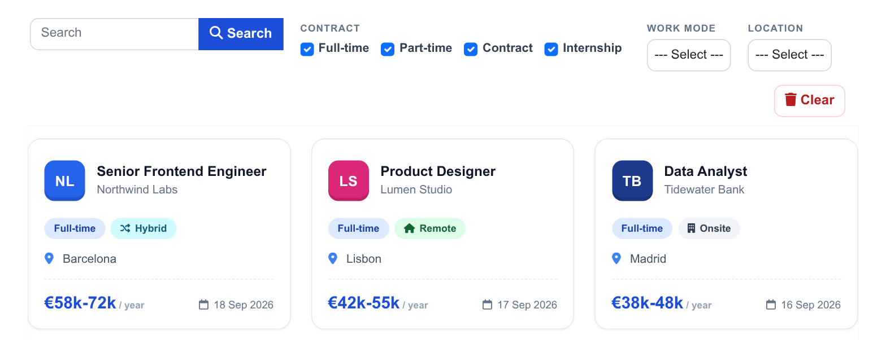
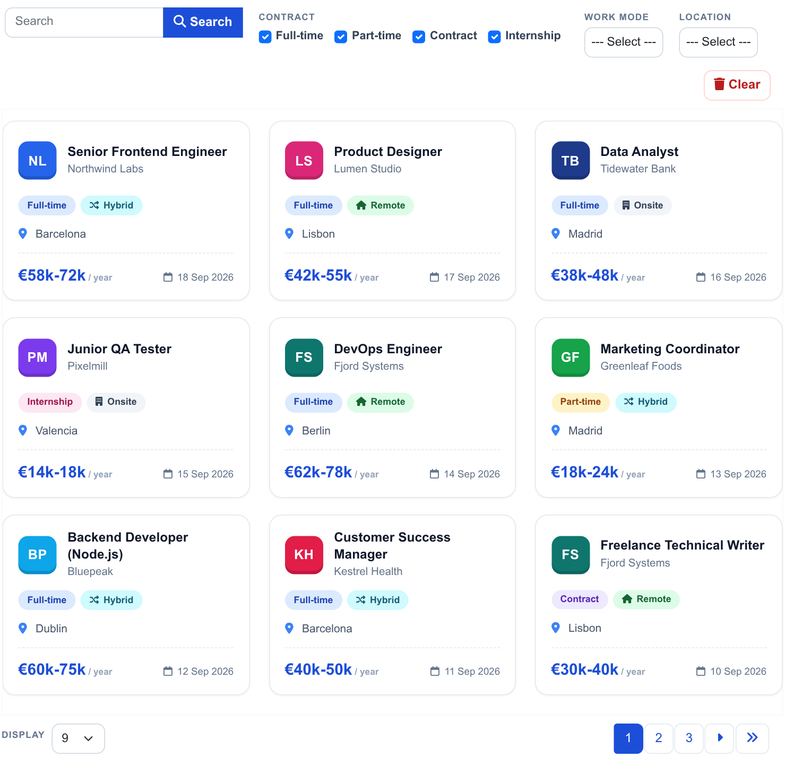
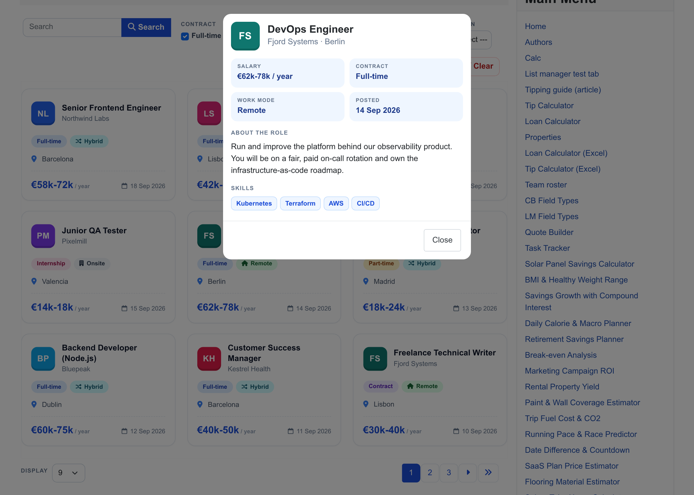
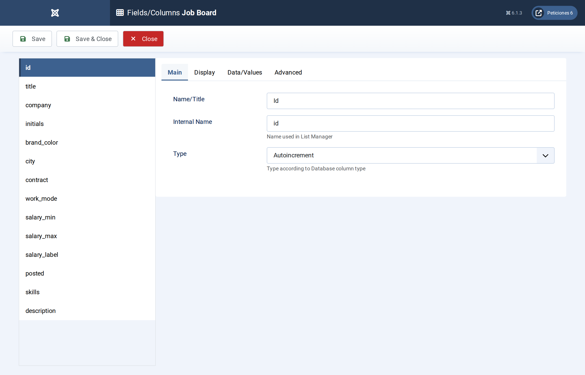
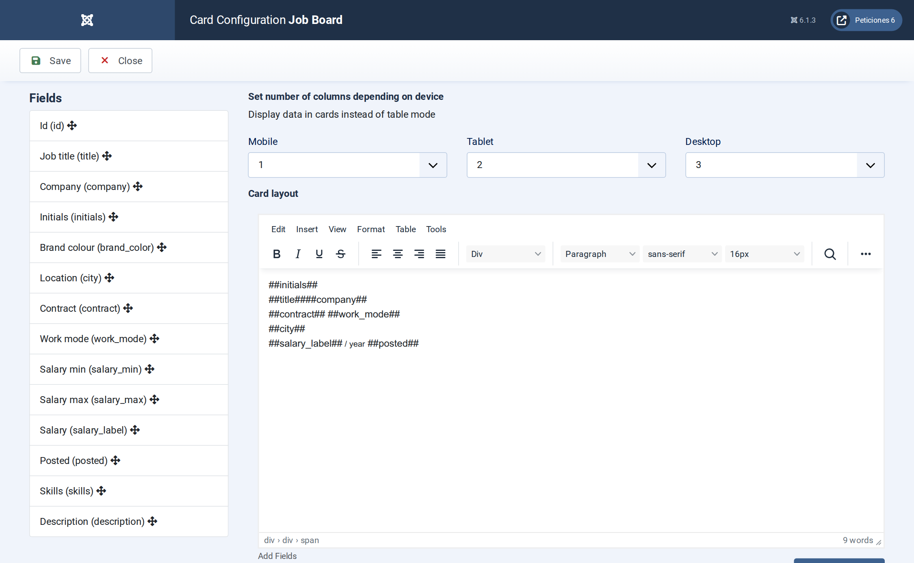
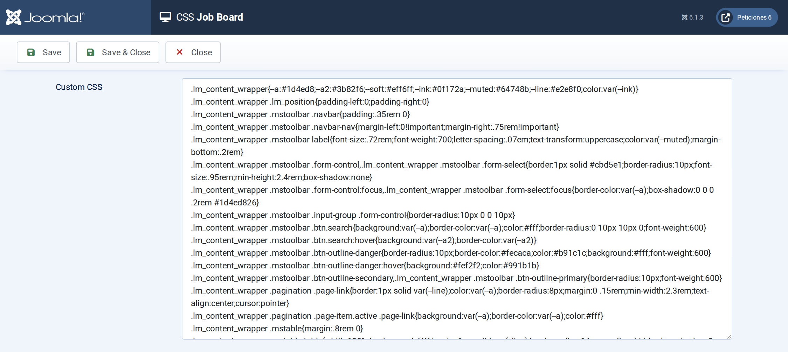

# Job Board

**List Manager example** · [Live demo](https://demo.moonsoft.es/job-board-import) · [Import instructions](https://demo.moonsoft.es/job-board-import)

A job board of 24 offers as company-monogram cards: search, contract-type checkboxes, work-mode and location filters, salary range and a detail pop-up with skills.

The **Job Board** list turns a MySQL table of job offers into a browsable board. Every row becomes a card with a company monogram, contract and work-mode chips, the location and the salary, and a click opens the full offer in a pop-up.

## What it shows

A candidate can narrow the offers in a few clicks:
- **Card layout** — three columns on desktop, two on tablets and one on phones, each card built from the row’s fields.
- **Filters** — contract type as a group of checkboxes, plus drop-down filters for work mode and location, and a search box over title, company, city and skills.
- **Chips and monograms** — the contract and work-mode chips take their colour from the option-list label; the company monogram colour is stored in the table.
- **Detail pop-up** — clicking a card opens the offer with salary, contract, work mode, posting date, description and the skills as tags.

## How it’s built

The list uses the **Card** layout: the card HTML is written once with `##field##` placeholders (title, company, salary, city...) and List Manager repeats it for every row. The salary is stored twice: as numbers (`salary_min`, `salary_max`) for sorting or future range filters, and as a ready-made text column `salary_label` (€45k-60k) that the card shows.

The posting date is a real **Date** column with fixed dates, formatted by the list’s date format, so the board never shows a stale “3 days ago”. The skills are a comma-separated text column that a few lines of the list’s **Javascript** screen turn into tags inside the pop-up.

The database is the table `lm_jobs` with 24 sample rows (see the SQL download); the list configuration is a single XML file created with the **Export Configuration** button.

## Files in this folder

- `job-board_config.xml`
- `job-board.sql`
- `screenshots/` – images of the frontend and of the List Manager settings

## How to import

1. Run the `*.sql` file on your Joomla database (phpMyAdmin or the mysql client). It creates the sample table with its data.
2. Open **Components › List Manager › Import** and upload the `*_config.xml` file.
3. Create a menu item of type *List Manager* and select the imported list.

Full step-by-step instructions with the live result: **https://demo.moonsoft.es/job-board-import**

## Screenshots

*Live result on the frontend*

*The whole board on the frontend: toolbar with search and filters, card grid and pagination.*

*The detail pop-up that opens when a card is clicked.*

*Fields/Columns: the columns with their types (text, option lists, numbers, date, textarea).*

*Display › Card: number of columns per device and the card HTML with its placeholders.*

*The CSS screen holds the whole design of the toolbar, pagination, cards and detail pop-up.*

---
Part of [Moonsoft demos](../../README.md) · [moonsoft.es](https://www.moonsoft.es) · [demo.moonsoft.es](https://demo.moonsoft.es)
