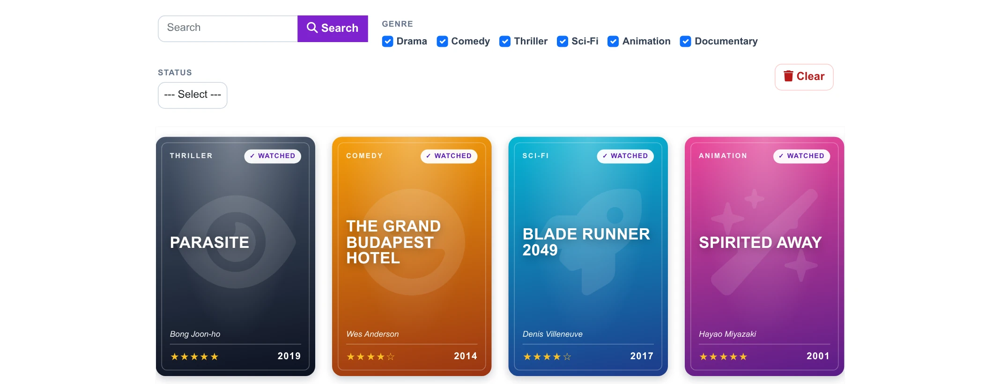
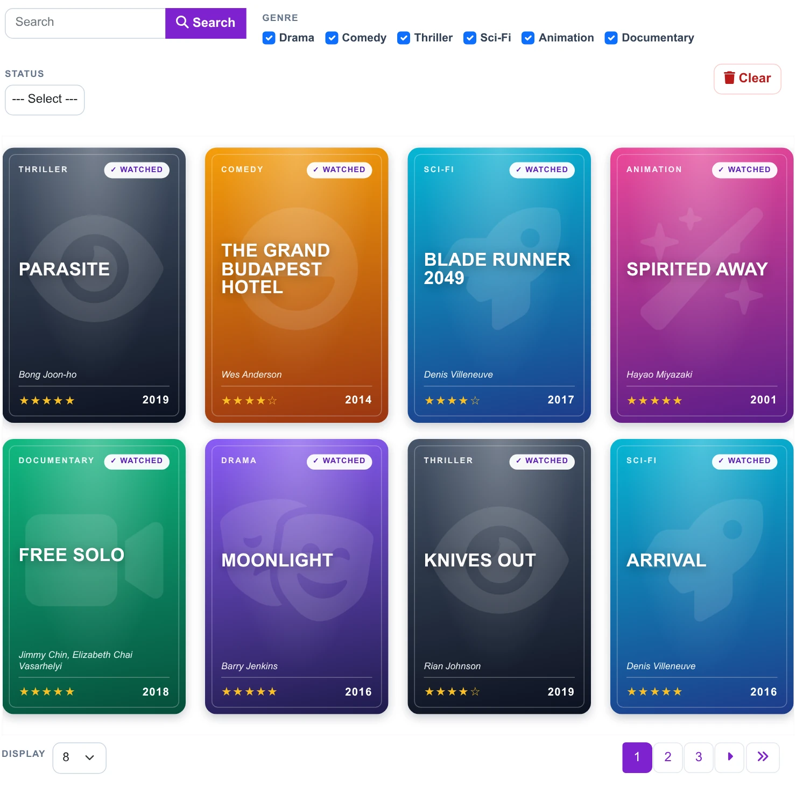
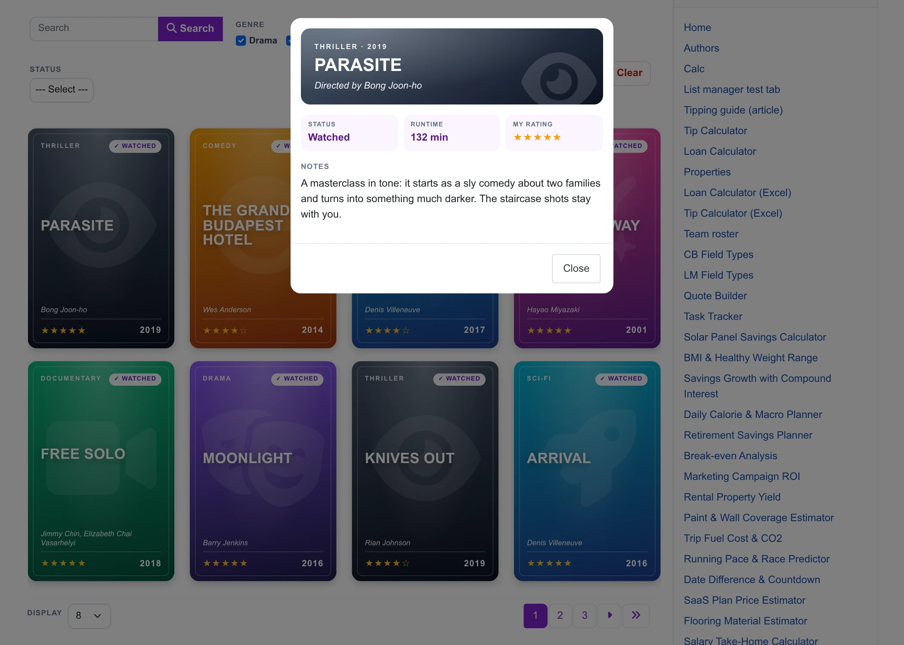
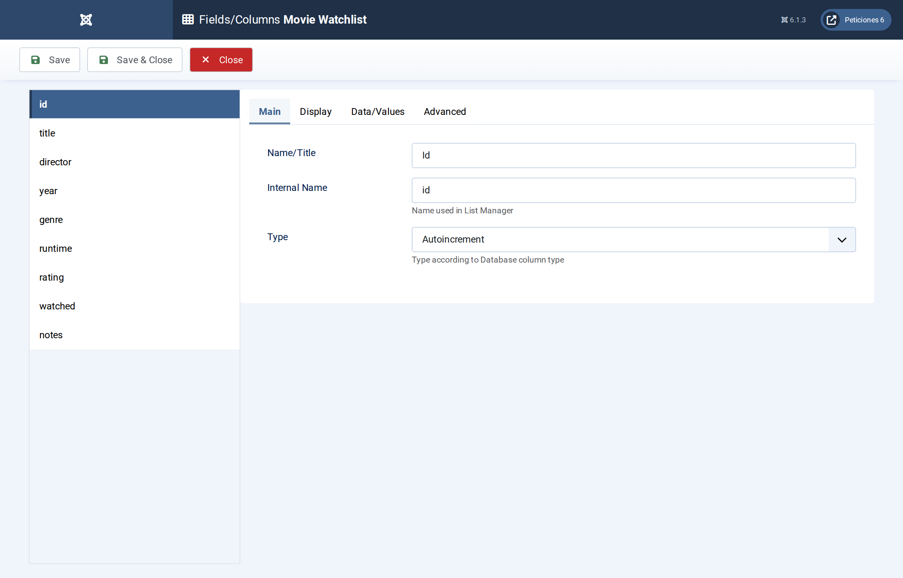
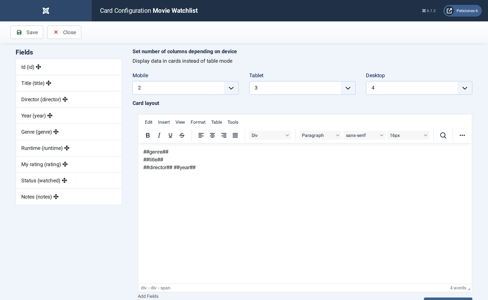
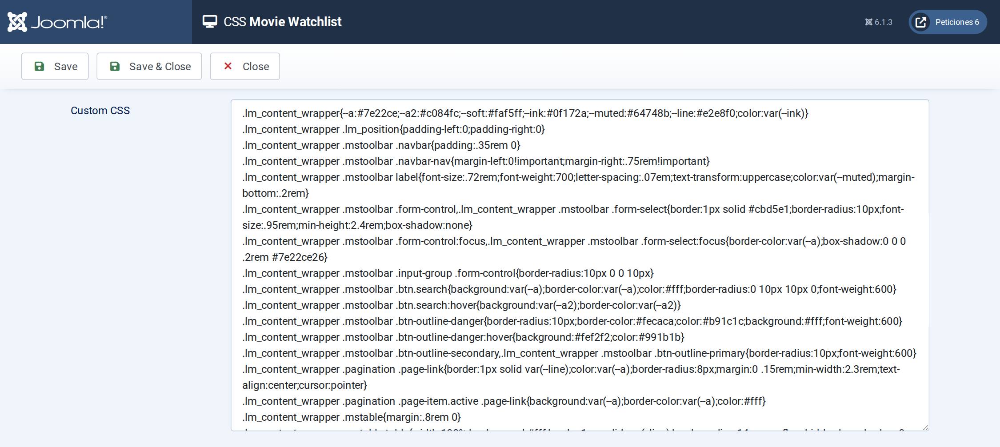

# Movie Watchlist

**List Manager example** · [Live demo](https://demo.moonsoft.es/movie-watchlist-import) · [Import instructions](https://demo.moonsoft.es/movie-watchlist-import)

A personal movie watchlist shown as film-poster cards: genre gradients, big title typography, CSS star ratings, a watched or queued badge, checkbox genre filter and a notes pop-up.

The **Movie Watchlist** list turns a MySQL table of 24 films into a wall of 2:3 posters. Each poster gets its colour and watermark icon from the genre, shows the title in big letters with the director, year and star rating, and carries a *Watched* or *Queued* badge. A click opens the runtime and personal notes.

## What it shows

A personal or club watchlist that is pleasant to browse:
- **Poster cards** — four columns on desktop, three on tablets and two on phones; every card keeps a 2:3 aspect ratio.
- **Filters** — genre as a group of checkboxes (tick several at once), a Watched/Queued drop-down and a search box over title, director, genre and notes.
- **Stars and badges** — the numeric rating is drawn as stars and the status as a badge, using only CSS attribute selectors on the values.
- **Detail pop-up** — clicking a poster opens a coloured header with the title and director, the status, runtime, rating and notes.

## How it’s built

The list uses the **Card** layout with the number of columns set for each device. The poster HTML is written once with `##field##` placeholders; the genre label becomes a CSS class (`g-Sci-Fi`) that sets the gradient and the watermark icon, which is why the option-list labels are single tokens.

The 2:3 shape comes from CSS `aspect-ratio`, and the title size scales with the width of the poster through container units, so the same design works in a wide desktop grid and in a two-column phone layout. A rating of 0 means “not rated yet” and shows a small text instead of stars.

The database is the table `lm_movies` with 24 sample rows (see the SQL download); the list configuration is a single XML file created with the **Export Configuration** button.

## Files in this folder

- `movie-watchlist_config.xml`
- `movie-watchlist.sql`
- `screenshots/` – images of the frontend and of the List Manager settings

## How to import

1. Run the `*.sql` file on your Joomla database (phpMyAdmin or the mysql client). It creates the sample table with its data.
2. Open **Components › List Manager › Import** and upload the `*_config.xml` file.
3. Create a menu item of type *List Manager* and select the imported list.

Full step-by-step instructions with the live result: **https://demo.moonsoft.es/movie-watchlist-import**

## Screenshots

*Live result on the frontend*

*The whole list on the frontend: toolbar with search and filters, poster grid and pagination.*

*The detail pop-up that opens when a poster is clicked.*

*Fields/Columns: the columns with their types (text, option lists, numbers, textarea).*

*Display › Card: number of columns per device and the poster HTML with its placeholders.*

*The CSS screen holds the whole design of the toolbar, pagination, posters and detail pop-up.*

---
Part of [Moonsoft demos](../../README.md) · [moonsoft.es](https://www.moonsoft.es) · [demo.moonsoft.es](https://demo.moonsoft.es)
