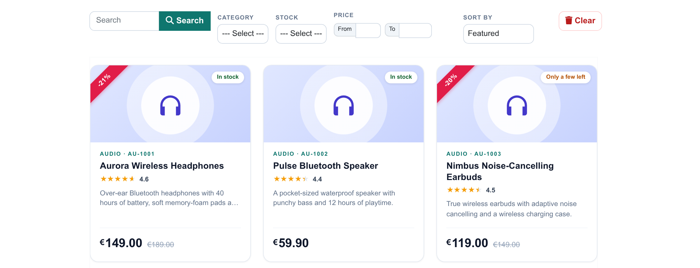
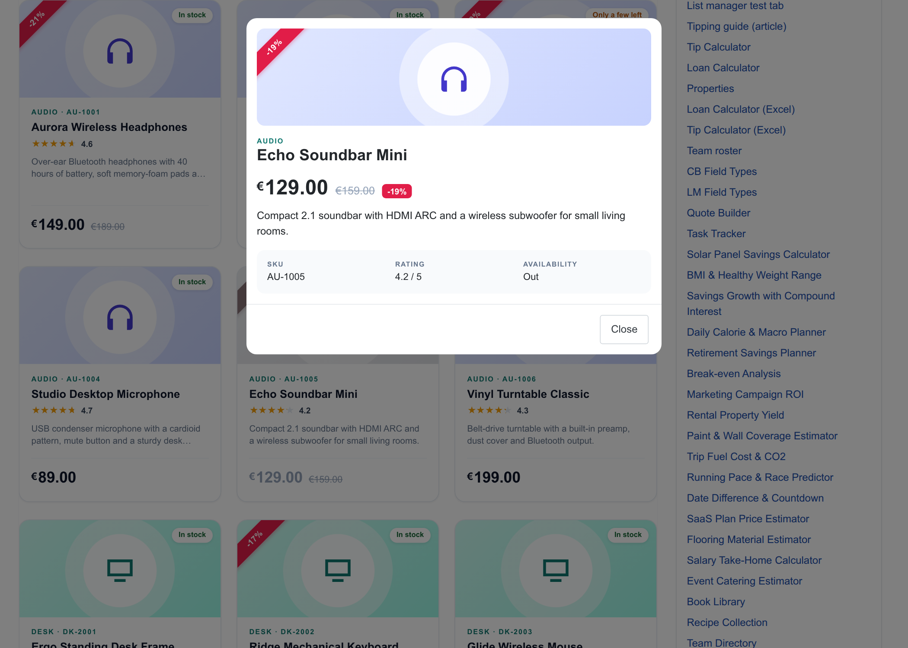
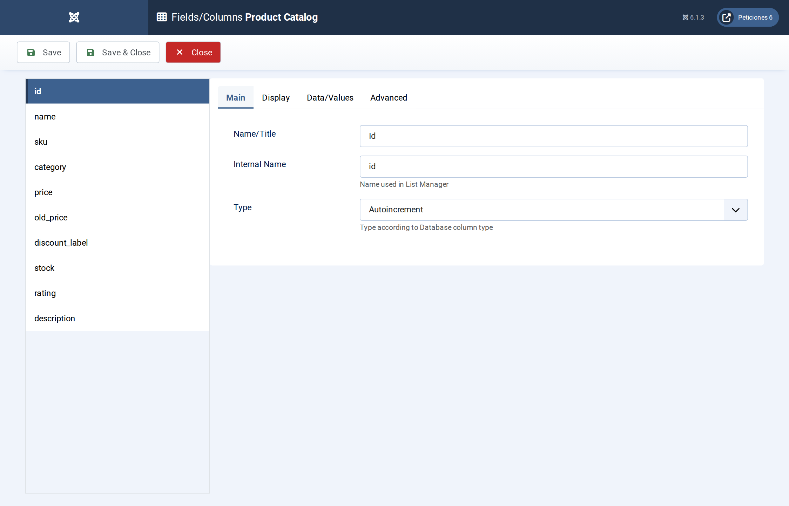
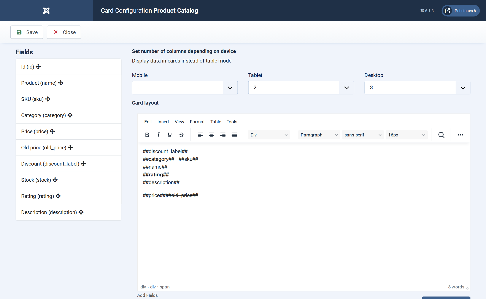
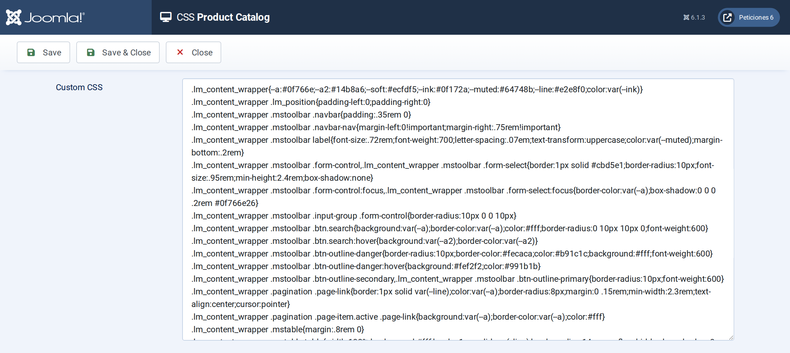

# Product Catalog

**List Manager example** · [Live demo](https://demo.moonsoft.es/product-catalog-import) · [Import instructions](https://demo.moonsoft.es/product-catalog-import)

A product catalogue as cards: prices with a CSS discount ribbon, stock badges, star ratings, category, stock and price-range filters, a sort selector and a detail pop-up.

The **Product Catalog** list turns a product table into a small shop window. Every row becomes a card with a category tile, a price block, a discount ribbon and a stock badge; a click opens the product details in a pop-up.

## What it shows

The visitor can narrow down the range in a few clicks:
- **Card layout** — three columns on desktop, two on tablets and one on phones.
- **Filters** — search over name, SKU, category and description, a category drop-down, a stock drop-down and a price range (from / to).
- **Price block and ribbon** — the old price is struck through and a red corner ribbon shows the discount; both disappear by themselves when the product has no offer.
- **Stock badge and stars** — the stock level becomes a badge (in stock, a few left, sold out) and the numeric rating is drawn as partly filled stars, using only CSS.
- **Sorting** — a small script adds a “Sort by” selector (price, rating, name) because card lists have no sortable column headers.

## How it’s built

The list uses the **Card** layout. The category tile colour and icon come from a CSS class taken from the option-list label (`c-##category##`), the stock badge from `s-##stock##`. The ribbon is a text column (`discount_label`) that is empty or like `-20%`; an empty ribbon is hidden with `:empty`.

The **Price** filter is a *Range* filter (type 3): two boxes, from and to, applied as `BETWEEN` on the numeric column. The sort selector is a few lines in the list’s **Javascript** screen.

The database is the table `lm_products` with 24 sample rows (see the SQL download); the list configuration is a single XML file created with the **Export Configuration** button.

## Files in this folder

- `product-catalog_config.xml`
- `product-catalog.sql`
- `screenshots/` – images of the frontend and of the List Manager settings

## How to import

1. Run the `*.sql` file on your Joomla database (phpMyAdmin or the mysql client). It creates the sample table with its data.
2. Open **Components › List Manager › Import** and upload the `*_config.xml` file.
3. Create a menu item of type *List Manager* and select the imported list.

Full step-by-step instructions with the live result: **https://demo.moonsoft.es/product-catalog-import**

## Screenshots

*Live result on the frontend*

*The whole list on the frontend: toolbar with search, filters, price range and sorting, product cards and pagination.*

*The detail pop-up with the price, description and specifications.*

*Fields/Columns: ten columns with their types (text, option lists, decimal numbers, textarea).*

*Display › Card: number of columns per device and the card HTML with its placeholders.*

*The CSS screen holds the toolbar, card design, ribbon, badges and category tiles.*

---
Part of [Moonsoft demos](../../README.md) · [moonsoft.es](https://www.moonsoft.es) · [demo.moonsoft.es](https://demo.moonsoft.es)
