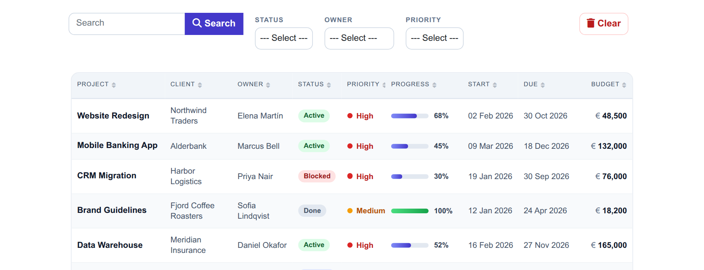
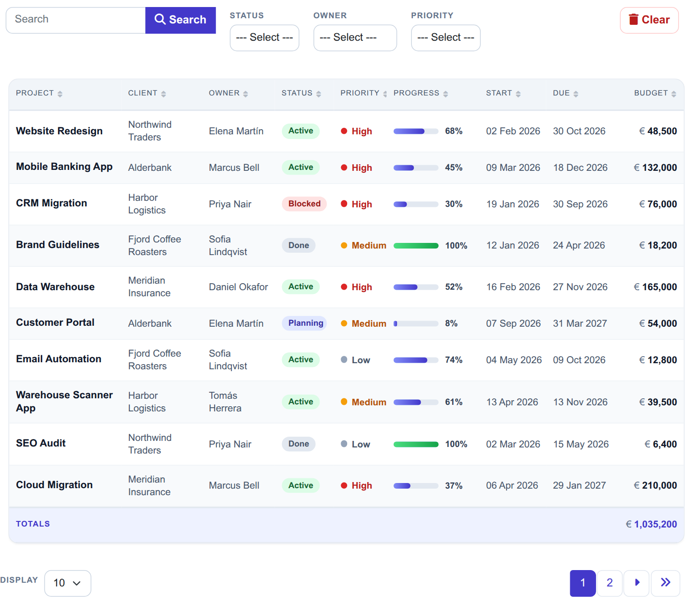
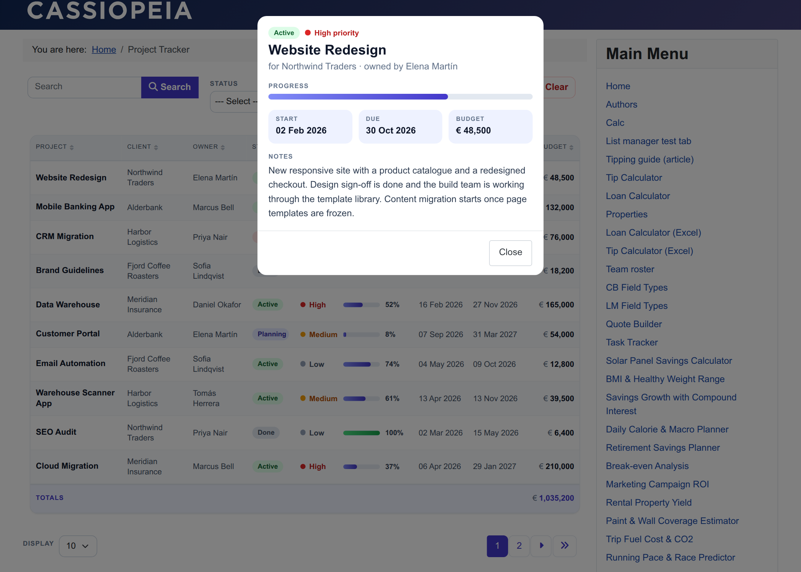
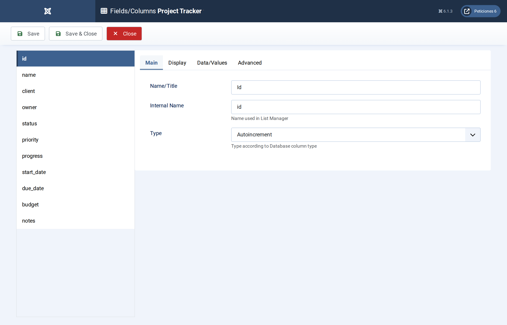
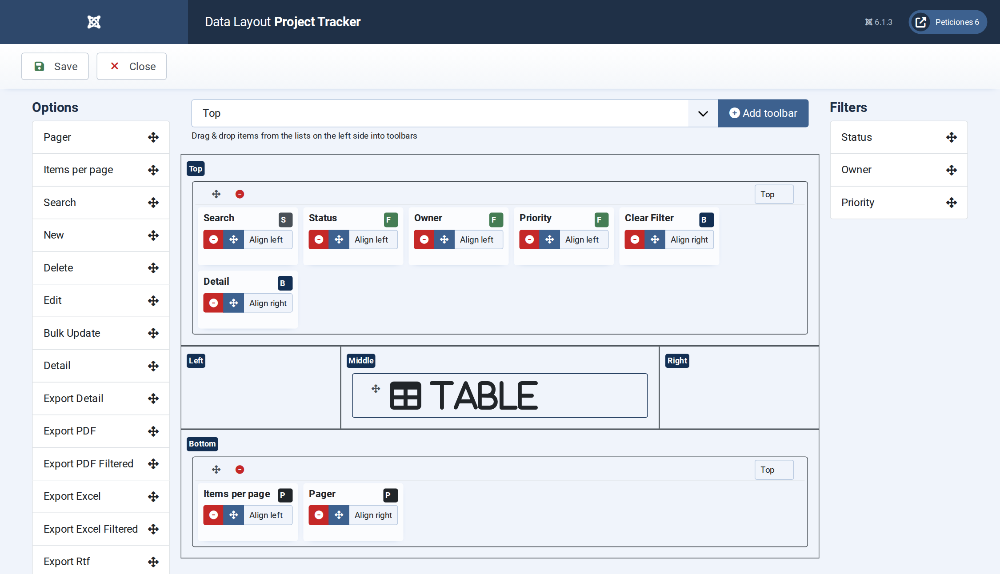
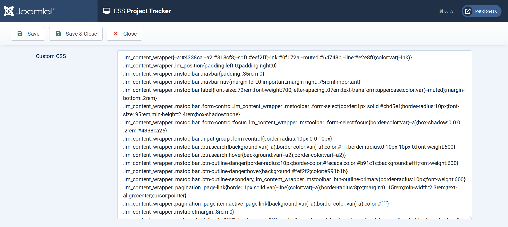

# Project Tracker

**List Manager example** · [Live demo](https://demo.moonsoft.es/project-tracker-import) · [Import instructions](https://demo.moonsoft.es/project-tracker-import)

A project portfolio as a clean table: status pills, priority dots, progress bars, a budget total, three filters and a detail pop-up with the project notes.

The **Project Tracker** list shows twenty client projects in a table that a project office could use as a live status board. Owners, clients, dates, budgets and progress sit in one row each, and a click on a row opens the full project notes.

## What it shows

The visitor gets a quick overview and can narrow it down in seconds:
- **Table layout** — eight columns with sorting on every header; on phones List Manager stacks each row and the CSS turns it into a compact card.
- **Progress bars** — the *Progress* field type draws a bar for the 0–100 value; the CSS adds the percentage label and turns finished projects green.
- **Budget total** — the Budget column has the *Total* option enabled, which adds a totals row under the table.
- **Search and filters** — a search box (project, client, owner, notes) plus drop-down filters for status, owner and priority.
- **Status and priority styling** — a few lines in the list’s Javascript wrap the cell text in a  with a data attribute, so the CSS can colour each value.
- **Detail pop-up** — clicking a row opens a summary with status, progress, dates, budget and the notes column, which is hidden in the table itself.

## How it’s built

The list uses the standard **Table** layout. Column widths are set in the **CSS** screen with `td.<column>` and `th[data-id=<column>]` selectors (List Manager sets equal widths inline, so the CSS overrides them with `flex` and `!important`). The Notes column is loaded but hidden with CSS, so it is still available to the detail pop-up and to search.

Status and priority are **Option list** fields; the small script in the **Javascript** screen adds a `data-v` attribute to those cells (and re-applies it after every filter, sort or page change). Everything else is plain CSS. The Progress field renders Bootstrap’s progress bar; the example restyles it and adds the number.

The database is the table `lm_projects` with 20 sample rows (see the SQL download); the list configuration is a single XML file created with the **Export Configuration** button.

## Files in this folder

- `project-tracker_config.xml`
- `project-tracker.sql`
- `screenshots/` – images of the frontend and of the List Manager settings

## How to import

1. Run the `*.sql` file on your Joomla database (phpMyAdmin or the mysql client). It creates the sample table with its data.
2. Open **Components › List Manager › Import** and upload the `*_config.xml` file.
3. Create a menu item of type *List Manager* and select the imported list.

Full step-by-step instructions with the live result: **https://demo.moonsoft.es/project-tracker-import**

## Screenshots

*Live result on the frontend*

*The whole list on the frontend: toolbar with search and three filters, the project table with progress bars and the budget total.*

*The detail pop-up that opens when a row is clicked, including the notes column that the table hides.*

*Fields/Columns: the project columns with their types (text, option lists, Progress, dates, number with total, textarea).*

*Display › Data Layout: table layout, date and number formats and the pagination defaults.*

*The CSS screen holds the column widths, the progress bar, the totals row and the phone layout.*

---
Part of [Moonsoft demos](../../README.md) · [moonsoft.es](https://www.moonsoft.es) · [demo.moonsoft.es](https://demo.moonsoft.es)
