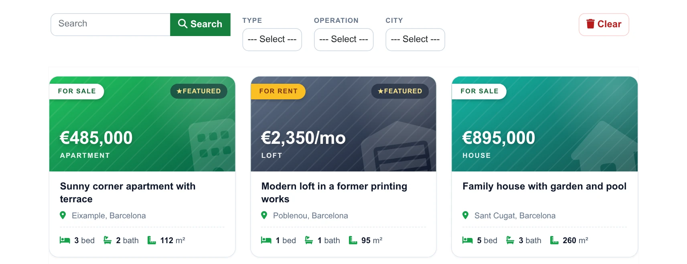
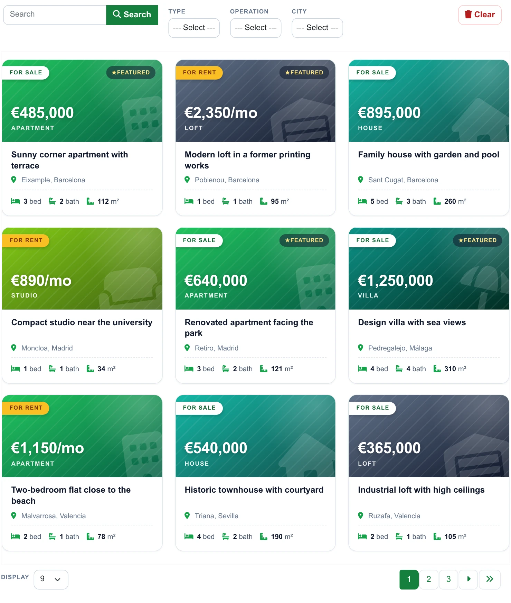
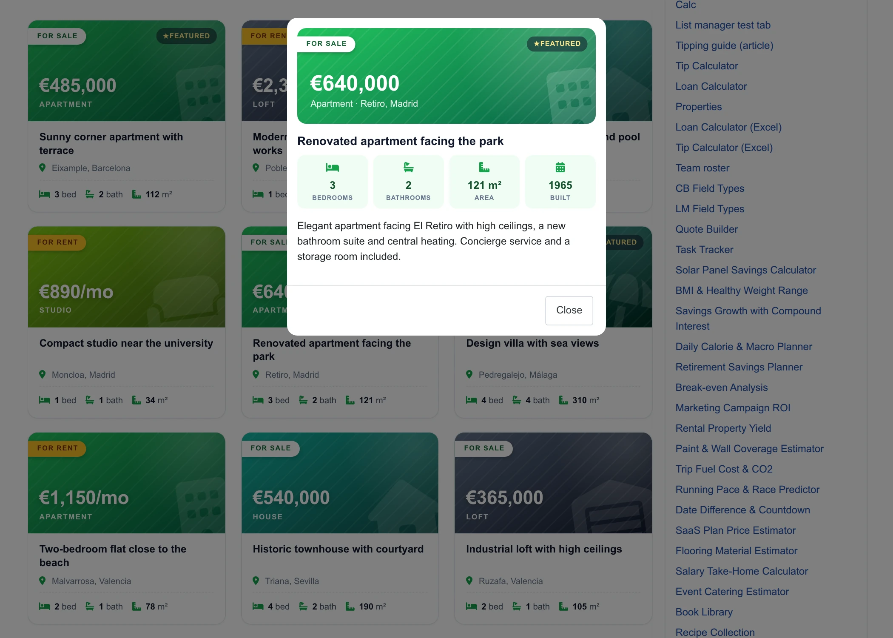
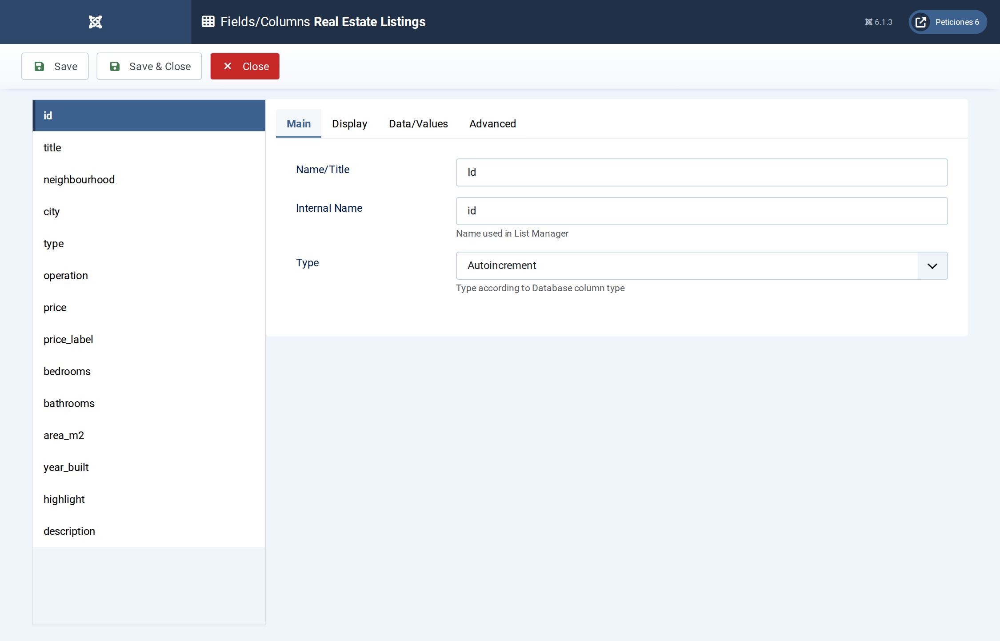
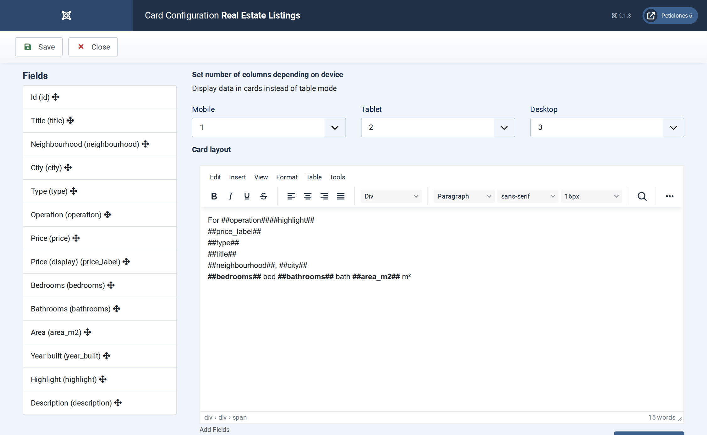
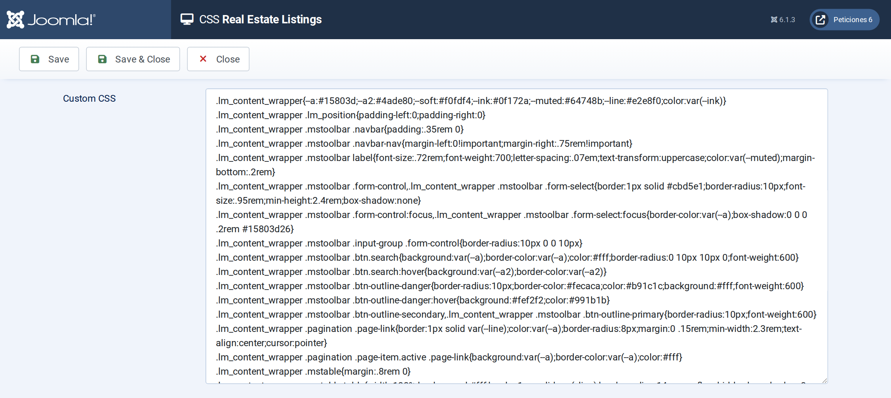

# Real Estate Listings

**List Manager example** · [Live demo](https://demo.moonsoft.es/real-estate-listings-import) · [Import instructions](https://demo.moonsoft.es/real-estate-listings-import)

Property listings without photos: gradient cards with a big price, a sale/rent ribbon and a bed, bath and area row, filters by type, operation and city, and a detail pop-up.

The **Real Estate Listings** list shows 24 properties for sale or rent as photo-less cards: a coloured header with the price, a “For sale” or “For rent” ribbon, a featured badge and an icon row with bedrooms, bathrooms and area. A click opens the full description in a pop-up.

## What it shows

An agency can present its portfolio with nothing more than a table:
- **Card layout** — three columns on desktop, two on tablets and one on phones; the header colour and watermark icon depend on the property type.
- **Filters and search** — drop-down filters for type, operation (sale or rent) and city, plus a search box over title, neighbourhood, city and description.
- **Price and ribbon** — a text column holds the ready-to-show price (€485,000 or €2,350/mo) and an option-list column drives the ribbon colour.
- **Detail pop-up** — a click opens the price, the location, four key facts and the description.

## How it’s built

The list uses the **Card** layout: the card HTML is written once with `##field##` placeholders and List Manager repeats it for every row. The price is stored both as a number (`price`) and as a text column (`price_label`) so thousands separators, the euro sign and the “/mo” of rentals come out exactly as written.

Yes/No columns render as icons, so the “Featured” flag is a small text column (`highlight`) that is either *Featured* or empty; the CSS hides the badge when it is empty. Icons come from Font Awesome, which List Manager already loads on the frontend.

The database is the table `lm_listings` with 24 sample rows (see the SQL download); the list configuration is a single XML file created with the **Export Configuration** button.

## Files in this folder

- `real-estate-listings_config.xml`
- `real-estate-listings.sql`
- `screenshots/` – images of the frontend and of the List Manager settings

## How to import

1. Run the `*.sql` file on your Joomla database (phpMyAdmin or the mysql client). It creates the sample table with its data.
2. Open **Components › List Manager › Import** and upload the `*_config.xml` file.
3. Create a menu item of type *List Manager* and select the imported list.

Full step-by-step instructions with the live result: **https://demo.moonsoft.es/real-estate-listings-import**

## Screenshots

*Live result on the frontend*

*The whole list on the frontend: toolbar with search and filters, property cards and pagination.*

*The detail pop-up that opens when a card is clicked.*

*Fields/Columns: the columns with their types (text, option lists, numbers, textarea).*

*Display › Card: number of columns per device and the card HTML with its placeholders.*

*The CSS screen holds the whole design of the toolbar, pagination, gradient headers and detail pop-up.*

---
Part of [Moonsoft demos](../../README.md) · [moonsoft.es](https://www.moonsoft.es) · [demo.moonsoft.es](https://demo.moonsoft.es)
