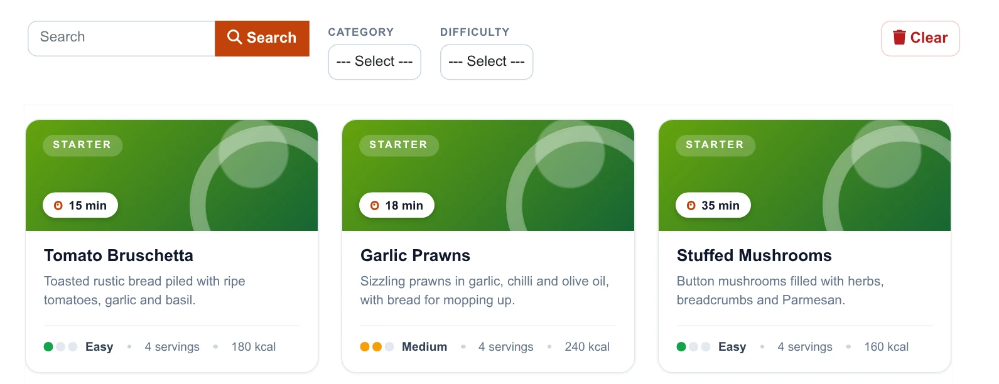
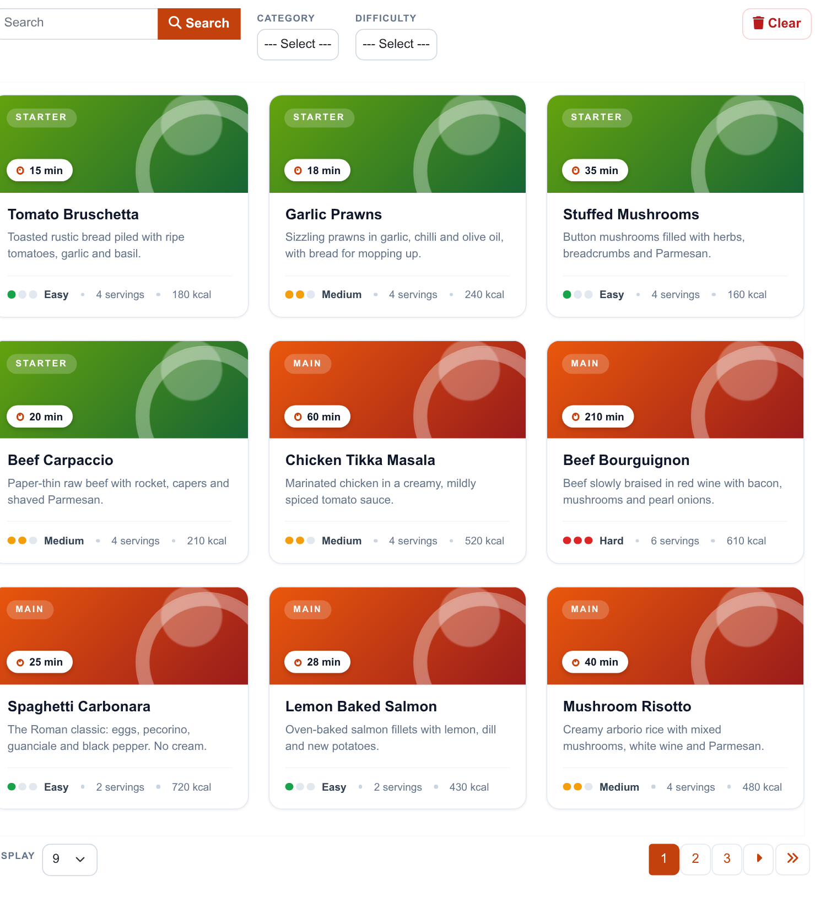
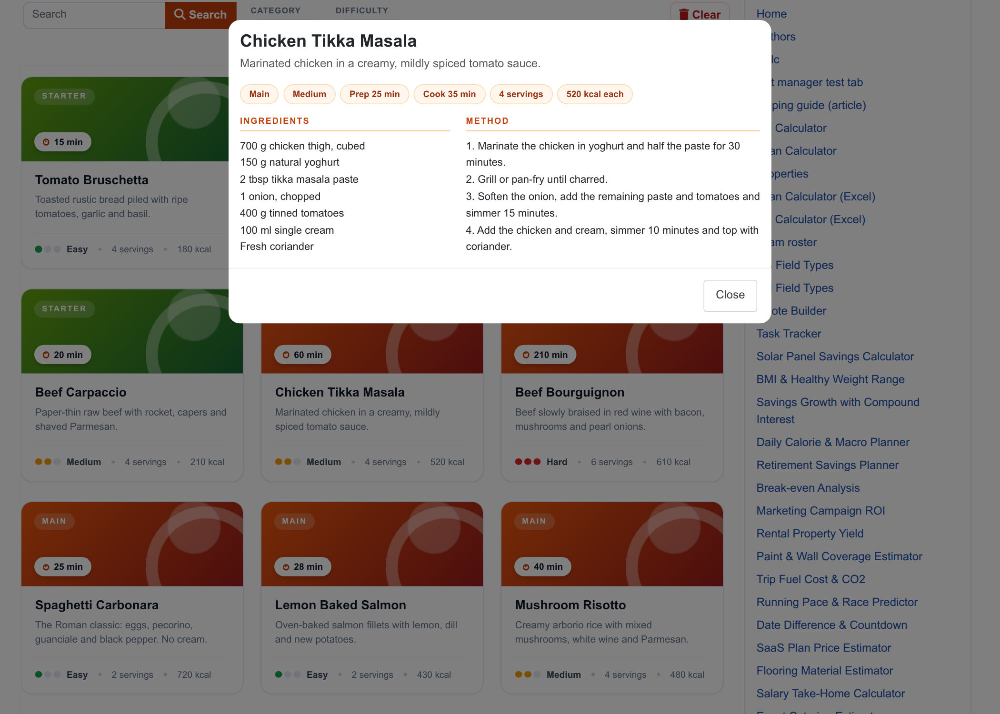
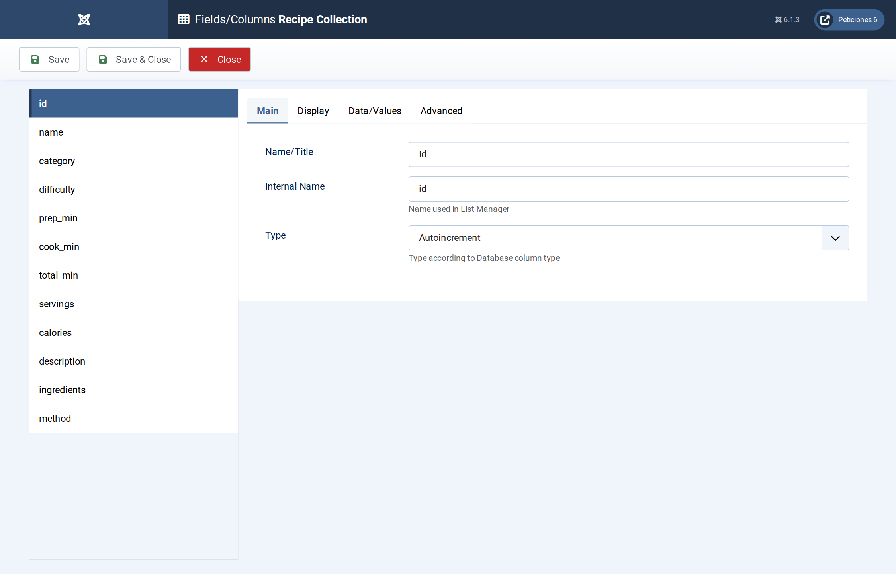
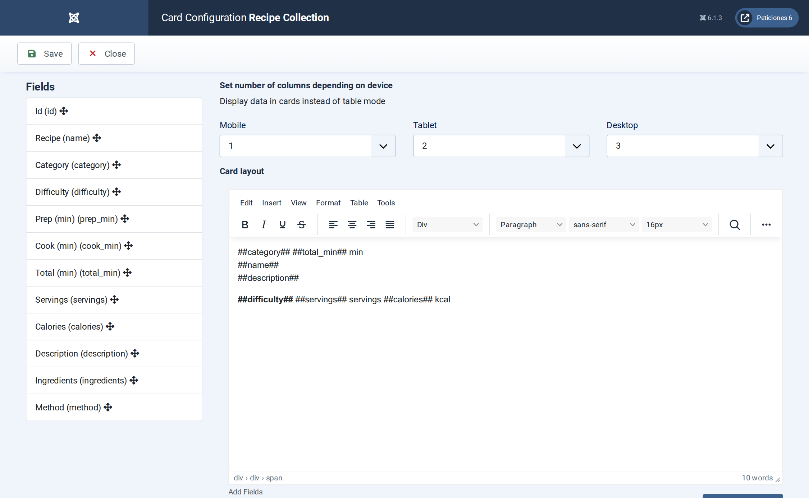
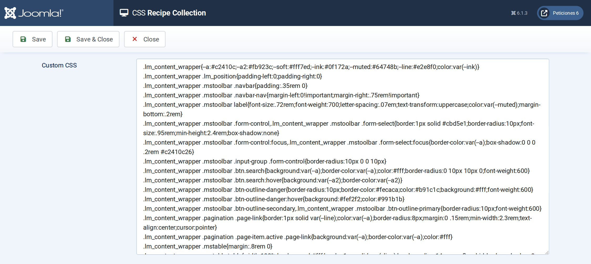

# Recipe Collection

**List Manager example** · [Live demo](https://demo.moonsoft.es/recipe-collection-import) · [Import instructions](https://demo.moonsoft.es/recipe-collection-import)

A recipe book of 25 dishes as food-style cards: colour headers by category, cooking-time chips, difficulty dots, filters and a detail pop-up with ingredients and method.

The **Recipe Collection** list turns a MySQL table of recipes into a browsable cookbook. Each row becomes a card with a gradient header coloured by category, and a click opens the full ingredients and method in a pop-up.

## What it shows

The visitor can find a dish for tonight in seconds:
- **Card layout** — three columns on desktop, two on tablets, one on phones.
- **Search and filters** — a search box over name, description and ingredients, plus category and difficulty drop-downs.
- **Difficulty dots and time chip** — the difficulty label is drawn as one, two or three coloured dots and the total minutes sit in a chip on the header, using only CSS.
- **Detail pop-up** — clicking a card opens a two-column pop-up with the ingredients and the numbered method.

## How it’s built

The list uses the **Card** layout. The header colour is picked with a CSS class taken from the option-list label (`c-##category##`), so a new category only needs one more CSS rule.

Ingredients and method are **Textarea** columns; List Manager turns their line breaks into ` ` in the detail pop-up. Total time is stored as its own column so it can be shown in the chip and sorted or filtered later.

The database is the table `lm_recipes` with 25 sample rows (see the SQL download); the list configuration is a single XML file created with the **Export Configuration** button.

## Files in this folder

- `recipe-collection_config.xml`
- `recipe-collection.sql`
- `screenshots/` – images of the frontend and of the List Manager settings

## How to import

1. Run the `*.sql` file on your Joomla database (phpMyAdmin or the mysql client). It creates the sample table with its data.
2. Open **Components › List Manager › Import** and upload the `*_config.xml` file.
3. Create a menu item of type *List Manager* and select the imported list.

Full step-by-step instructions with the live result: **https://demo.moonsoft.es/recipe-collection-import**

## Screenshots

*Live result on the frontend*

*The whole list on the frontend: toolbar with search and filters, recipe cards and pagination.*

*The detail pop-up with ingredients and method.*

*Fields/Columns: twelve columns with their types (text, option lists, numbers, textareas).*

*Display › Card: number of columns per device and the card HTML with its placeholders.*

*The CSS screen holds the toolbar, pagination and card design, including the category gradients.*

---
Part of [Moonsoft demos](../../README.md) · [moonsoft.es](https://www.moonsoft.es) · [demo.moonsoft.es](https://demo.moonsoft.es)
