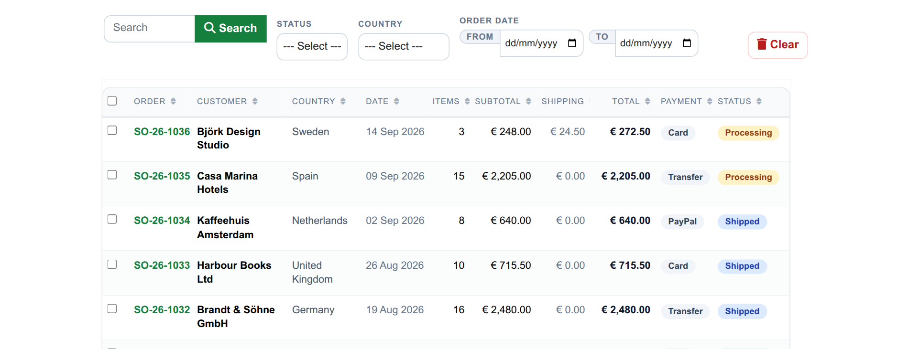
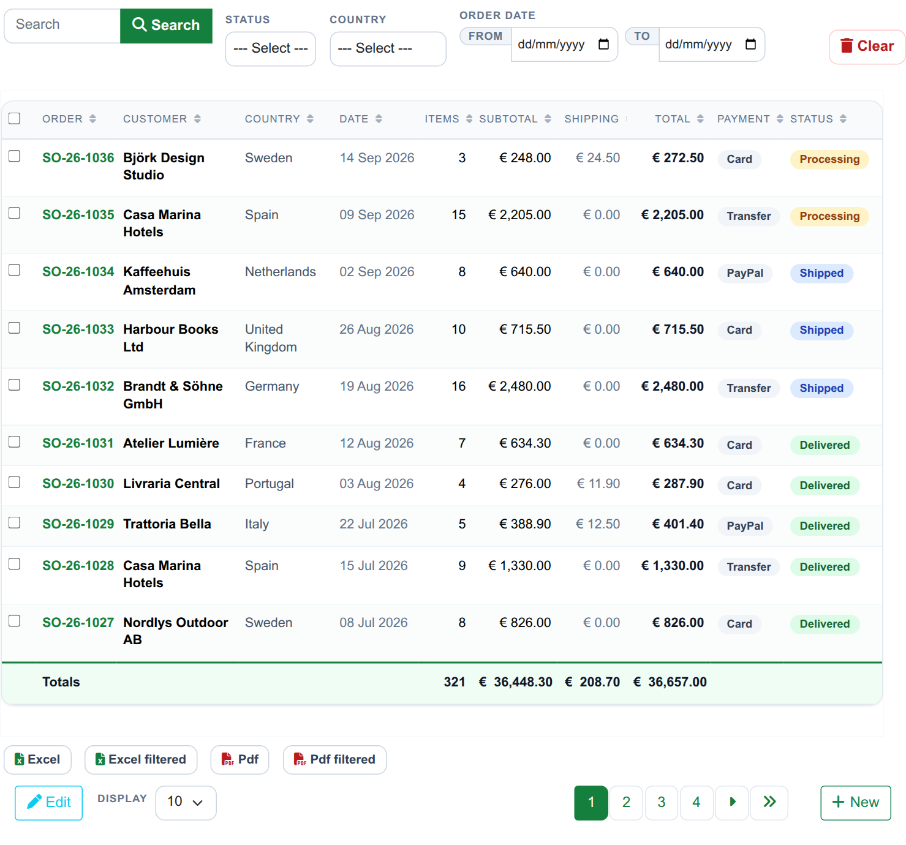
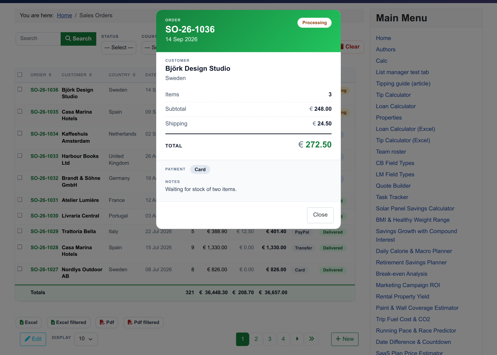
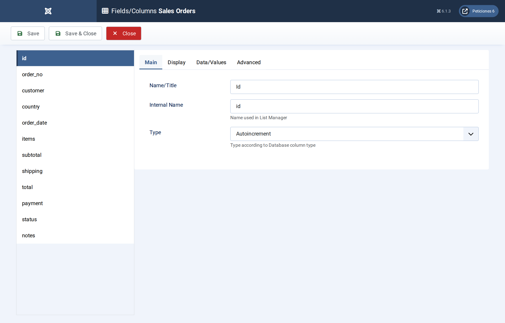
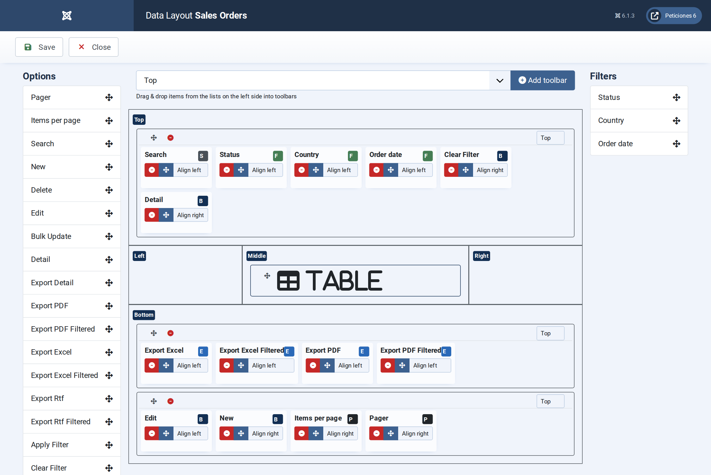
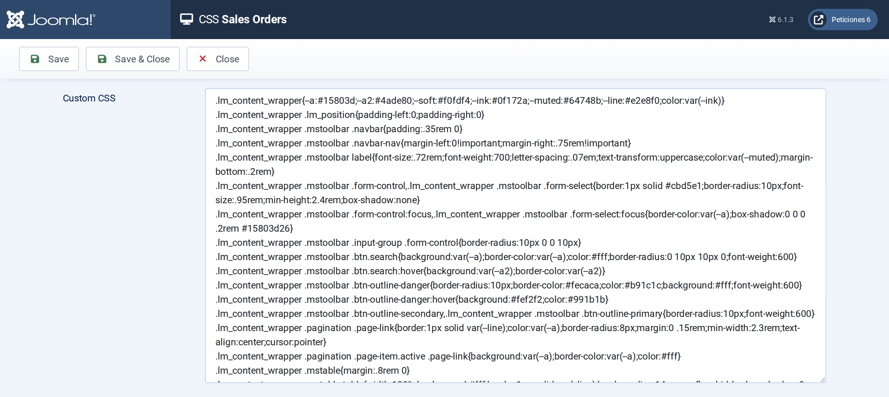

# Sales Orders

**List Manager example** · [Live demo](https://demo.moonsoft.es/sales-orders-import) · [Import instructions](https://demo.moonsoft.es/sales-orders-import)

An order book as a table with a totals row: status and country filters, an order-date range, Excel and PDF export, status pills, an order-summary pop-up and a styled add/edit form.

The **Sales Orders** list shows an order book in the **Table** layout: money columns, a totals row, an order-date range filter and export buttons, with a receipt-style pop-up for each order.

## What it shows

What a visitor can do:
- **Filters and search** — filter by status or country, pick a date range with the From/To filter, or search order numbers, customers and notes.
- **Totals row** — the last row adds up items, subtotal, shipping and total for everything the current filters match, not only the visible page.
- **Newest first** — the list opens sorted by order date, newest first, and every column header sorts on click.
- **Export** — Excel and Pdf buttons download the whole list, and the *filtered* versions download only what the filters match.
- **Order summary** — clicking a row opens a pop-up laid out like a receipt: customer, item and money lines, total, payment method and notes.
- **Phone layout** — on narrow screens each order becomes a small card and the totals row becomes a summary card.

## How it’s built

Country, payment and status are **Option list** fields, the date is a **Date** field and items, subtotal, shipping and total are **Number** fields with two decimals and *Total* set to **Sum** in the field’s advanced options. The default order (order date, descending) is set in Display › Data Layout, and the date range is a filter of type *Range*.

The status and payment pills and the euro sign are drawn with a few lines of **JavaScript** plus CSS, because table cells only contain plain text. Column widths use `td.<column>` and `th[data-id=<column>]` rules in the **CSS** screen. The pop-up is the **Detail Layout** and the add/edit form is the **Form Layout**, both plain HTML with `##field##` placeholders.

The database is the table `lm_orders` with 36 sample rows (see the SQL download); the list configuration is a single XML file created with the **Export Configuration** button.

## Files in this folder

- `sales-orders_config.xml`
- `sales-orders.sql`
- `screenshots/` – images of the frontend and of the List Manager settings

## How to import

1. Run the `*.sql` file on your Joomla database (phpMyAdmin or the mysql client). It creates the sample table with its data.
2. Open **Components › List Manager › Import** and upload the `*_config.xml` file.
3. Create a menu item of type *List Manager* and select the imported list.

Full step-by-step instructions with the live result: **https://demo.moonsoft.es/sales-orders-import**

## Screenshots

*Live result on the frontend*

*The whole list on the frontend: filters with the date range, the table with status pills and the totals row, export buttons and pagination.*

*The order-summary pop-up that opens when a row is clicked.*

*Fields/Columns: the twelve columns with their types; the money columns use two decimals and a Sum total.*

*Display › Data Layout: toolbar rows with the filters (including the date range) and the export buttons.*

*The CSS screen: column widths, the totals row, the phone card layout, the order summary and the form.*

---
Part of [Moonsoft demos](../../README.md) · [moonsoft.es](https://www.moonsoft.es) · [demo.moonsoft.es](https://demo.moonsoft.es)
