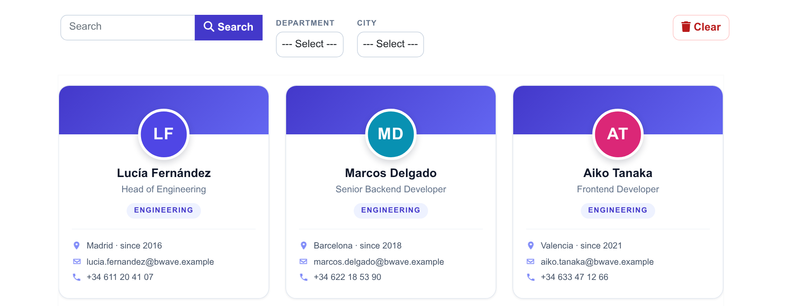
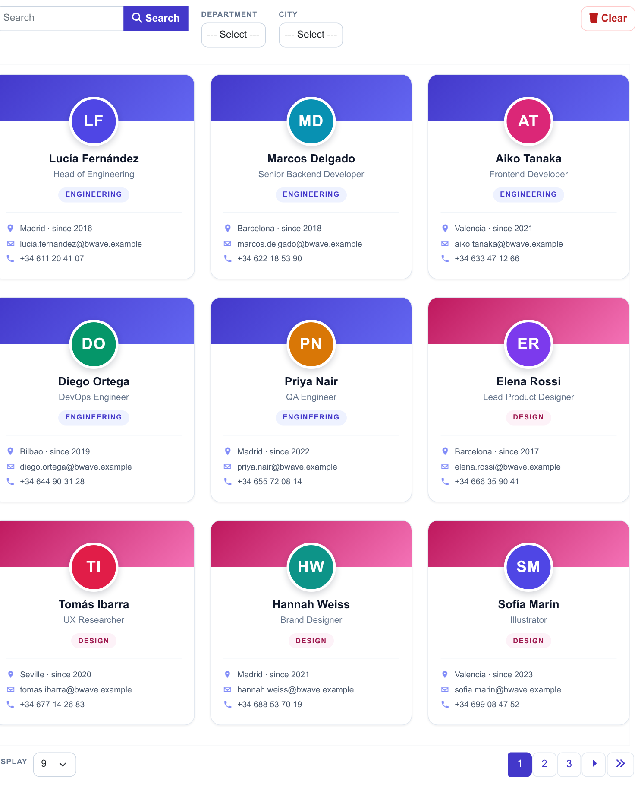
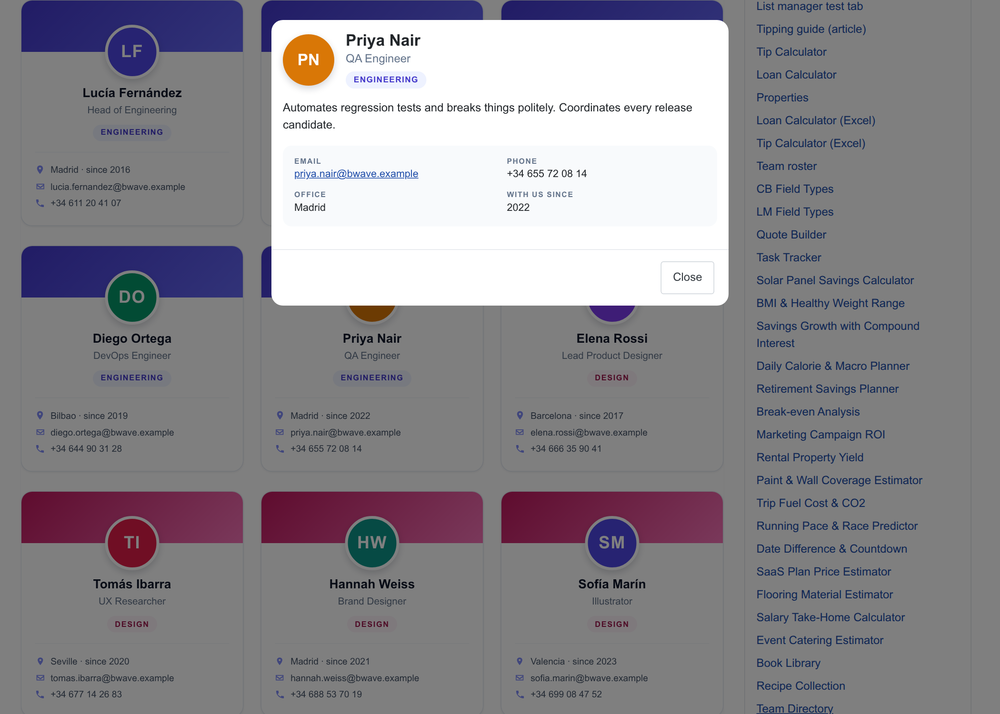
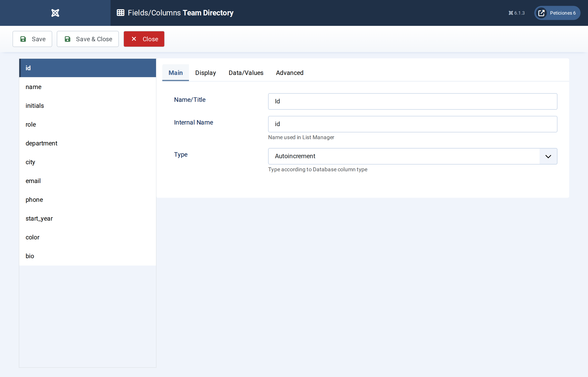
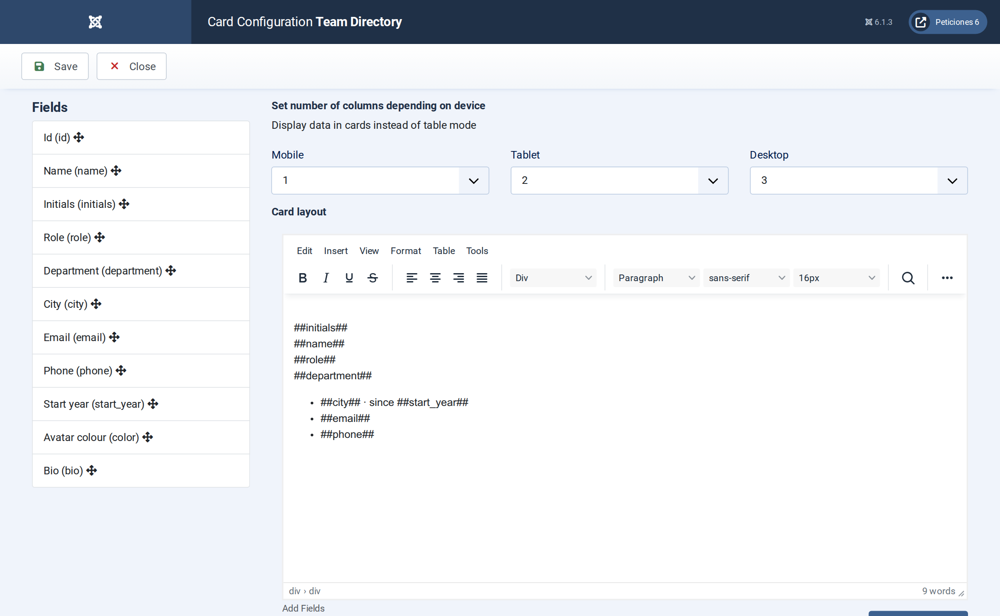
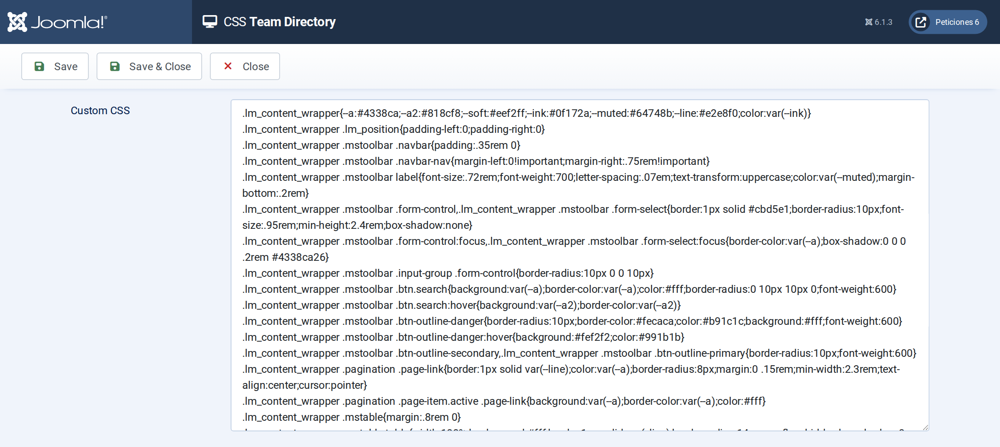

# Team Directory

**List Manager example** · [Live demo](https://demo.moonsoft.es/team-directory-import) · [Import instructions](https://demo.moonsoft.es/team-directory-import)

A staff directory as profile cards: coloured initials avatars, department badges, contact lines, department and city filters, name/role search and a detail pop-up with the bio.

The **Team Directory** list turns a table of employees into a friendly company directory. Each person becomes a profile card with a coloured initials avatar, and a click opens the bio and contact details in a pop-up.

## What it shows

Colleagues can find each other quickly:
- **Profile cards** — four people per row on wide screens, two on tablets and one on phones.
- **Search and filters** — a search box over name and role, plus department and city drop-downs.
- **CSS avatars** — the avatar is a circle painted with the `color` column and the `initials` column; no image files are needed.
- **Detail pop-up** — clicking a card opens the full bio with a clickable email address.

## How it’s built

The list uses the **Card** layout. The colour of the card header and of the department badge comes from a CSS class taken from the option-list label (`d-##department##`); the avatar colour is stored per person in the table.

Contact lines use small CSS-masked icons, so there are no image files or icon fonts to maintain. Department and city are **Option list** columns, which also feed the two filters.

The database is the table `lm_people` with 24 sample rows (see the SQL download); the list configuration is a single XML file created with the **Export Configuration** button.

## Files in this folder

- `team-directory_config.xml`
- `team-directory.sql`
- `screenshots/` – images of the frontend and of the List Manager settings

## How to import

1. Run the `*.sql` file on your Joomla database (phpMyAdmin or the mysql client). It creates the sample table with its data.
2. Open **Components › List Manager › Import** and upload the `*_config.xml` file.
3. Create a menu item of type *List Manager* and select the imported list.

Full step-by-step instructions with the live result: **https://demo.moonsoft.es/team-directory-import**

## Screenshots

*Live result on the frontend*

*The whole list on the frontend: toolbar with search and filters, profile cards and pagination.*

*The detail pop-up with the bio and contact details.*

*Fields/Columns: eleven columns with their types (text, option lists, number, textarea).*

*Display › Card: number of columns per device and the card HTML with its placeholders.*

*The CSS screen holds the toolbar, pagination and profile-card design.*

---
Part of [Moonsoft demos](../../README.md) · [moonsoft.es](https://www.moonsoft.es) · [demo.moonsoft.es](https://demo.moonsoft.es)
